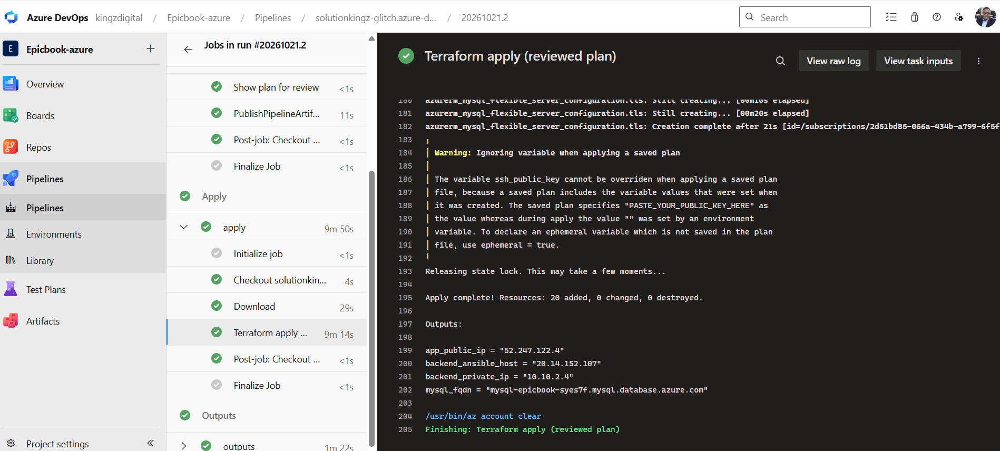
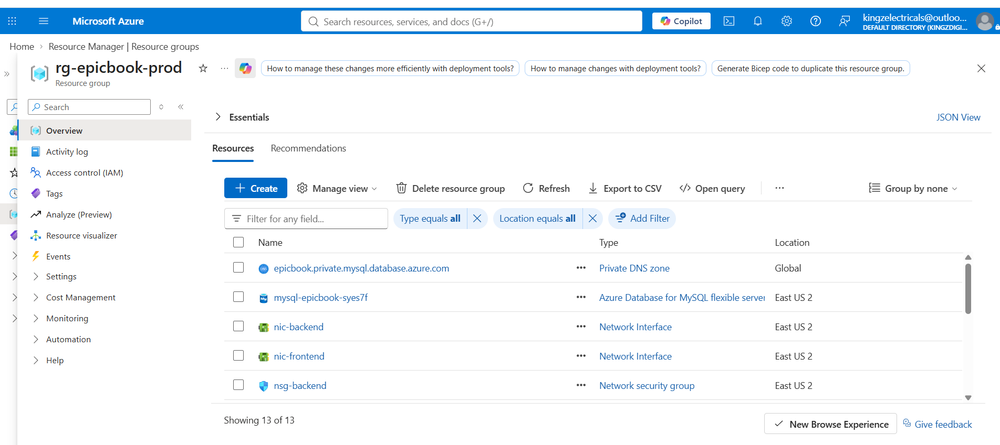
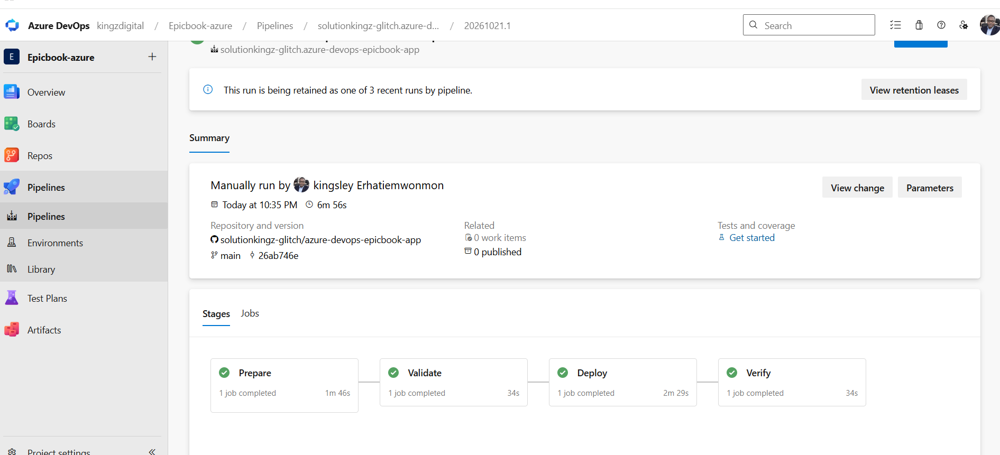
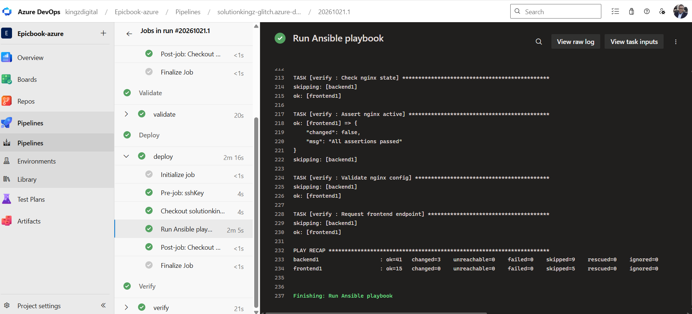
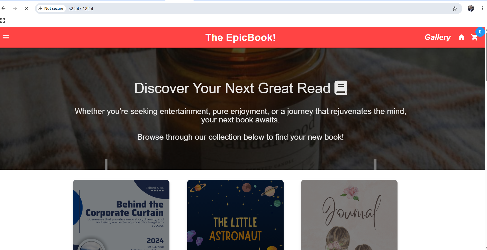
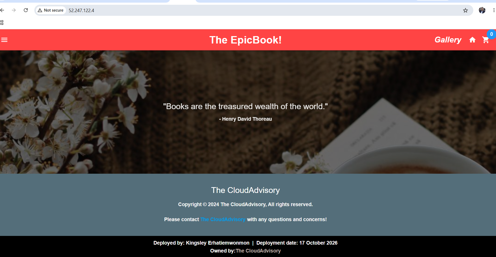

# Assignment 4 — Automate EpicBook Deployment with Dual Pipelines

Part of the DevOps Micro Internship (DMI) with Agentic AI

---

## Purpose

In this assignment, you will automate the EpicBook infrastructure and application deployment on Microsoft Azure using two repositories and two Azure DevOps pipelines. Terraform will provision the infrastructure, and Ansible will configure the servers, connect EpicBook to Azure Database for MySQL, and deploy the application through Nginx.

---

# Task 0 — Verify Accounts, Tools, and Pipeline Capacity

## Goal

Confirm that the required accounts, tools, pipeline agent, SSH key pair, and Terraform remote-state location are ready.

No submission screenshot is required for this task.

---

# Task 1 — Prepare the Two Repositories

## Goal

Create separate Infrastructure and Application Repositories for the EpicBook deployment.

No submission screenshot is required for this task.

---

# Task 2 — Configure Azure DevOps Connections, Secure Files, and Secrets

## Goal

Configure controlled pipeline access to GitHub, Microsoft Azure, the virtual machines, and Azure Database for MySQL.

No submission screenshot is required for this task.

> Do not expose the Azure Client Secret, SSH private key, MySQL password, access token, subscription ID, or another sensitive value.

---

# Task 3 — Author the Terraform Infrastructure Configuration

## Goal

Define the complete EpicBook Azure infrastructure using Terraform and an Azure Storage remote backend.

No submission screenshot is required for this task.

---

# Task 4 — Author and Run the Infrastructure Pipeline

## Goal

Validate, plan, approve, and apply the Terraform configuration through the Infrastructure Pipeline.

## Evidence

### Screenshot 1 — Successful Infrastructure Pipeline

Add a screenshot of the Infrastructure Pipeline run showing:

* Successful `terraform apply` completion
* `app_public_ip`
* `backend_ansible_host`
* `backend_private_ip`
* `mysql_fqdn`

> Do not expose the MySQL password, Client Secret, Terraform state, SSH private key, or another sensitive value.

---

### Screenshot 2 — Provisioned Azure Resources

Add a screenshot of the Azure Portal Resource Group overview showing:

* Virtual Network and related networking resources
* Frontend VM
* Backend VM
* Azure Database for MySQL Flexible Server
* Related EpicBook resources

> Hide sensitive IDs, credentials, and database details.

---

# Task 5 — Complete the Manual Terraform-to-Ansible Handoff

## Goal

Transfer the required non-sensitive Terraform outputs to the Application Repository for use by Ansible.

No submission screenshot is required for this task.

---

# Task 6 — Author the Ansible Application Configuration

## Goal

Create idempotent Ansible automation that configures the frontend and backend VMs, prepares the database, configures Nginx, and deploys EpicBook.

No submission screenshot is required for this task.

---

# Task 7 — Author and Run the Application Pipeline

## Goal

Run the Application Pipeline to configure the VMs, deploy EpicBook, and verify the application environment.

## Evidence

### Screenshot 3 — Successful Application Pipeline

Add a screenshot of the Application Pipeline run summary showing all required stages or jobs succeeded.

---

### Screenshot 4 — Successful Ansible Play Recap

Add a screenshot of the Application Pipeline log showing:

* Ansible play recap
* Successful configuration or verification
* Zero failed hosts
* Zero unreachable hosts

> Do not expose the SSH private key, MySQL password, Client Secret, or complete database connection string.

---

# Task 8 — Verify the Complete EpicBook Workflow

## Goal

Verify that the frontend, backend, and Azure Database for MySQL work together correctly.

## Evidence

### Screenshot 5 — Running EpicBook Application

Add a browser screenshot showing:

* Running EpicBook application
* Frontend public IP address in the browser address bar
* Your Full Name
* Deployment date

The screenshot may show a product, cart, or successful order view.

> Do not expose credentials or sensitive information.

---

# Required URLs

## Frontend Application URL

http://52.247.122.4/

## Infrastructure Repository URL

https://github.com/solutionkingz-glitch/azure-devops-epicbook-infra

## Application Repository URL

https://github.com/solutionkingz-glitch/azure-devops-epicbook-app

---

# Two-Repository Model

Write a short explanation of why separate Infrastructure and Application Repositories were used.

Separate repositories let each kind of change follow its own lifecycle, ownership and risk level. In this project, the infrastructure repository (azure-devops-epicbook-infra) holds the Terraform that creates the Azure network, VMs and private MySQL server. The application repository (azure-devops-epicbook-app) holds the EpicBook code, the Ansible roles and the deployment pipeline.

Different rates of change. Infrastructure changes rarely, while application code and configuration change often. With two repositories, a small application fix triggers only the Ansible pipeline. It cannot accidentally run terraform apply or touch the VMs, network or database server.

Separation of responsibilities. The infrastructure team can own Terraform and Azure resources, and the application team can own Ansible and the code. Each team reviews and approves its own changes without needing access to the other’s work.

Smaller blast radius and tighter security. Only the infrastructure pipeline uses the Azure service connection, which has Contributor rights on the subscription. The application pipeline never receives it. It gets only the SSH key from Secure Files and the database credentials from a secured variable group. A mistake or compromise in the application pipeline therefore cannot create or delete cloud resources.

Independent pipelines and approvals. The infrastructure pipeline uses a manual approval before apply and keeps its state in a remote backend. The application pipeline can run on every commit without that gate. Each pipeline has its own triggers, permissions and history, which makes failures easier to trace.

A clear, auditable handoff. The only link between the two is the set of non-sensitive Terraform outputs (app_public_ip, backend_ansible_host, backend_private_ip, mysql_fqdn) that were copied into the Ansible inventory and variables. This makes the dependency explicit and reviewable. It could later be automated, for example by publishing outputs as a pipeline artifact or storing them in a shared variable group.

---

# Manual Terraform-to-Ansible Handoff

Write a short explanation of how the following non-sensitive Terraform outputs were transferred to the Application Repository:

* `app_public_ip`
* `backend_ansible_host`
* `backend_private_ip`
* `mysql_fqdn`

How the Terraform outputs were transferred to the Application Repository

After the Infrastructure Pipeline finished its terraform apply, its final Outputs stage printed the four non-sensitive values in the pipeline log. I opened that successful run and copied them by hand into the Application Repository (azure-devops-epicbook-app). This is the temporary manual handoff the assignment describes.

app_public_ip (52.247.122.4): saved as the frontend host address in the Ansible inventory (ansible/inventory/hosts.ini) and as a variable in ansible/inventory/group_vars/all.yml. The pipeline’s verify stage also uses it to request the site through Nginx.
backend_ansible_host (20.14.152.107): saved only in hosts.ini as the ansible_host of the backend. This is the public management address Ansible uses for SSH, so it is kept separate from the private application address.
backend_private_ip (10.10.2.4): saved in all.yml and used in the Nginx template as the upstream, so frontend-to-backend traffic stays on the private network instead of using the backend’s public address.
mysql_fqdn: saved in all.yml and used by the Ansible database tasks and the backend service’s database connection settings.

I committed these changes to main in the Application Repository with a descriptive commit message. Only non-sensitive values were copied. The MySQL password, the SSH private key, the Terraform state and the Azure client secret were never added to the repository. They stay in the Azure DevOps variable group, Secure Files and the service connection.

The copy is manual and must be repeated if the infrastructure is rebuilt and the values change. It could later be automated by publishing the outputs as a pipeline artifact, writing them to a shared variable group, or triggering the Application Pipeline from the Infrastructure Pipeline.

---

# LinkedIn Requirement

## Evidence

### Screenshot 6 — LinkedIn Post

Add a screenshot of your LinkedIn post showing:

* Post text
* At least one image or link

## LinkedIn Post URL

https://www.linkedin.com/posts/kingsley-erhatiemwonmon_devops-azure-terraform-ugcPost-7519130869635166208-bBfM/?utm_source=share&utm_medium=member_desktop&rcm=ACoAAClDkSEBa4Zo6dTWVIEEl8FJLczvH_zPHtY

Your post must include:

* What you automated
* Why separate Infrastructure and Application Repositories were used
* A brief explanation of the Terraform and Ansible pipelines
* How Azure credentials, the SSH key, and database secrets were protected
* One challenge you encountered
* How you solved the challenge
* Relevant technologies and skills

> Do not expose credentials, SSH keys, database passwords, subscription details, or other sensitive information.

---

# Submission Instructions

* Complete all tasks in sequence.
* Include your Full Name.
* Include a short explanation of the two-repository model.
* Include a short explanation of the manual Terraform-to-Ansible handoff.
* Include the Infrastructure Repository URL.
* Include the Application Repository URL.
* Include the final EpicBook application URL.
* Include Screenshots 1–6.
* Include the public LinkedIn post URL.
* Confirm that all screenshots are readable.
* Do not include Terraform state.
* Do not expose the Azure Client Secret, MySQL password, SSH private key, access token, complete connection string, subscription ID, tenant ID, account ID, or another sensitive value.
* Follow the Assignment Submission Guidelines.

---

# Completion Checklist

* [ ] Two separate repositories were created
* [ ] The Infrastructure Repository contains Terraform and its pipeline
* [ ] The Application Repository contains EpicBook, Ansible, and its pipeline
* [ ] Your Full Name and deployment date are visible in EpicBook
* [ ] Both pipelines use the intended `main` branch
* [ ] The Azure Resource Manager Service Connection works
* [ ] The Azure Client Secret is not stored in Git or YAML
* [ ] Terraform uses an Azure Storage remote backend
* [ ] Terraform state was not published or committed
* [ ] Separate frontend, backend, and database subnets were created
* [ ] The frontend VM accepts public HTTP traffic on port 80
* [ ] SSH access is restricted
* [ ] The backend application port is not publicly accessible
* [ ] Azure Database for MySQL uses private access
* [ ] The Infrastructure Pipeline validates, plans, applies, and displays non-sensitive outputs
* [ ] The reviewed Terraform plan was used during Apply
* [ ] Approval or manual validation occurred before Apply
* [ ] `app_public_ip` is available
* [ ] `backend_ansible_host` is available
* [ ] `backend_private_ip` is available
* [ ] `mysql_fqdn` is available
* [ ] Only non-sensitive Terraform outputs were transferred to the Application Repository
* [ ] The SSH private key is stored in Azure DevOps Secure Files
* [ ] The SSH private key was not committed or published
* [ ] The MySQL password is stored as a secret pipeline variable
* [ ] Ansible reaches both frontend and backend VMs
* [ ] Ansible completes with zero failed and zero unreachable hosts
* [ ] Nginx proxies requests to the backend private IP
* [ ] EpicBook runs as a persistent service
* [ ] The database schema and seed data are available
* [ ] The application displays database-backed products
* [ ] Cart or checkout actions are recorded in MySQL
* [ ] The final application displays your Full Name and deployment date
* [ ] Screenshots 1–6 are included and readable
* [ ] The Infrastructure Repository URL is included
* [ ] The Application Repository URL is included
* [ ] The final EpicBook application URL is included
* [ ] The LinkedIn post is published
* [ ] The LinkedIn post URL is included
* [ ] No secret or sensitive identifier is exposed

---

*This submission is part of the DevOps Micro Internship (DMI) — Agentic AI Track.*
