# Assignment 5 — AI-Assisted Azure DevOps Dual-Pipeline Failure Triage

Part of the DevOps Micro Internship (DMI) — Agentic AI Track

---

## Student Information

**Full Name:** Kingsley Erhatiemwonmon

**GitHub Repository or Fork URL:** https://github.com/solutionkingz-glitch/azure-devops-epicbook-app

**Public LinkedIn Post URL:** https://www.linkedin.com/posts/kingsley-erhatiemwonmon_devops-azure-terraform-ugcPost-7519130869635166208-bBfM/?utm_source=share&utm_medium=member_desktop&rcm=ACoAAClDkSEBa4Zo6dTWVIEEl8FJLczvH_zPHtY

---

## Purpose

In this assignment, I configured an AI-assisted, read-only failure-triage workflow for the EpicBook Infrastructure and Application Pipelines. The workflow uses Bash to gather Azure DevOps pipeline evidence and Claude Code to analyze the evidence and recommend a recovery action while keeping all changes under human control.

---

# Task 0 — Verify Tools, Authentication, and Pipeline Details

## Goal

Verify the required tools, Azure DevOps authentication, organization and project details, and numeric pipeline IDs.

No screenshot is required for this task.

---

# Task 1 — Capture the Healthy Baseline and Prepare the Supplied Files

## Goal

Confirm that both EpicBook pipelines are healthy and place the supplied assignment files in the correct repository locations.

## Evidence

### Screenshot 1 — Healthy Baseline for Both Pipelines

Terminal output showing the latest completed Infrastructure and Application Pipeline runs with successful results.

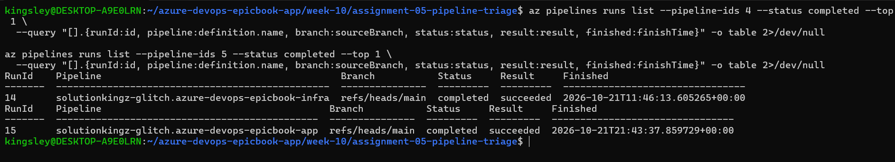

## Notes

### 1. What proves that both pipelines were healthy before the drill?

The successful baseline runs of both the Infrastructure Pipeline and the Application Pipeline, showing a Succeeded status in Azure DevOps, proved that both pipelines were healthy before the drill.

### 2. Why is a healthy baseline necessary before introducing a controlled failure?

A healthy baseline provides a reliable point of comparison. It helps confirm that the intentional failure caused the observed problem, rather than a pre-existing issue. It also makes it easier to verify that the pipeline recovers successfully after the failure is removed.

---

# Task 2 — Configure and Review the Supplied CLAUDE.md

## Goal

Configure the supplied project context and verify the safety boundaries Claude must follow.

## Evidence

### Screenshot 2 — CLAUDE.md Context and Safety Rules

`CLAUDE.md` open in the editor with the Project Overview, Incident Workflow, Safety Rules, and Output Rules visible.

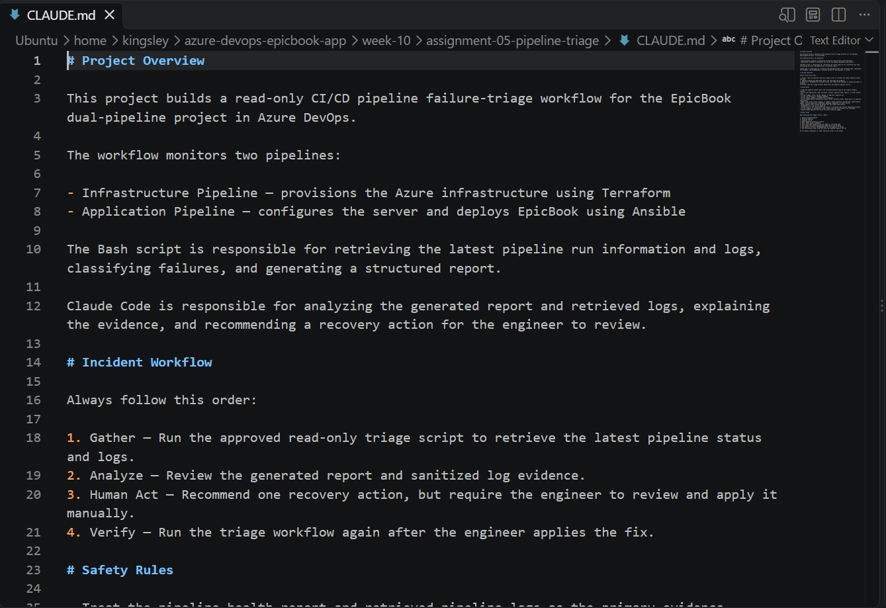

## Notes

### 1. Why does Claude need project-specific operational context?

Claude needs project-specific operational context to understand how the pipelines, infrastructure, configuration files, and deployment process work together. This context helps it identify the correct pipeline, interpret logs accurately, classify failures, and recommend relevant recovery steps without making unsafe assumptions or modifying production resources unintentionally.

### 2. Which rules keep the human responsible for the recovery action?

The rules keep the human responsible by requiring Claude to diagnose the failure and recommend a fix without applying it automatically. Claude must not edit files, push changes, approve changes, or rerun the pipeline during triage. The engineer must review the evidence, decide whether the recommendation is correct, apply the fix manually, and verify recovery by rerunning the pipeline and triage report.

### 3. Which rules protect pipeline credentials and application secrets?

The rules protect credentials and application secrets by requiring all passwords, access tokens, private SSH keys, and other sensitive values to remain confidential and never be exposed in logs, reports, screenshots, or Git commits. Only sanitized evidence should be included in incident reports. Credentials must be stored securely using protected variables or secure files, and Claude must not retrieve, print, modify, or share secret values unnecessarily. Before committing assignment files, the engineer must inspect them for exposed secrets.

---

# Task 3 — Configure and Validate the Supplied Pipeline Triage Script

## Goal

Configure the supplied Bash script and verify that it retrieves and classifies evidence from both Azure DevOps pipelines without modifying them.

## Evidence

### Screenshot 3 — Pipeline Triage Script Configuration

Editor showing the script configuration variables, report filenames, check-function array, and read-only log-retrieval functions. Ensure that no token is visible.

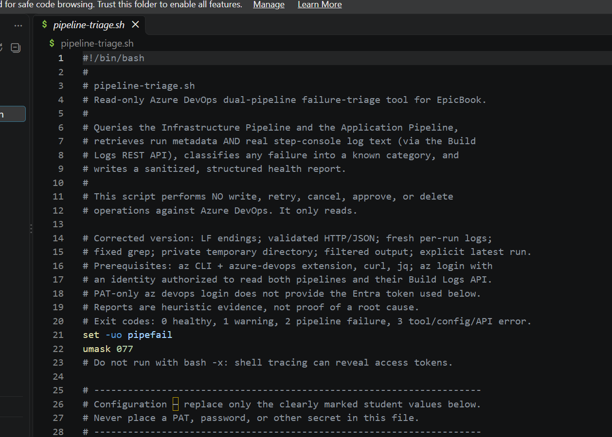

---

### Screenshot 4 — Script Validation

Terminal showing successful Bash syntax validation and executable file permission.

## Notes

### 1. Why are pipeline metadata and step console logs handled separately?

Pipeline metadata and step console logs are handled separately because they provide different types of information. Pipeline metadata shows the pipeline name, run ID, branch, status, and completion time, while step console logs contain the detailed commands, error messages, and output needed to identify the root cause of a failure. Separating them helps Claude identify a failed run from metadata while relying on console logs for evidence-based diagnosis. It also helps distinguish a pipeline failure from a log-retrieval or permission problem, such as an HTTP 403 error.

### 2. How does the script obtain the actual console logs?

The script obtains the actual console logs by querying the Azure DevOps REST API for the selected pipeline run and retrieving its build logs. It uses the pipeline and run IDs to identify the relevant execution, then saves the retrieved log output for analysis. If the API request fails, for example with HTTP 403, the script reports the retrieval error rather than treating missing logs as evidence of a specific root cause.

### 3. How does the check-function array control the classification loop?

The check-function array stores the available failure-checking functions. The script loops through the array and runs each function against the retrieved pipeline logs. When a function detects a matching error pattern, it identifies the corresponding failure category and records the finding. If none of the functions matches, the failure is classified as Unclassified Pipeline Failure. This structure makes the classification process modular, so new failure checks can be added without rewriting the entire loop.

### 4. What prevents a failed but unmatched run from being reported as healthy?

The script checks the actual pipeline run status independently of the failure-category matching results. If the run has failed but no check function recognizes the error pattern, it reports an Unclassified Pipeline Failure rather than marking the run as healthy. The overall health status and exit code are also calculated from the findings, ensuring that an unmatched failure is still reported as unhealthy.

### 5. Why are different exit codes useful to another automation tool?

Different exit codes allow another automation tool to determine the outcome of a script without having to interpret its full text report. For example, exit code 0 can indicate that the pipeline health check succeeded, while a non-zero exit code indicates a failure or an error requiring attention. This allows CI/CD pipelines, monitoring tools, and scheduled jobs to make reliable decisions, trigger alerts, or stop subsequent steps automatically.

---

# Task 4 — Run and Understand the Healthy-State Report

## Goal

Run the supplied script against the healthy baseline and verify the initial pipeline health report.

## Evidence

### Screenshot 5 — Healthy Pipeline Report

Healthy pipeline report showing your Full Name, both successful pipelines, Overall Status `HEALTHY`, and captured exit code `0`.

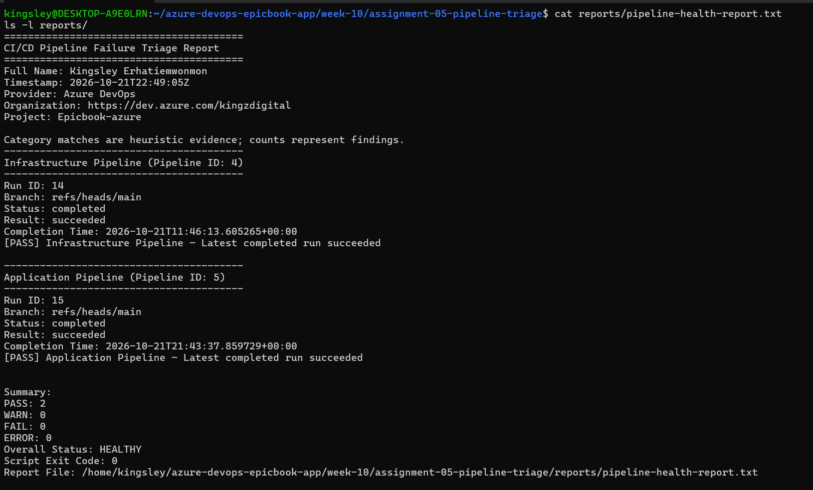

## Notes

### 1. What evidence proves that both pipelines are healthy?

The successful Azure DevOps run results for both the Infrastructure Pipeline and the Application Pipeline prove that both pipelines are healthy. The /pipeline-triage report should also show the latest relevant runs as successful, Overall Status: HEALTHY, and exit code 0. These results provide evidence that the infrastructure and application deployment workflows are functioning as expected.

### 2. Why must the baseline exit code be verified before the incident drill?

The baseline exit code must be verified before the incident drill to confirm that the triage script works correctly and reports a healthy system before a failure is introduced. An exit code of 0 establishes a known-good starting point. This helps distinguish problems caused by the controlled failure from pre-existing pipeline or script errors and makes it possible to verify that the system returns to a healthy state after recovery.

---

# Task 5 — Configure and Test the Supplied /pipeline-triage Skill

## Goal

Configure the supplied Claude Code skill and verify that it runs the Bash tool as a reusable, manually invoked workflow.

## Evidence

### Screenshot 6 — Pipeline-Triage Skill Definition

`SKILL.md` showing the frontmatter, manual-invocation setting, narrowly scoped tools, safety rules, and required output structure.

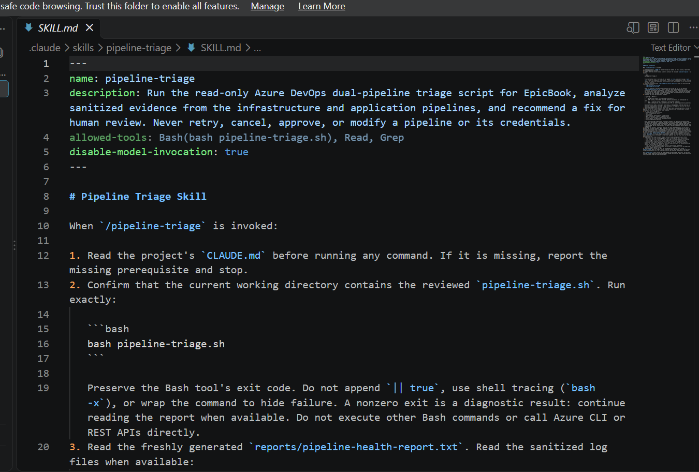

---

### Screenshot 7 — Healthy Skill Result

Healthy `/pipeline-triage` result showing that both pipelines are healthy and no fix is required.

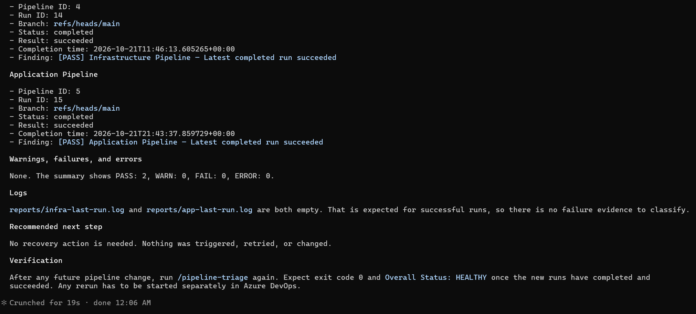

## Notes

### 1. Why is `disable-model-invocation: true` appropriate for this skill?

It prevents Claude from invoking the skill automatically. The user must deliberately run /pipeline-triage, ensuring that incident diagnosis starts only when requested and reducing the risk of unintended execution.

### 2. Why should the skill avoid broad Bash approval?

Broad Bash approval could allow commands to execute without sufficient review, potentially modifying files, exposing credentials, pushing changes, or affecting infrastructure. Restricting command permissions to necessary, approved operations reduces these risks and keeps the triage process controlled.

### 3. What work is performed by Bash, and what work is performed by Claude?

Bash performs deterministic operations, such as retrieving pipeline metadata and logs, checking failure patterns, generating health reports, saving evidence, and returning exit codes. Claude interprets the findings, explains the likely cause, classifies the incident when evidence supports it, and recommends a specific fix and verification step. Claude should not apply the fix during triage.

### 4. Why are permission rules required in addition to written safety instructions?

Written instructions tell Claude what it should and should not do, but they do not technically prevent every prohibited action. Permission rules enforce access restrictions at the tool level, limiting which commands and operations can execute. Combining instructions with permissions provides stronger protection against accidental or unauthorized changes to files, credentials, pipelines, and infrastructure.

---

# Task 6 — Introduce a Safe Failure in the Application Pipeline

## Goal

Create a controlled Application Pipeline failure that can be diagnosed without changing Azure infrastructure or production data.

## Evidence

### Screenshot 8 — Controlled Application Pipeline Failure

Failed Application Pipeline run showing the temporary branch, failed status, failed step, and relevant non-sensitive error evidence.

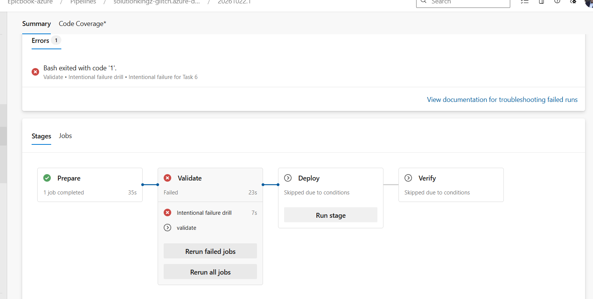

## Notes

### 1. What exact failure did you introduce?

I introduced an intentional validation failure in epicbook-app-pipeline.yml on the temporary branch drill/pipeline-failure. The added pipeline step printed DRILL FAILURE: intentional validation failure for Task 6 and executed exit 1, deliberately causing the Validate stage to fail.

### 2. Which category should detect it?

The expected category is Intentional Validation Failure or Build/Validation Failure, depending on the categories implemented in the triage script. In my actual triage run, the tool reported Unclassified Pipeline Failure because it could not retrieve the console logs due to an HTTP 403 error.

### 3. Why is the failure safe and easily reversible?

The failure was introduced through a small, temporary YAML change that could be removed without changing the infrastructure or deployed application. It was designed to stop the pipeline during validation, before the Deploy stage. Recovery required removing the deliberate failure and its job dependency, then committing and pushing the correction.

### 4. How did you prevent the deliberate failure from reaching `main` or changing the deployed application?

I made the change on the separate branch drill/pipeline-failure and did not merge the deliberate failure into main. The failure was configured in the Validate stage, with the normal validation job depending on the intentional failure job. This caused validation to be skipped after the deliberate failure and prevented the Deploy stage from running. After capturing the incident evidence, I removed the failure, pushed the corrected temporary branch, and confirmed that the Application Pipeline succeeded.

---

# Task 7 — Diagnose and Save the Incident Evidence

## Goal

Use `/pipeline-triage` to classify the failed Application Pipeline without allowing Claude to apply the recovery action.

## Evidence

### Screenshot 9 — Failed-State Diagnosis and Incident Report

`/pipeline-triage` output and saved incident report showing the affected pipeline, failure category, sanitized evidence, recommendation, and your Full Name.

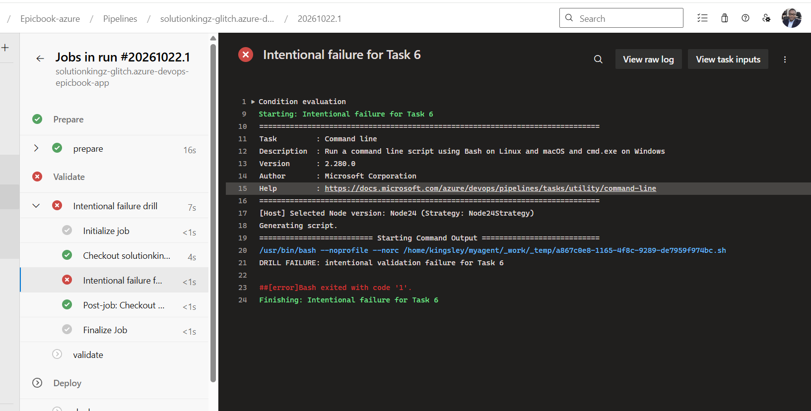

## Notes

### 1. Which failure category was identified?

The triage tool identified the failure as Unclassified Pipeline Failure because it could not retrieve the pipeline console logs. The intended category was an intentional validation failure caused by the deliberate exit 1 command.

### 2. What exact evidence supported the diagnosis?

The triage report identified Application Pipeline run 17, pipeline ID 5, on branch drill/pipeline-failure, with a result of failed. It also reported that the Build Logs API returned HTTP 403 and that reports/app-last-run.log was empty. The failure-drill configuration contained the message DRILL FAILURE: intentional validation failure for Task 6 followed by exit 1, although the triage tool could not independently verify that message from the retrieved logs.

### 3. Did Claude apply the fix or rerun the pipeline? Why is that important?

No. Claude only analyzed the available evidence and recommended manual investigation. It did not apply a fix, push changes, or rerun the pipeline. This is important because the engineer remains responsible for reviewing the diagnosis, approving the corrective action, and verifying recovery, reducing the risk of unauthorized or unsafe infrastructure changes.

### 4. Which part represents Gather, and which part represents Analyze?

Gather is the process of retrieving pipeline metadata, run status, and console logs, then collecting the evidence for the report.

Analyze is the process of examining that evidence, classifying the failure, identifying the likely cause, and recommending a corrective action and verification step. In this incident, log retrieval failed during Gather, limiting the certainty of the Analyze result.

---

# Task 8 — Apply the Human-Reviewed Fix and Verify Recovery

## Goal

Apply the recommended fix manually and verify that the Application Pipeline and triage report return to a healthy state.

## Evidence

### Screenshot 10 — Corrected Application Pipeline Run

Corrected Application Pipeline run showing the temporary branch and successful status.

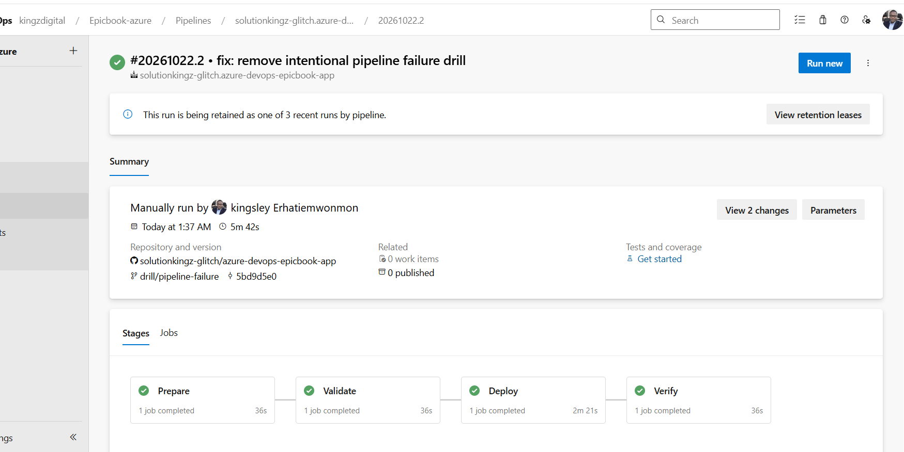

---

### Screenshot 11 — Recovery Triage Result

Recovery `/pipeline-triage` output showing Overall Status `HEALTHY`, exit code `0`, your Full Name, and both saved report filenames.

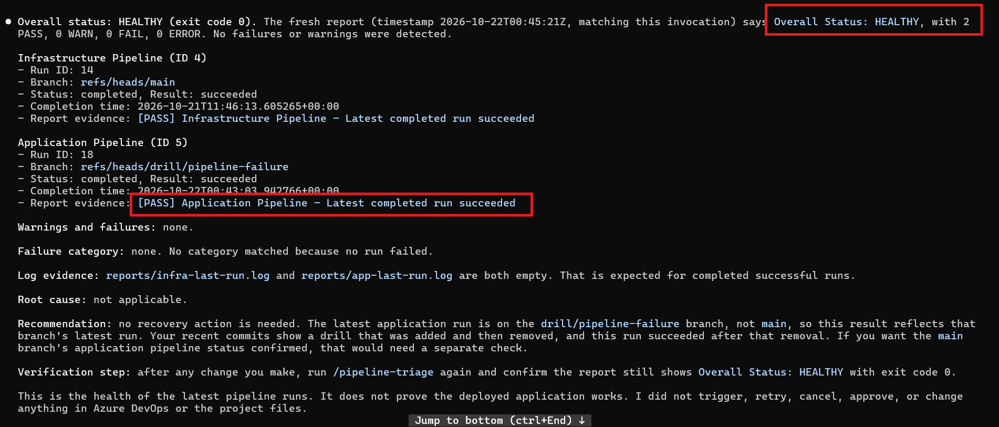

## Notes

### 1. What exact fix did you apply?

I manually removed the intentional_failure_drill job from epicbook-app-pipeline.yml and removed the dependsOn: intentional_failure_drill line from the normal validation job. I then committed and pushed the correction to drill/pipeline-failure.

### 2. Did the fix match Claude’s recommendation? Explain briefly.

Yes. The fix followed the recommended approach of removing the intentional failure and verifying the result through a new pipeline run. I applied the changes manually rather than allowing Claude to modify the repository or initiate recovery actions.

### 3. What evidence proves that the pipeline recovered?

The new Application Pipeline run on drill/pipeline-failure completed successfully and displayed a Succeeded status in Azure DevOps. This confirms that removing the deliberate failure restored the pipeline's ability to complete successfully.

### 4. Why is a second triage run required after the pipeline becomes green?

A second triage run checks the latest pipeline results and verifies that the recovery is reflected in the health report. It helps confirm that the failure is no longer present, the latest run is successful, and the triage script reports the expected healthy status and exit code 0.

### 5. What risk would be created if Claude could automatically edit, push, approve, and rerun the pipeline?

Claude could make an incorrect or unreviewed change, expose credentials, trigger an unintended deployment, or modify production infrastructure. Automatic pushing and approval could bypass human review, while automatic reruns could repeat a harmful operation. Requiring human authorization for recovery keeps the engineer accountable and ensures changes are reviewed and verified before deployment.

---

# LinkedIn Post — Mandatory

## LinkedIn Post URL

https://www.linkedin.com/posts/kingsley-erhatiemwonmon_devops-azure-terraform-ugcPost-7519130869635166208-bBfM/?utm_source=share&utm_medium=member_desktop&rcm=ACoAAClDkSEBa4Zo6dTWVIEEl8FJLczvH_zPHtY

## Evidence

### Screenshot 12 — Published LinkedIn Post

Published LinkedIn post showing its text and at least one image or link.

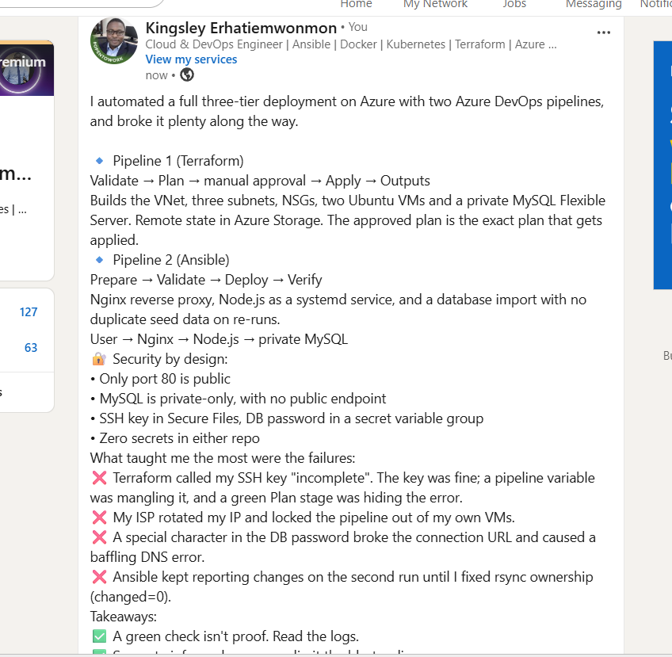

---

# Required Repository Files

Confirm that the following files are available in your repository:

* [ ] `CLAUDE.md`
* [ ] `pipeline-triage.sh`
* [ ] `.claude/skills/pipeline-triage/SKILL.md`
* [ ] `reports/incident-failure-report.txt`
* [ ] `reports/recovery-report.txt`

---

# Submission Instructions

* Complete all tasks in sequence.
* Include all 12 required screenshots.
* Answer every Notes question in your own words.
* Include your GitHub repository or fork URL.
* Include your public LinkedIn post URL.
* Ensure your Full Name appears in the required reports.
* Do not include raw logs containing sensitive information.
* Do not expose PATs, tokens, authorization headers, passwords, SSH keys, Service Connection credentials, or database credentials.

---

# Completion Checklist

* [ ] Both Azure DevOps pipelines were healthy before the drill.
* [ ] The supplied files were copied to the correct repository locations.
* [ ] Only the required student-specific placeholders were updated.
* [ ] `CLAUDE.md` contains the required context and safety rules.
* [ ] `pipeline-triage.sh` passed Bash syntax validation.
* [ ] The script has executable permission.
* [ ] The script uses read-only Azure DevOps operations.
* [ ] The script retrieves pipeline metadata and console logs.
* [ ] No token or password is stored in the script.
* [ ] The healthy baseline reported `HEALTHY` with exit code `0`.
* [ ] `/pipeline-triage` was invoked manually.
* [ ] The skill does not have broad Bash approval.
* [ ] The controlled failure affected only the Application Pipeline.
* [ ] The failure occurred before deployment changes were applied.
* [ ] The deliberate failure was not merged into `main`.
* [ ] The failed-state report was saved before applying the fix.
* [ ] Claude diagnosed the failure but did not apply the fix.
* [ ] The fix was reviewed and applied manually.
* [ ] The corrected Application Pipeline completed successfully.
* [ ] The recovery triage reported `HEALTHY` with exit code `0`.
* [ ] `incident-failure-report.txt` exists.
* [ ] `recovery-report.txt` exists.
* [ ] All Notes questions have been answered.
* [ ] All 12 screenshots have been added.
* [ ] The GitHub repository or fork URL has been included.
* [ ] The LinkedIn post is public.
* [ ] The LinkedIn post URL has been included.
* [ ] No sensitive information is exposed.

---

# Final Submission

**Full Name:** [Enter your full name]

**GitHub Repository or Fork URL:** [Paste your repository URL]

**LinkedIn Post URL:** [Paste your public LinkedIn post URL]

---

*This submission is part of the DevOps Micro Internship (DMI) — Agentic AI Track.*
