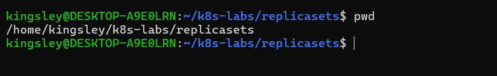
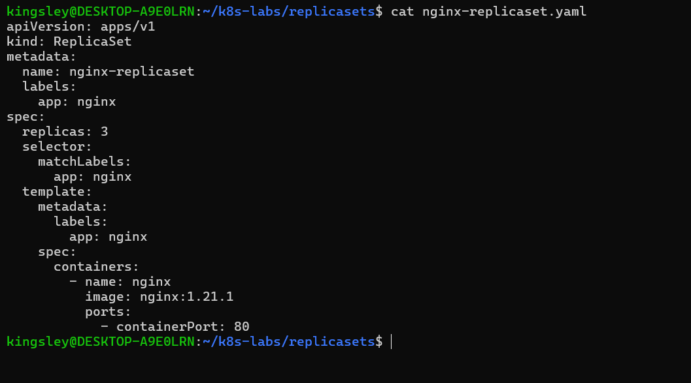
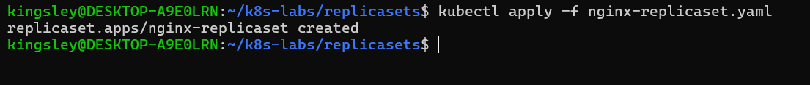
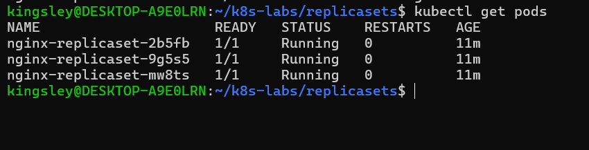
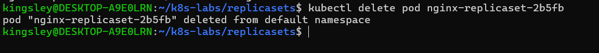
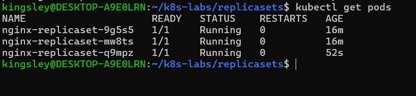
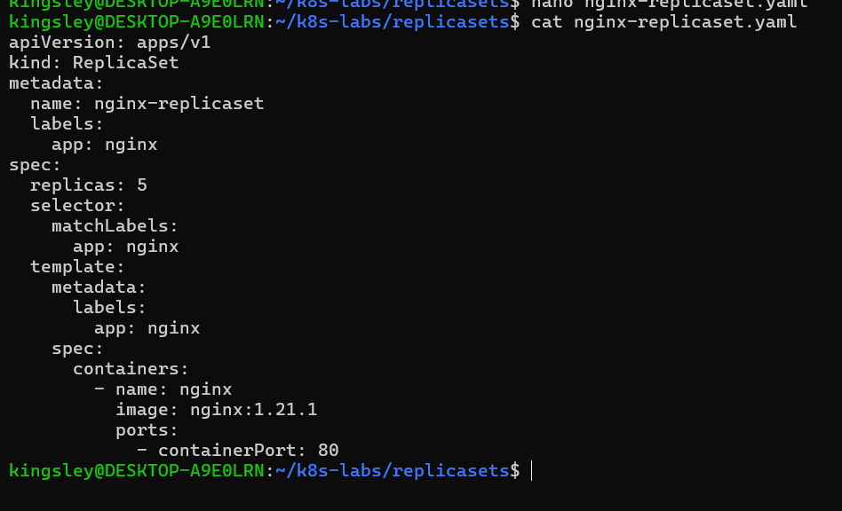
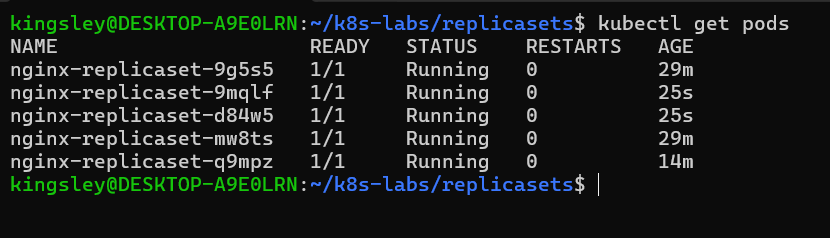
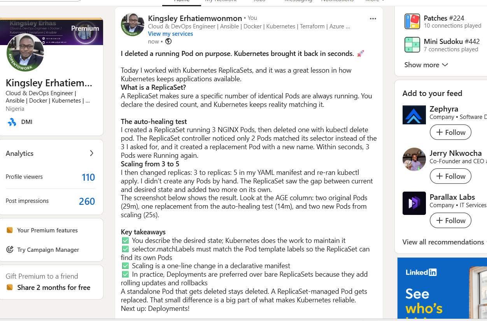

# Assignment 02 — ReplicaSets: Keeping Your Pods Alive

Part of the DevOps Micro Internship (DMI) with Agentic AI

---

## Purpose

In this assignment, you will create three NGINX Pods using a ReplicaSet, test auto-healing by deleting one Pod, and scale the ReplicaSet from three to five Pods.

---

# Task 0 — Pre-check: Remove the Pod from Assignment 01

## Goal

Confirm that you are connected to your learning cluster and remove the previous standalone Pod to prevent the ReplicaSet from adopting it.

### Evidence

No screenshots required.

---

# Task 1 — Set Up Your Working Directory

## Goal

Create and enter a dedicated directory for this ReplicaSet lab.

### Evidence

#### Screenshot 01 — Output of `pwd` showing the working directory ending in `/k8s-labs/replicasets`

---

### Notes

**1. Why is it useful to keep Kubernetes manifests in organized directories?**

Organizing manifests into a clear directory structure makes your cluster configuration easier to manage as it grows. A lab with one Pod file is simple, but real projects quickly accumulate Deployments, Services, ConfigMaps, and more.

Key benefits:

- **Easier to find and understand:** Grouping files by resource type or application (for example `pods/`, `services/`, `deployments/`) lets you locate a manifest quickly.
- **Bulk operations:** You can apply an entire directory with one command, such as `kubectl apply -f ./pods/`, instead of applying files one at a time.
- **Version control:** A tidy structure works well with Git, making changes easy to track, review, and roll back.
- **Collaboration:** Teammates can navigate the project without guessing where things live, and code reviews are simpler when changes are scoped to clear folders.
- **Separation of environments:** You can keep `dev/`, `staging/`, and `prod/` configurations apart, which reduces the risk of applying changes to the wrong environment.
- **Reusability and consistency:** Related resources stay together, so an application can be recreated or moved to another cluster reliably.
- **Less risk of mistakes:** Clear organization avoids duplicate or conflicting manifests and makes it obvious which files are current.

**Example structure:**
k8s-labs/
├── pods/
│ └── nginx-pod.yaml
├── deployments/
│ └── nginx-deployment.yaml
├── services/
│ └── nginx-service.yaml
└── configmaps/
└── app-config.yaml

**Summary:** Organized directories make manifests easier to find, apply, review, and maintain, which supports the declarative, version-controlled workflow Kubernetes is designed around.

---

**2. What file will you create in this directory for this assignment?**

I will create a ReplicaSet manifest file named **`nginx-replicaset.yaml`** in the `k8s-labs/replicasets/` directory.

This YAML file declares the desired state of a ReplicaSet named `nginx-replicaset` that keeps three NGINX Pods running:

    apiVersion: apps/v1
    kind: ReplicaSet
    metadata:
      name: nginx-replicaset
      labels:
        app: nginx
    spec:
      replicas: 3
      selector:
        matchLabels:
          app: nginx
      template:
        metadata:
          labels:
            app: nginx
        spec:
          containers:
            - name: nginx
              image: nginx:1.21.1
              ports:
                - containerPort: 80

It is created and applied with:

    cd ~/k8s-labs/replicasets
    touch nginx-replicaset.yaml
    nano nginx-replicaset.yaml
    kubectl apply -f nginx-replicaset.yaml

**Why this name and location:** The `.yaml` extension marks it as a Kubernetes manifest, `nginx-replicaset` describes the resource it defines (and is the filename the assignment requires), and placing it in `replicasets/` keeps it separate from the Pod manifests in `pods/`.

---

# Task 2 — Create and Apply the NGINX ReplicaSet

## Goal

Create a ReplicaSet that maintains three NGINX Pods.

### Evidence

#### Screenshot 02 — Completed `nginx-replicaset.yaml` manifest showing `replicas: 3`

---

#### Screenshot 03 — Output of `kubectl apply -f nginx-replicaset.yaml`

---

#### Screenshot 04 — Output of `kubectl get pods` showing three NGINX Pods with `1/1` under `READY` and `Running` under `STATUS`

---

### Notes

**1. What does `replicas: 3` mean in this manifest?**

It sets the desired state: Kubernetes should keep exactly three identical NGINX Pods running at all times. If the number of running Pods drops below three, the ReplicaSet creates new ones. If it rises above three, it removes the extras.

---

**2. Why must `selector.matchLabels` match `template.metadata.labels`?**

The selector is how the ReplicaSet identifies which Pods it owns and counts toward `replicas`. The template labels are what get stamped onto every Pod the ReplicaSet creates. If the two don't match, the ReplicaSet would create Pods that it can't recognize as its own. It would see zero matching Pods and keep creating more indefinitely. To prevent this, the Kubernetes API rejects a ReplicaSet whose selector doesn't match its template labels.

In this manifest, both use `app: nginx`, so every Pod created from the template is automatically managed by the ReplicaSet.

---

**3. What image and image tag are used for the NGINX container?**

The container uses the official NGINX image from Docker Hub, with the tag `1.21.1`, written as **`nginx:1.21.1`** in the manifest:

    containers:
      - name: nginx
        image: nginx:1.21.1
        ports:
          - containerPort: 80

Pinning a specific tag like `1.21.1` instead of `latest` keeps the deployment predictable and reproducible.

---

# Task 3 — Test ReplicaSet Auto-Healing

## Goal

Delete one Pod managed by the ReplicaSet and observe Kubernetes automatically create a replacement.

### Evidence

#### Screenshot 05 — Output of the command deleting one ReplicaSet-managed Pod

---

#### Screenshot 06 — Output of `kubectl get pods` showing the replacement Pod with a different name from the deleted Pod

---

#### Screenshot 07 — Output showing three NGINX Pods with `1/1` under `READY` and `Running` under `STATUS` again

---

### Notes

**1. What happened after you deleted one Pod?**

The selected Pod went into `Terminating` and was removed. Almost immediately, the ReplicaSet created a new Pod with a different name (nginx-replicaset-q9mpz) and a very young AGE. Within a few seconds there were three Pods running again.

---

**2. How does the ReplicaSet know that a replacement Pod is needed?**

The ReplicaSet controller continuously watches the Pods that match its selector and compares the current count with the desired count in `spec.replicas`. When the deletion dropped the count from 3 to 2, the controller saw the mismatch and created one Pod from its template to restore the desired state.

---

**3. What proves that auto-healing worked successfully?**

- The deleted Pod's name no longer appears in `kubectl get pods`.
- A new Pod with a different name and a recent AGE appears without any manual action.
- Three Pods show `1/1` under READY and `Running` under STATUS again.

---

# Task 4 — Manually Scale the ReplicaSet

## Goal

Scale the ReplicaSet from three NGINX Pods to five NGINX Pods by changing the YAML manifest.

### Evidence

#### Screenshot 08 — Updated `nginx-replicaset.yaml` showing `replicas: 5`

---

#### Screenshot 09 — Output of `kubectl get pods` showing five NGINX Pods with `1/1` under `READY` and `Running` under `STATUS`

---

### Notes

**1. What change did you make to scale the ReplicaSet?**

I edited `nginx-replicaset.yaml`, changed `replicas: 3` to `replicas: 5` under `spec`, and re-applied it with `kubectl apply -f nginx-replicaset.yaml`.

---

**2. Did you manually create the additional Pods? Explain why or why not.**

No. I only changed the desired count in the manifest. The ReplicaSet saw that the current count (3) was lower than the desired count (5) and created two more Pods from its template. The original three Pods were left untouched.

---

**3. What would happen if you changed the replica count from five back to three?**

After re-applying the manifest, the ReplicaSet would see five Pods against a desired count of three and delete two of them. Three Pods would remain. Which two are removed is decided by the controller, and it generally prefers Pods that are newer or not yet ready.

---

# LinkedIn Requirement

Create a LinkedIn post that includes:

- A short explanation of what a Kubernetes ReplicaSet does.
- What happened when you deleted one NGINX Pod.
- How Kubernetes automatically created a replacement Pod to maintain the desired replica count.
- What you learned by changing the replica count from three to five.
- One screenshot showing either:
  - Three Pods running after the auto-healing test, or
  - Five Pods running after scaling the ReplicaSet.

Do not share sensitive information, cluster credentials, tokens, or kubeconfig details in your post.

### Evidence

#### Screenshot 10 — Published LinkedIn post showing your name, the required explanation, and the attached Pod screenshot

---

### Post Link

https://www.linkedin.com/posts/kingsley-erhatiemwonmon_kubernetes-devops-cloudnative-ugcPost-7520939981654188032-FKMd/?utm_source=share&utm_medium=member_desktop&rcm=ACoAAClDkSEBa4Zo6dTWVIEEl8FJLczvH_zPHtY

---

# Submission Instructions

- Add all required screenshots, numbered 01–10, to this template.
- Full Name must be visible in required screenshots.
- Ensure screenshots are clear and readable.
- Submit the final `nginx-replicaset.yaml` file showing `replicas: 5`. Screenshot 02 provides evidence of the initial manifest with `replicas: 3`.
- Complete the Notes sections in Tasks 1–4 in your own words.
- Include the published LinkedIn post URL.
- Do not expose tokens, passwords, private keys, kubeconfig files, or account IDs.

---

# Completion Checklist

- [ ] Completed Task 0 and confirmed that the previous `nginx-pod` is no longer listed
- [ ] Created and entered the ReplicaSet working directory (Screenshot 01)
- [ ] Created `nginx-replicaset.yaml` with an initial replica count of three (Screenshot 02)
- [ ] Applied the ReplicaSet manifest successfully (Screenshot 03)
- [ ] Confirmed three NGINX Pods are running (Screenshot 04)
- [ ] Deleted one ReplicaSet-managed Pod (Screenshot 05)
- [ ] Observed the automatically created replacement Pod (Screenshot 06)
- [ ] Confirmed three NGINX Pods are running again (Screenshot 07)
- [ ] Changed the replica count from three to five (Screenshot 08)
- [ ] Confirmed five NGINX Pods are running (Screenshot 09)
- [ ] Submitted the final `nginx-replicaset.yaml` file with `replicas: 5`
- [ ] Completed the Notes sections in Tasks 1–4
- [ ] Published the LinkedIn post with the required explanation and Pod screenshot (Screenshot 10)
- [ ] Included the published LinkedIn post URL
- [ ] Included all required screenshots
- [ ] No sensitive data exposed

---

## 📌 About DMI & CloudAdvisory

DevOps Micro Internship (DMI) is a project-based DevOps program run by Pravin Mishra (The CloudAdvisory) focused on real-world execution, systems thinking, and career readiness.

It helps learners build strong DevOps foundations with hands-on experience.

---

## 📌 Resources

- 🌐 DMI Official Website: https://dmi.pravinmishra.com?utm_source=github&utm_medium=readme  
- 🎓 University: https://university.pravinmishra.com?utm_source=github&utm_medium=readme  
- 💬 Discord Community: https://discord.pravinmishra.com?utm_source=github&utm_medium=readme  
- 📝 Blog: https://dmi.pravinmishra.com/blog?utm_source=github&utm_medium=readme  
- ▶️ YouTube Playlist: https://www.youtube.com/playlist?list=PLFeSNDtI4Cho  
- 🔗 Pravin Mishra (LinkedIn): https://www.linkedin.com/in/pravin-mishra-aws-trainer/  
- 🏢 CloudAdvisory (LinkedIn): https://www.linkedin.com/company/thecloudadvisory/

---

*This submission is part of DevOps Micro Internship (DMI) — Agentic AI Track.*
