# Assignment 4 — Auto-Scaling & Auto-Healing: Let Kubernetes React for You

Part of the DevOps Micro Internship (DMI) with Agentic AI

---

## Purpose

Create Deployments, test Pod auto-healing, configure CPU requests and limits, verify Metrics Server, and create a Horizontal Pod Autoscaler.

Optionally generate CPU load to observe how the HPA responds.

---

# Task 0 — Check the Existing Cluster Resources

## Goal

Confirm that you are connected to your learning cluster and inspect existing Deployments and HPAs.

### Evidence

No screenshots required.

---

# Task 1 — Set Up Your Lab Directory

## Goal

Create and enter a dedicated directory for the auto-scaling lab.

### Evidence

#### Screenshot 1 — Terminal showing that you are working inside `~/k8s-labs/autoscaling`

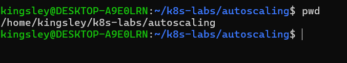

---

### Notes

**1. What is the difference between auto-healing and auto-scaling?**

Auto-healing automatically replaces or restarts failed Pods to maintain the desired number of healthy application instances. For example, if one NGINX Pod crashes, Kubernetes can create a replacement.

Auto-scaling automatically increases or decreases the number of Pods based on demand or resource usage, such as CPU utilization. For example, Kubernetes can increase the number of NGINX Pods from 2 to 5 when traffic increases.

In summary: Auto-healing maintains application health, while auto-scaling adjusts application capacity to meet demand.

---

**2. Which Kubernetes feature will you use for CPU-based auto-scaling?**

The Horizontal Pod Autoscaler (HPA) is the Kubernetes feature used for CPU-based auto-scaling. It automatically increases or decreases the number of Pod replicas in a Deployment based on CPU utilization compared with a configured target.

For example, if an NGINX Deployment has 2 Pods and the target CPU utilization is 70%, the HPA can increase the number of replicas when CPU usage rises above the target and reduce the number when demand decreases, subject to its scaling rules and minimum and maximum replica settings.

For CPU-based scaling to work correctly, the containers should have CPU resource requests configured, and the cluster must have a working metrics source, such as Metrics Server.

In summary: HPA helps an application handle changing workloads by adjusting the number of running Pods automatically, improving resource efficiency and helping maintain application performance.

---

# Task 2 — Test Auto-Healing with a Deployment

## Goal

Create a Deployment with two replicas, delete one Pod, and observe Kubernetes create a replacement Pod.

### Evidence

#### Screenshot 2 — Completed `autohealing-deployment.yaml` manifest

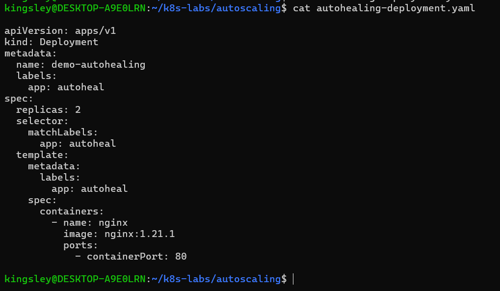

---

#### Screenshot 3 — Output of `kubectl get pods` showing two running Pods before deletion

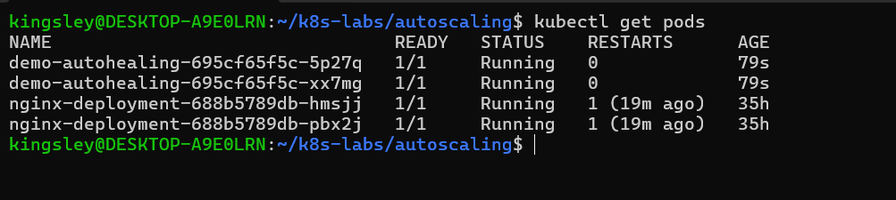

---

#### Screenshot 4 — Output of the `kubectl delete pod` command

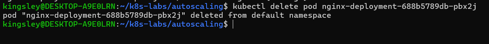

---

#### Screenshot 5 — Output of `kubectl get pods` showing the replacement Pod and two running Pods

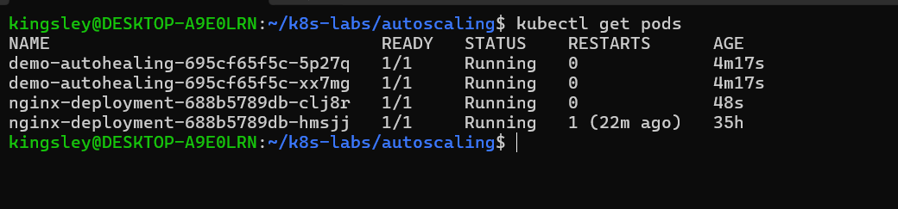

---

### Notes

**1. What happened after you deleted one Pod?**

After I deleted one Pod, Kubernetes automatically detected that the number of running Pods had fallen below the desired replica count of two. The Deployment controller created a replacement Pod to restore the desired state. This demonstrates auto-healing in Kubernetes, which helps maintain the availability of applications without manual intervention.

---

**2. What Kubernetes resource maintains the desired replica count for this Deployment?**

The Deployment controller, through a ReplicaSet, maintains the desired replica count. The ReplicaSet ensures that two Pods for `demo-autohealing` are running. If one Pod is deleted or fails, it creates a replacement to restore the desired count of two.

---

**3. What proves that auto-healing worked?**

Auto-healing worked because after I deleted one Pod, Kubernetes automatically created a replacement Pod, restoring the Deployment to its desired replica count of two. The `kubectl get pods` output showed both `demo-autohealing` Pods in the `Running` status with `1/1` containers ready, confirming that the application recovered without manual intervention.

---

# Task 3 — Create a Deployment for HPA

## Goal

Create a Deployment with CPU resource requests and limits so that HPA can calculate CPU utilization.

### Evidence

#### Screenshot 6 — Completed `hpa-deployment.yaml` manifest showing CPU requests and limits

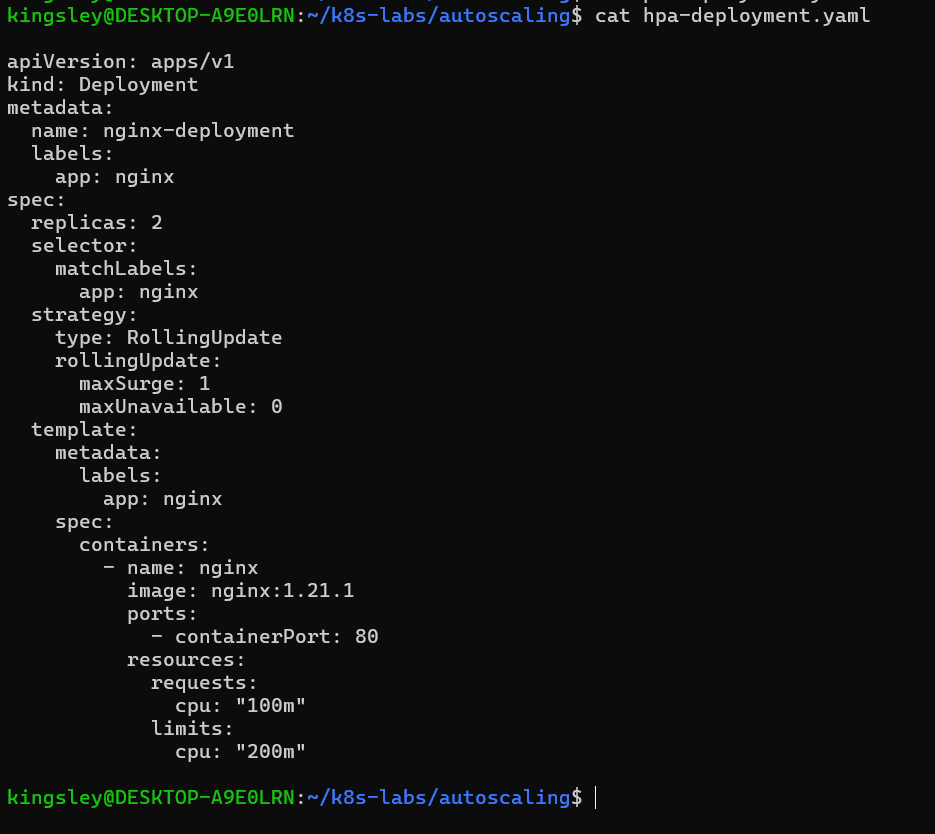

---

#### Screenshot 7 — Output showing `nginx-deployment` and its running Pods

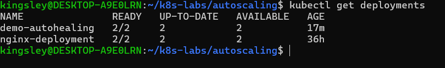

---

### Notes

**1. What does `cpu: "100m"` mean?**

`cpu: "100m"` means the container requests 100 millicores of CPU, equivalent to 0.1 of one CPU core. Kubernetes uses this CPU request when scheduling the Pod onto a suitable node and when calculating CPU utilization for a Horizontal Pod Autoscaler (HPA). It is a request for CPU capacity, not a fixed amount the container must always consume.

---

**2. What is the difference between a CPU request and a CPU limit?**

A CPU request is the amount of CPU resources Kubernetes reserves for a container when scheduling its Pod onto a node. It is also used as the reference for calculating CPU utilization by the Horizontal Pod Autoscaler (HPA).

A CPU limit is the maximum CPU time a container is allowed to use. If the container tries to exceed this limit, Kubernetes throttles its CPU usage.

For example, `requests.cpu: "100m"` means the container requests 0.1 CPU core, while `limits.cpu: "200m"` means it can use up to 0.2 CPU core.

---

**3. Why does CPU-based HPA require CPU requests?**

CPU-based HPA requires CPU requests because it calculates CPU utilization as a percentage of the CPU request assigned to each container. For example, if a container requests `100m` CPU and uses `50m`, its CPU utilization is 50%. Without CPU requests, Kubernetes cannot calculate this utilization percentage accurately, so the HPA cannot properly make CPU-based scaling decisions.

---

# Task 4 — Enable and Verify Metrics Server

## Goal

Ensure the cluster can collect resource metrics for the HPA.

### Evidence

#### Screenshot 8 — Output showing Metrics Server running, or `kubectl top pods` displaying Pod metrics

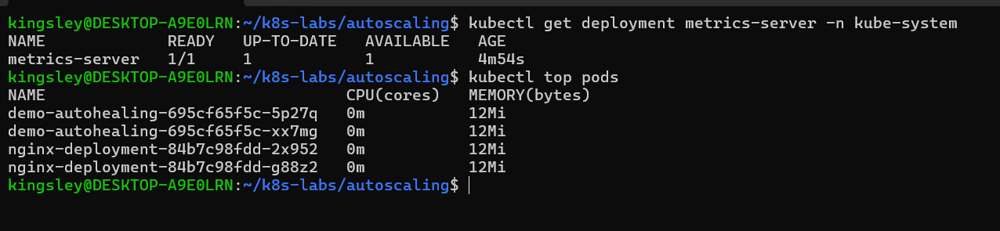

---

### Notes

**1. Why does HPA need Metrics Server?**

Metrics Server provides Kubernetes with current resource usage data, such as CPU and memory consumption, from running Pods and nodes. The Horizontal Pod Autoscaler (HPA) uses this data to compare actual CPU utilization with the configured target and decide whether to increase or decrease the number of Pod replicas. Without Metrics Server or another suitable metrics source, CPU-based HPA cannot obtain the metrics it needs to make scaling decisions.

---

**2. What issue can occur if Metrics Server is not working?**

If Metrics Server is not working, the HPA cannot retrieve current CPU and memory usage metrics from Pods. As a result, CPU-based auto-scaling may fail to make scaling decisions, and the HPA may display `<unknown>` for its metrics or report errors. The application may continue running, but automatic scaling based on those metrics will not work correctly.

---

**3. What does `kubectl top pods` help you check?**

`kubectl top pods` displays the current CPU and memory usage of running Kubernetes Pods. It helps you monitor resource consumption, identify Pods using excessive resources, and verify that Metrics Server is providing metrics needed for CPU- or memory-based auto-scaling with HPA.

---

# Task 5 — Create a Horizontal Pod Autoscaler

## Goal

Create an HPA that keeps at least two Pods running and can scale up to five Pods when average CPU utilization exceeds 50%.

### Evidence

#### Screenshot 9 — The imperative command output OR completed `hpa-nginx.yaml` manifest

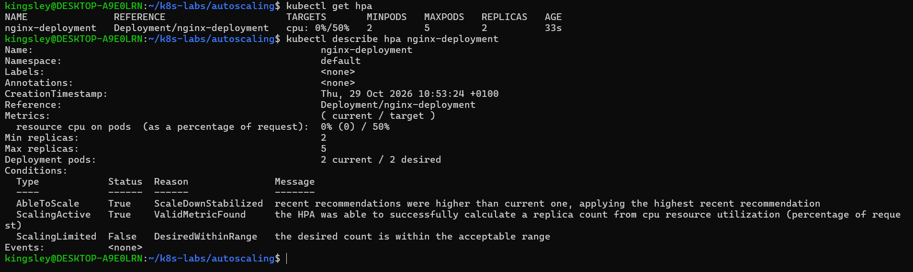

---

#### Screenshot 10 — Output of `kubectl get hpa` and the relevant `kubectl describe hpa` command

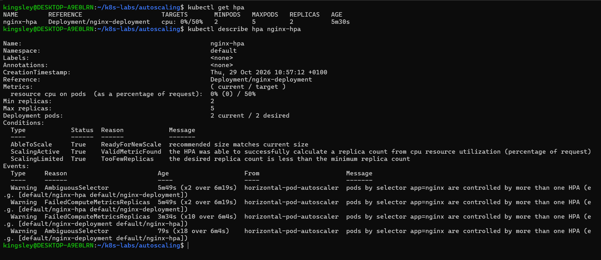

---

### Notes

**1. What does `minReplicas: 2` mean?**

minReplicas: 2 specifies the minimum number of Pod replicas that the Horizontal Pod Autoscaler (HPA) should maintain for a Deployment.

For example, if your NGINX Deployment has two Pods and CPU utilization drops to 0%, the HPA will not scale the Deployment below two replicas. This helps maintain a baseline level of application availability and allows the application to handle incoming requests without needing to start from zero Pods.

Even during low traffic, both Pods can remain available to serve requests and provide some resilience if one Pod fails.

---

**2. What does `maxReplicas: 5` mean?**

maxReplicas: 5 specifies the maximum number of Pod replicas that the HPA is allowed to maintain for the Deployment.

For example, if your NGINX application experiences increased traffic and CPU utilization rises above its target, the HPA can increase the number of replicas from two to three, four, or five, depending on its calculations.

Once the Deployment reaches five replicas, the HPA will not scale it beyond that configured maximum, even if CPU utilization remains high. This limit helps control resource consumption, although it does not guarantee that five replicas will be sufficient for every workload.

---

**3. What does `averageUtilization: 50` mean?**

averageUtilization: 50 sets the target average CPU utilization to 50% of the CPU requests configured for the containers in the Pods managed by the HPA.

For example, suppose each NGINX container has this CPU request:
resources:
  requests:
    cpu: "100m"

    Here, 100m means 0.1 CPU core. A target utilization of 50% corresponds to an average CPU usage of approximately 50m per container.
- If average CPU utilization rises significantly above 50%, the HPA may increase the number of replicas.
- If average utilization falls below 50%, the HPA may reduce the number of replicas, but not below minReplicas: 2.
- If CPU utilization is around 50%, the HPA will generally keep the current number of replicas, subject to its tolerance and scaling behavior.
The HPA calculates its scaling recommendation using the observed metrics, target utilization, and current replica count. It does not necessarily add or remove a Pod every time utilization crosses 50%.

---

**4. Why should only one HPA manage a Deployment at a time?**

A Horizontal Pod Autoscaler continuously evaluates metrics and adjusts a Deployment's replica count to match the desired workload.

If two HPAs target the same Deployment, both may attempt to control the number of replicas independently. Their scaling decisions can conflict, causing errors such as AmbiguousSelector and preventing reliable autoscaling.

In your lab, you initially had two HPAs:
- nginx-deployment
- nginx-hpa
Both targeted Deployment/nginx-deployment. Kubernetes reported an AmbiguousSelector error because the same Pods were being targeted by multiple HPAs.

After you deleted the duplicate and kept nginx-hpa, the HPA reported:
ScalingActive   True   ValidMetricFound

This confirmed that the remaining HPA could successfully retrieve CPU metrics and calculate a replica count.

In summary: minReplicas sets the lower scaling boundary, maxReplicas sets the upper boundary, averageUtilization defines the CPU target, and using one HPA per target Deployment avoids competing autoscaling controllers.

---

# Task 6 — Optional: Generate CPU Load and Observe Scaling

## Goal

Generate CPU load in one NGINX Pod and observe how HPA responds.

### Evidence

If you skip this task, write “Not completed — optional” and leave the remaining Task 6 placeholders blank.

#### Screenshot 11 — Terminal showing the CPU-load command running inside the selected Pod

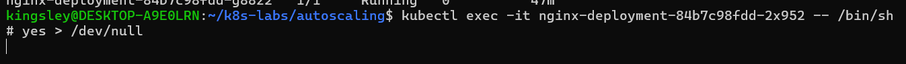

---

#### Screenshot 12 — Output of `kubectl get hpa` and `kubectl get pods` while HPA evaluates or changes the replica count

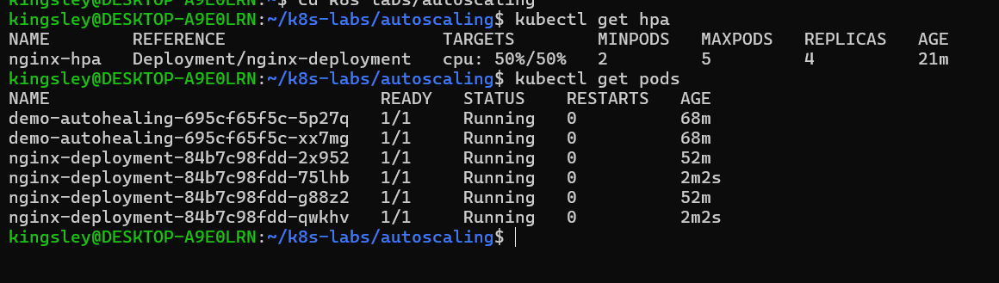

---

### Notes

Complete these answers only if you perform the optional test.

**1. Did the HPA change the number of Pods? Explain what you observed.**

Yes. The Horizontal Pod Autoscaler (HPA) automatically increased the number of Pods managed by nginx-deployment from 2 to 4 after CPU load was generated. The CPU utilization reached the target of 50%, and Kubernetes created two additional Pods. All four NGINX Pods were running successfully. This demonstrated automatic scaling in response to increased CPU demand.

---

**2. If scaling did not happen, what are two possible reasons?**

Not applicable — scaling occurred.

---

**3. Why is automatic scale-down useful after traffic decreases?**

Automatic scale-down reduces the number of Pods when demand decreases, helping to conserve CPU, memory, and other computing resources. It can also reduce cloud infrastructure costs while maintaining the minimum number of replicas needed to keep the application available.

---

# LinkedIn Requirement

### Evidence

#### Screenshot 13 — Published LinkedIn post showing your name, the required explanation, and the attached Kubernetes screenshot

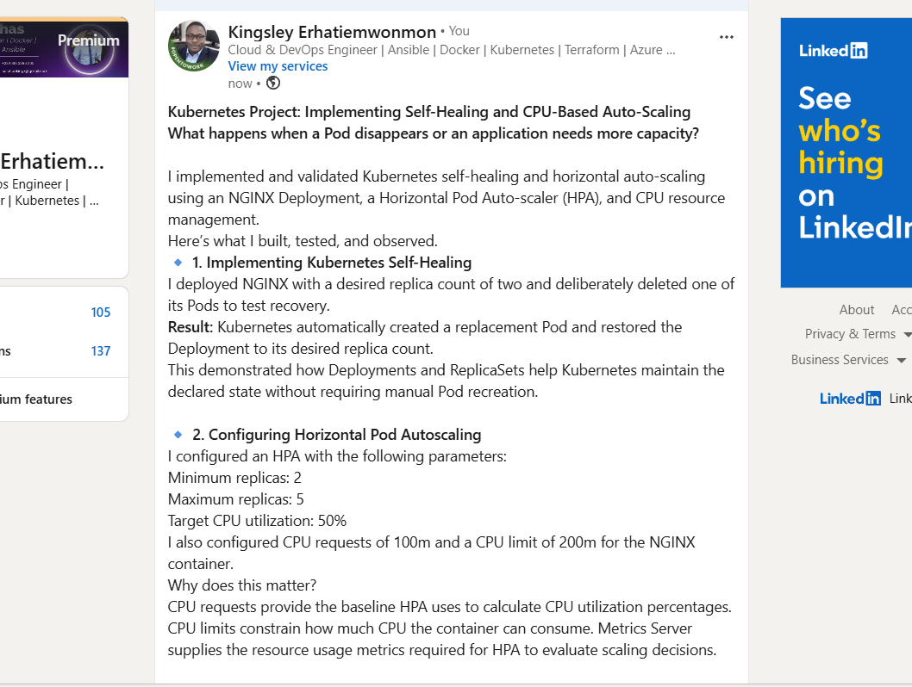

#### Linkedin Post Link

https://www.linkedin.com/posts/kingsley-erhatiemwonmon_kubernetes-devops-cloudengineering-ugcPost-7521526809713160192-h6UU/?utm_source=share&utm_medium=member_desktop&rcm=ACoAAClDkSEBa4Zo6dTWVIEEl8FJLczvH_zPHtY

---

# Submission Instructions

- Include required Screenshots 1–10 and Screenshot 13.
- Include Screenshots 11–12 only if you complete Task 6.
- Full Name must be visible in required screenshots.
- Ensure screenshots are clear and readable.
- Include the completed `autohealing-deployment.yaml` and `hpa-deployment.yaml` files.
- Include `hpa-nginx.yaml` if you selected the declarative HPA method.
- Complete the Notes sections for Tasks 1–5 in your own words.
- Complete Task 6 notes only if you perform the optional test.
- Do not expose passwords, tokens, private keys, kubeconfig files, or account IDs.

---

# Completion Checklist

- [ ] Checked the active context and existing cluster resources
- [ ] Created the autoscaling working directory (Screenshot 1)
- [ ] Created `autohealing-deployment.yaml` (Screenshot 2)
- [ ] Confirmed two auto-healing Pods were running (Screenshot 3)
- [ ] Deleted one managed Pod (Screenshot 4)
- [ ] Confirmed that the Pod was automatically replaced (Screenshot 5)
- [ ] Created `hpa-deployment.yaml` with CPU requests and limits (Screenshot 6)
- [ ] Verified `nginx-deployment` and its running Pods (Screenshot 7)
- [ ] Verified Metrics Server and confirmed Pod metrics are available (Screenshot 8)
- [ ] Created one HPA using the selected method (Screenshot 9)
- [ ] Verified minimum replicas of 2, maximum replicas of 5, and a CPU target of 50% (Screenshot 10)
- [ ] Completed Notes for Tasks 1–5
- [ ] Completed Task 6 evidence and notes, or marked it “Not completed — optional”
- [ ] Stopped the CPU-load command and exited the container shell, if Task 6 was completed
- [ ] Published the LinkedIn post with the required explanation and attached screenshot (Screenshot 13)
- [ ] Included the required manifest files
- [ ] No sensitive data exposed

---

## 📌 About DMI & CloudAdvisory

DevOps Micro Internship (DMI) is a project-based DevOps program run by Pravin Mishra (The CloudAdvisory) focused on real-world execution, systems thinking, and career readiness.

It helps learners build strong DevOps foundations with hands-on experience.

---

## 📌 Resources

- 🌐 DMI Official Website: https://dmi.pravinmishra.com?utm_source=github&utm_medium=readme  
- 🎓 University: https://university.pravinmishra.com?utm_source=github&utm_medium=readme  
- 💬 Discord Community: https://discord.pravinmishra.com?utm_source=github&utm_medium=readme  
- 📝 Blog: https://dmi.pravinmishra.com/blog?utm_source=github&utm_medium=readme  
- ▶️ YouTube Playlist: https://www.youtube.com/playlist?list=PLFeSNDtI4Cho  
- 🔗 Pravin Mishra (LinkedIn): https://www.linkedin.com/in/pravin-mishra-aws-trainer/  
- 🏢 CloudAdvisory (LinkedIn): https://www.linkedin.com/company/thecloudadvisory/

---

*This submission is part of DevOps Micro Internship (DMI) — Agentic AI Track.*
