# Assignment 5 — Kubernetes Health Probes (Readiness)

Part of the DevOps Micro Internship (DMI) with Agentic AI

---

## Purpose

In this assignment, you will configure and test a Kubernetes readiness probe. You will create a baseline NGINX Deployment, add an HTTP readiness probe, intentionally break it, observe a stalled rollout, and restore the working configuration.

You will also demonstrate how readiness probes protect rolling updates.

---

# Task 0 — Prepare the Lab Environment

## Goal

Confirm that you are connected to your learning cluster and remove the previous assignment’s HPA and NGINX Deployment before starting this lab.

No screenshot or written notes are required for this pre-check.

---

# Task 1 — Set Up Your Lab Directory

## Goal

Create and enter a dedicated directory for the readiness-probe lab.

### Evidence

#### Screenshot 1 — Terminal showing that you are working inside `~/k8s-labs/health-probes-readiness`

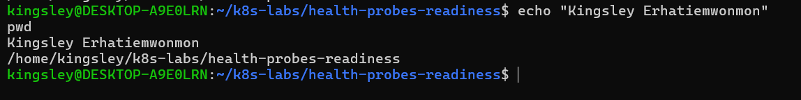
---

### Notes

**1. What is the purpose of a readiness probe?**

The purpose of a readiness probe is to allow Kubernetes to determine whether a container is ready to receive traffic. It prevents traffic from being sent to Pods that are still starting up or are unable to serve requests.

**2. Why is a Pod being Running not always enough to confirm it can serve traffic?**

A Pod being Running only means that its container has started. It does not necessarily mean the application inside is ready to handle requests. The application may still be starting up or experiencing problems. A readiness probe allows Kubernetes to verify that the Pod can successfully serve traffic before marking it Ready.

---

# Task 2 — Create a Baseline Deployment Without Probes

## Goal

Create a baseline NGINX Deployment with two replicas and no readiness probe.

### Evidence

#### Screenshot 2 — Completed `00-nginx-deploy-baseline.yaml` manifest

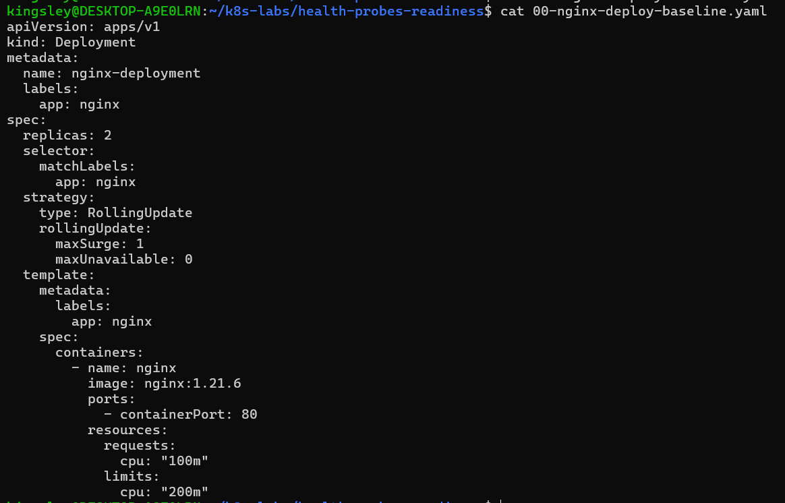

---

#### Screenshot 3 — Output showing a successful rollout and two running NGINX Pods

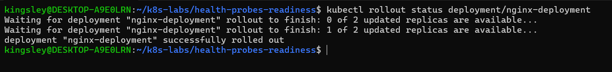

---

#### Screenshot 4 — Relevant output from `kubectl describe deployment nginx-deployment`

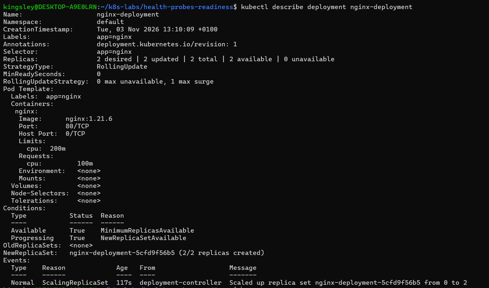

---

### Notes

**1. How many replicas does this Deployment maintain?**

This Deployment maintains 2 replicas (Pods) to ensure that two instances of the NGINX application are running and available.

**2. What does `maxUnavailable: 0` mean during a rolling update?**

`maxUnavailable: 0` means Kubernetes must not allow any of the desired replicas to become unavailable during a rolling update. It keeps the existing healthy Pods running until the replacement Pods pass their readiness probes and become Ready. This helps maintain application availability and prevents service disruption.

**3. Is a readiness probe configured in this baseline Deployment?**

No. The baseline Deployment does not have a readiness probe configured. It only defines the NGINX container and its other deployment settings, without checking whether the Pod is ready to receive traffic.

---

# Task 3 — Add a Readiness Probe

## Goal

Add an HTTP readiness probe so Kubernetes checks whether each NGINX container is ready to accept requests.

### Evidence

#### Screenshot 5 — Completed `01-nginx-deploy-readiness.yaml` manifest showing the readiness probe

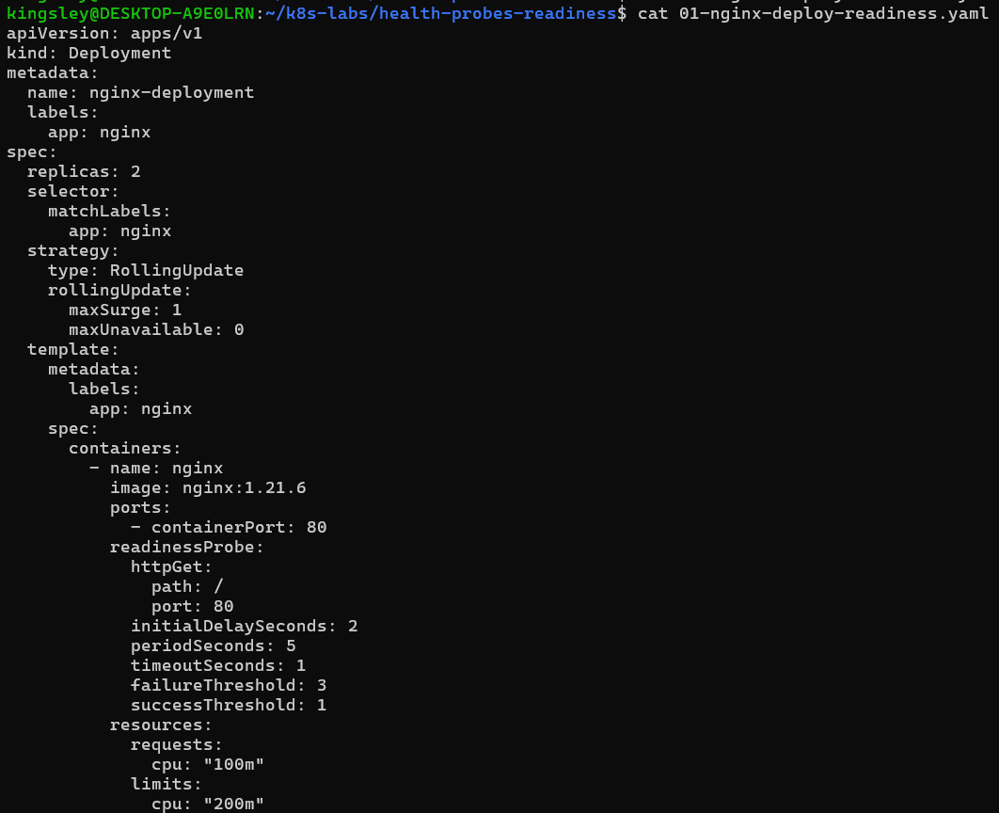

---

#### Screenshot 6 — Output of the successful rollout and ready Pods

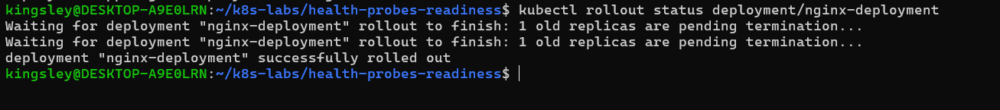

---

#### Screenshot 7 — Pod description showing readiness conditions and readiness probe details

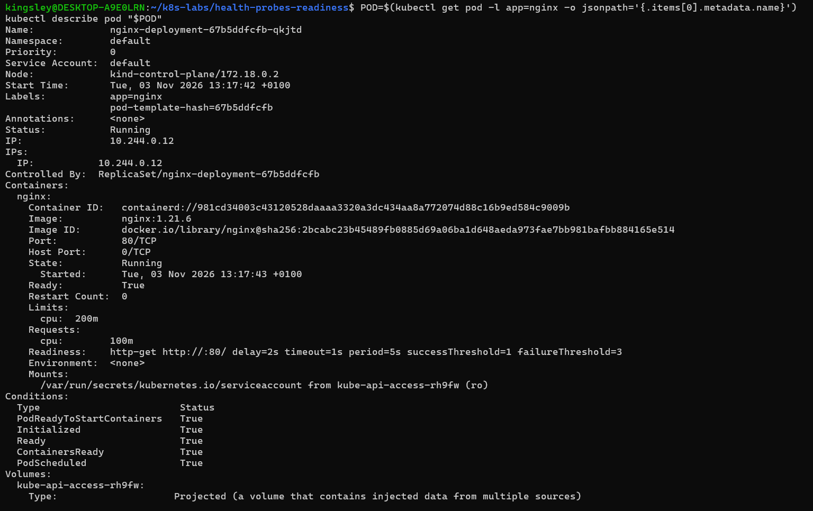

---

### Notes

**1. What path and port does the readiness probe check?**

The readiness probe checks the HTTP path `/` on port `80` of the NGINX container to determine whether the Pod is ready to receive traffic.

**2. What does `initialDelaySeconds: 2` do?**

`initialDelaySeconds: 2` tells Kubernetes to wait 2 seconds after the container starts before performing the first readiness probe. This gives the NGINX container time to start up before Kubernetes checks whether it is ready to receive traffic.

**3. What does `periodSeconds: 5` do?**

`periodSeconds: 5` tells Kubernetes to perform the readiness probe every 5 seconds to check whether the container is ready to receive traffic.

**4. What must happen before Kubernetes considers this Pod ready?**

Kubernetes must successfully receive an HTTP response from the configured endpoint (`/`) on port `80`. Once the readiness probe succeeds, Kubernetes marks the Pod as Ready and allows it to receive traffic.

---

# Task 4 — Break and Restore Readiness

## Goal

Intentionally fail the readiness probe, observe the NotReady behavior, and then restore the working probe configuration.

### Evidence

#### Screenshot 8 — `02-nginx-readiness-broken.yaml` showing `/does-not-exist`

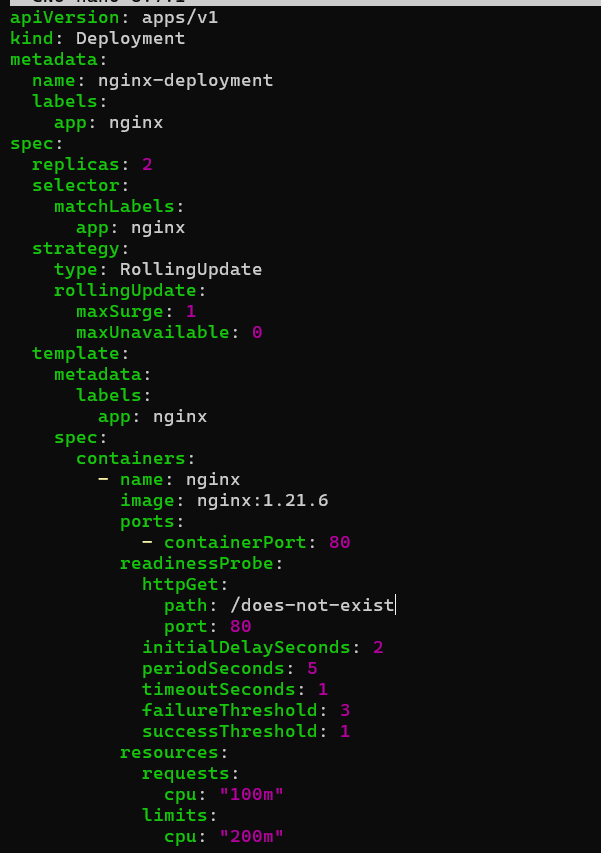

---

#### Screenshot 9 — Output showing the rollout timeout or incomplete rollout

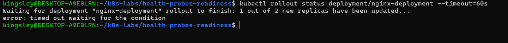

---

#### Screenshot 10 — Pod details showing `Ready: False` or readiness-probe failure events

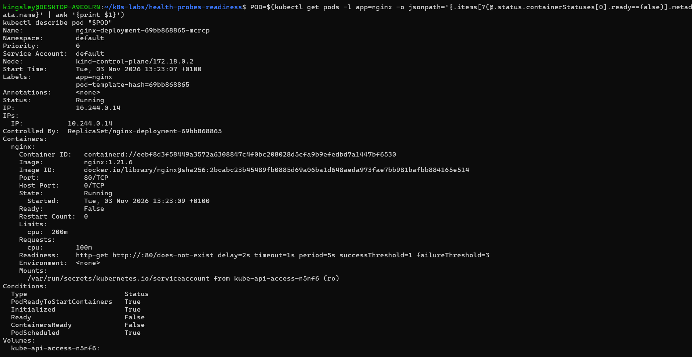

---

#### Screenshot 11 — Output showing successful rollout and ready Pods after the fix

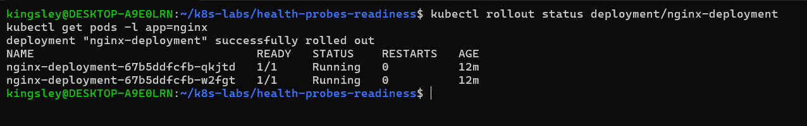

---

### Notes

**1. Why did the readiness probe fail?**

The readiness probe failed because the configured HTTP endpoint was incorrect. It checked /does-not-exist instead of the valid / endpoint, causing the NGINX server to return HTTP 404 (Not Found). As a result, Kubernetes marked the new Pods as NotReady.

**2. What happened to the Pod readiness status?**

The new Pod's readiness status changed to NotReady (0/1) because the readiness probe repeatedly failed with HTTP 404. Although the container remained Running, Kubernetes did not consider it ready to receive traffic.

**3. Why did the rollout fail to complete?**

The rollout failed to complete because the new Pods could not pass their readiness probes. Since they remained NotReady, Kubernetes could not safely terminate the existing healthy Pods and complete the replacement. The maxUnavailable: 0 setting required the existing replicas to remain available until the new Pods became ready.

**4. How did you restore the Deployment successfully?**

I restored the Deployment by reapplying the working configuration using kubectl apply -f 03-nginx-readiness-fixed.yaml. This changed the readiness probe endpoint back to /, allowing the new Pods to pass their readiness checks. I then verified the recovery using kubectl rollout status deployment/nginx-deployment, which confirmed that the rollout completed successfully and both replacement Pods were Running and Ready (1/1).

---

# Task 5 — See How Readiness Protects Rolling Updates

## Goal

Observe how readiness prevents a bad new Pod from replacing healthy Pods during a rolling update.

### Evidence

#### Screenshot 12 — Successful update command and rollout status

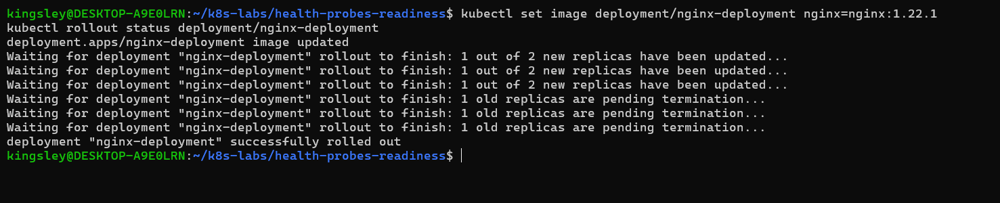

---

#### Screenshot 13 — ReplicaSets and Pods after the successful rolling update

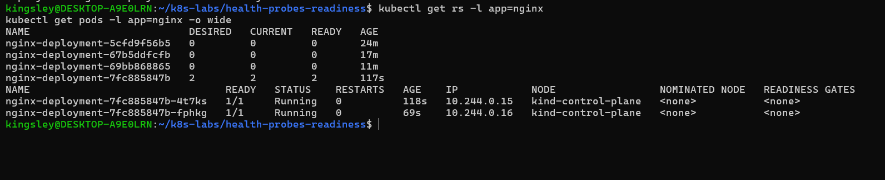

---

#### Screenshot 14 — Completed `04-readiness-broken-patch.yaml`

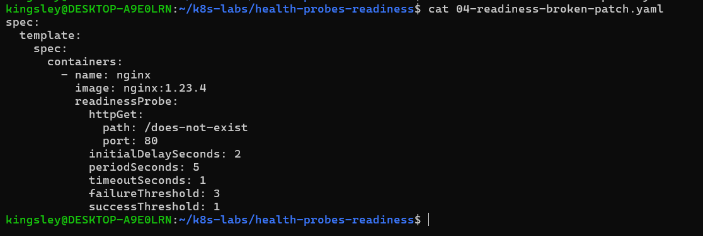

---

#### Screenshot 15 — Output showing the expected stalled rollout or timeout

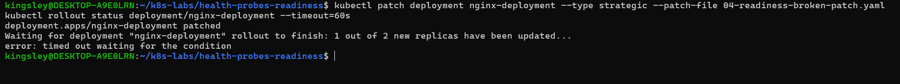

---

#### Screenshot 16 — Deployment or Pod output showing the effect of the broken readiness probe

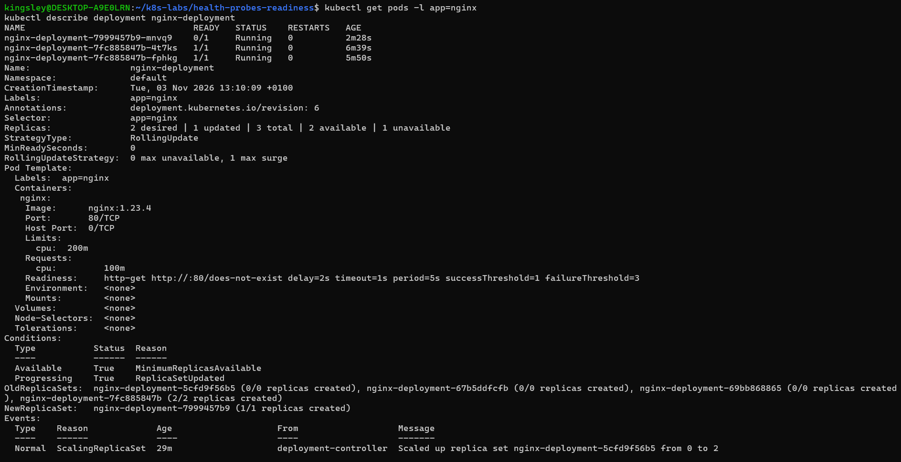

---

#### Screenshot 17 — Successful rollout status after restoring the fixed configuration

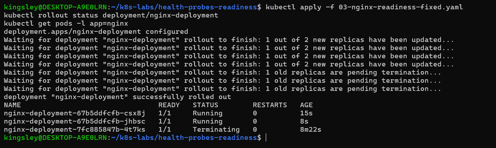

---

### Notes

**1. What happened during the successful rolling update?**

Kubernetes gradually created new Pods using the updated container image. It waited for the new Pods to pass their readiness probes before terminating the old Pods.

**2. Why did Kubernetes create a new ReplicaSet?**

A new ReplicaSet was created because the Deployment's Pod template changed when the container image was updated. Kubernetes uses ReplicaSets to manage the different versions of Pods during rolling updates.

**3. Why were the new Pods unable to replace the existing healthy Pods after readiness was broken?**

The new Pods were unable to replace the existing healthy Pods because their readiness probes were failing. The invalid endpoint (/does-not-exist) returned HTTP 404, leaving the new Pods in a Running but NotReady state. Since the Deployment had maxUnavailable: 0, Kubernetes kept the existing healthy Pods running to maintain the required number of available replicas and prevent service disruption.

**4. How does `maxUnavailable: 0` protect availability during this rollout?**

maxUnavailable: 0 ensures that Kubernetes does not reduce the number of available replicas below the desired count during a rolling update. It keeps the existing healthy Pods running until the new Pods pass their readiness probes and become ready. This prevents service disruption and maintains application availability even when the new Pods fail their readiness checks.

---

# Task 6 — Share Your Readiness-Probe Learning on LinkedIn

## Goal

Share what you learned about Kubernetes readiness probes and how they protect rolling updates.

### Evidence

#### Screenshot 18 — Published LinkedIn post

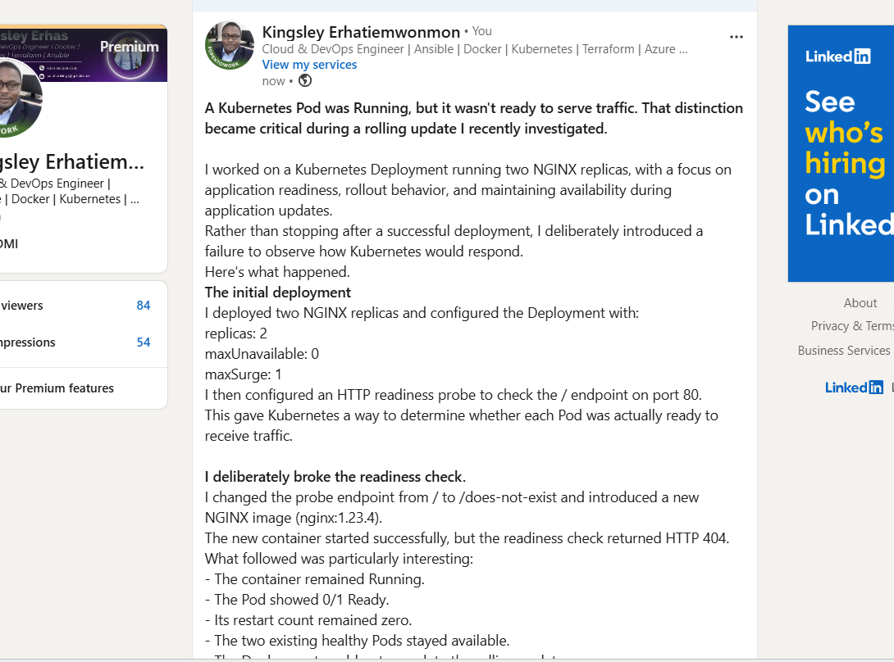

#### Linkedin post link

https://www.linkedin.com/posts/kingsley-erhatiemwonmon_kubernetes-devops-cloudengineering-ugcPost-7523376666904109057-9iC-/?utm_source=share&utm_medium=member_desktop&rcm=ACoAAClDkSEBa4Zo6dTWVIEEl8FJLczvH_zPHtY

---

# Submission Instructions

- Add all required screenshots numbered 1–18.
- Ensure your full name is visible in required screenshots.
- Use clear, readable screenshots showing the relevant manifest or output.
- Include the completed baseline and readiness-probe manifests in your repository.
- Answer all Notes questions for Tasks 1–5 in your own words.
- Include evidence of the intentional readiness failure and successful recovery.
- Do not expose tokens, passwords, kubeconfig files, account IDs, or other sensitive information.

---

# Completion Checklist

- [ ] Learning cluster confirmed and previous assignment resources removed where applicable
- [ ] Readiness-probe lab directory created (Screenshot 1)
- [ ] Baseline Deployment created successfully (Screenshot 2)
- [ ] Two baseline Pods running and successful rollout verified (Screenshot 3)
- [ ] Baseline Deployment details reviewed (Screenshot 4)
- [ ] Readiness probe added successfully (Screenshot 5)
- [ ] Successful readiness rollout verified (Screenshot 6)
- [ ] Pod readiness conditions and probe details inspected (Screenshot 7)
- [ ] Broken readiness configuration created (Screenshot 8)
- [ ] Stalled rollout or timeout observed (Screenshot 9)
- [ ] NotReady status or readiness-probe failure events captured (Screenshot 10)
- [ ] Working readiness configuration restored (Screenshot 11)
- [ ] Successful image update completed (Screenshot 12)
- [ ] ReplicaSets and Pods inspected after the update (Screenshot 13)
- [ ] Broken-readiness patch created (Screenshot 14)
- [ ] Stalled rollout observed after the patch (Screenshot 15)
- [ ] Effect of broken readiness captured (Screenshot 16)
- [ ] Final recovery completed (Screenshot 17)
- [ ] LinkedIn post published (Screenshot 18)
- [ ] Notes for Tasks 1–5 completed
- [ ] Required manifests included
- [ ] All screenshots are clear and readable
- [ ] No sensitive data exposed

---

## 📌 About DMI & CloudAdvisory

DevOps Micro Internship (DMI) is a project-based DevOps program run by Pravin Mishra (The CloudAdvisory) focused on real-world execution, systems thinking, and career readiness.

It helps learners build strong DevOps foundations with hands-on experience.

---

## 📌 Resources

- 🌐 DMI Official Website: https://dmi.pravinmishra.com?utm_source=github&utm_medium=readme  
- 🎓 University: https://university.pravinmishra.com?utm_source=github&utm_medium=readme  
- 💬 Discord Community: https://discord.pravinmishra.com?utm_source=github&utm_medium=readme  
- 📝 Blog: https://dmi.pravinmishra.com/blog?utm_source=github&utm_medium=readme  
- ▶️ YouTube Playlist: https://www.youtube.com/playlist?list=PLFeSNDtI4Cho  
- 🔗 Pravin Mishra (LinkedIn): https://www.linkedin.com/in/pravin-mishra-aws-trainer/  
- 🏢 CloudAdvisory (LinkedIn): https://www.linkedin.com/company/thecloudadvisory/

---

*This submission is part of DevOps Micro Internship (DMI) — Agentic AI Track.*
