# Assignment 6 — Kubernetes Health Probes (Liveness)

Part of the DevOps Micro Internship (DMI) with Agentic AI

---

## Purpose

In this assignment, you will configure and test a Kubernetes liveness probe. You will create a baseline NGINX Deployment, add an HTTP liveness probe, intentionally make it fail, observe container restarts, and restore the working configuration.

---

# Task 0 — Prepare the Lab Environment

## Goal

Confirm that you are connected to your learning cluster and remove the previous HPA and NGINX Deployment before starting this lab.

No screenshot or written notes are required for this pre-check.

---

# Task 1 — Set Up Your Lab Directory

## Goal

Create and enter a dedicated directory for the liveness-probe lab.

### Evidence

#### Screenshot 1 — Terminal showing that you are working inside `~/k8s-labs/health-probes-liveness`

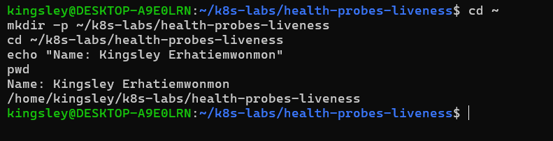

---

### Notes

**1. What problem does a liveness probe solve?**

A liveness probe detects when a container becomes unhealthy or stops functioning correctly. When Kubernetes detects repeated liveness probe failures, it automatically restarts the container to restore normal operation without requiring manual intervention.

**2. What is the key difference between a readiness probe and a liveness probe?**

A readiness probe determines whether a Pod is ready to receive application traffic, while a liveness probe determines whether a container is still functioning properly and needs to be restarted. A failed readiness probe removes the Pod from service traffic without restarting it, whereas repeated liveness probe failures cause Kubernetes to restart the container.

---

# Task 2 — Create a Baseline Deployment Without Probes

## Goal

Create a baseline NGINX Deployment with two replicas and no health probes.

### Evidence

#### Screenshot 2 — Completed `00-nginx-deploy-baseline.yaml` manifest

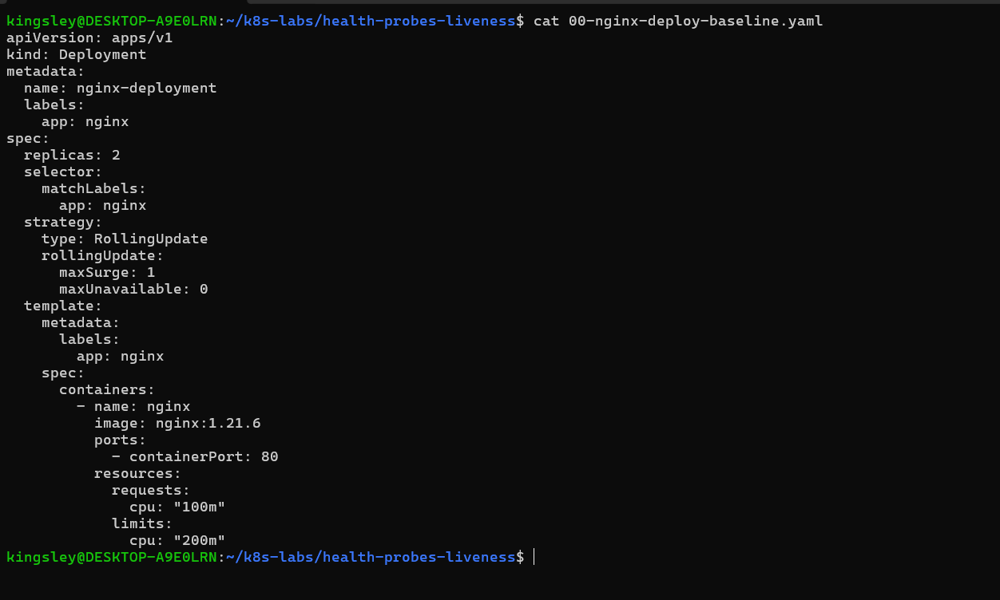

---

#### Screenshot 3 — Output showing a successful rollout and two running NGINX Pods

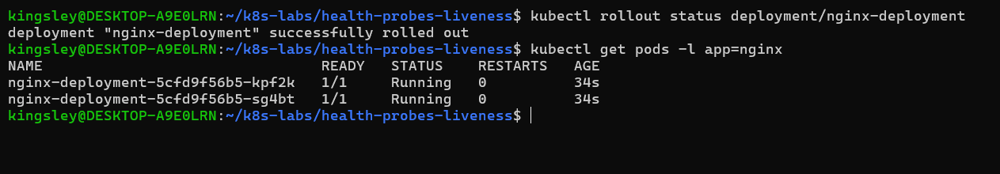

---

#### Screenshot 4 — Relevant output from `kubectl describe deployment nginx-deployment`

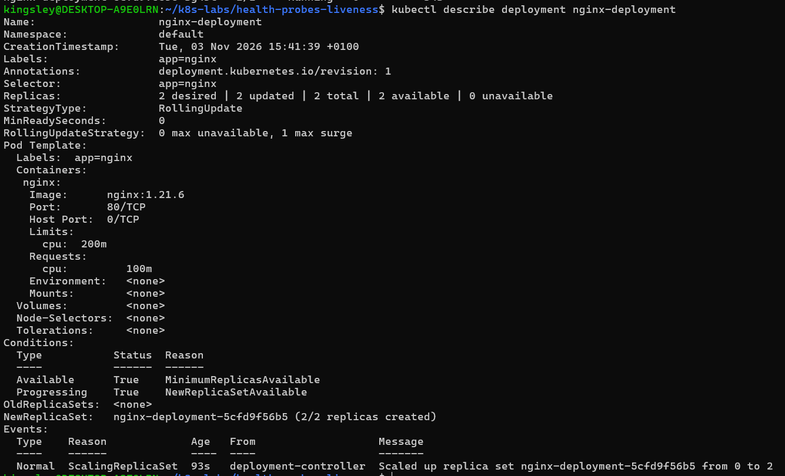

---

### Notes

**1. How many replicas does this Deployment maintain?**

The Deployment maintains 2 replicas of the NGINX application, as specified by replicas: 2 in the Deployment manifest.

**2. Are any health probes configured in the baseline Deployment?**

No. The baseline Deployment does not have any liveness or readiness probes configured.

**3. Why is a baseline useful before adding a liveness probe?**

A baseline provides a reference point for observing how the Deployment behaves without health probes. It allows us to compare the application's behaviour before and after introducing a liveness probe and understand the impact of automatic container restarts.

---

# Task 3 — Add a Liveness Probe

## Goal

Add an HTTP liveness probe so Kubernetes can periodically check whether the NGINX container is still responsive.

### Evidence

#### Screenshot 5 — Completed `01-nginx-deploy-liveness.yaml` manifest showing the liveness probe

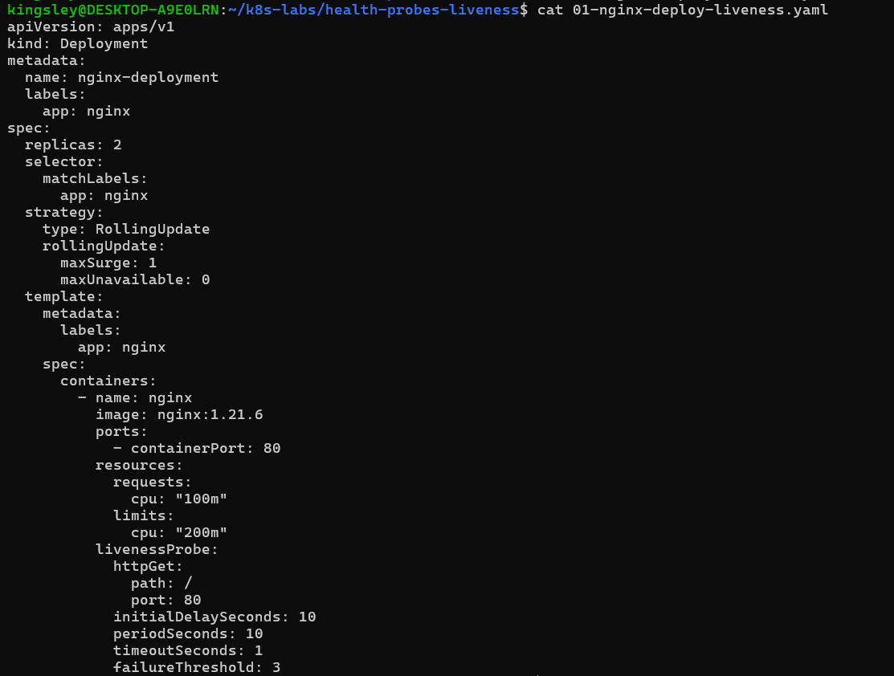

---

#### Screenshot 6 — Output showing successful rollout and running Pods

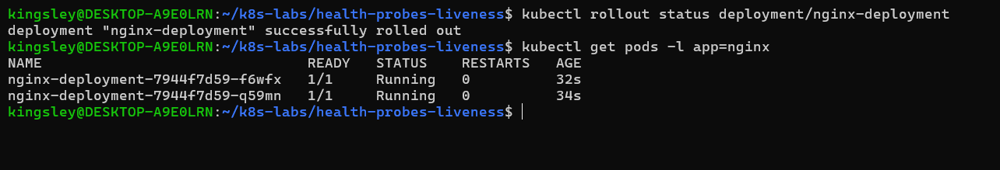

---

#### Screenshot 7 — Pod description showing liveness-probe details

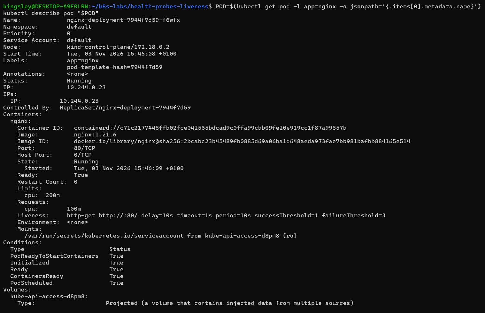

---

### Notes

**1. What path and port does the liveness probe check?**

The liveness probe sends an HTTP GET request to the root path (/) on port 80 to verify that the NGINX container is functioning correctly.

**2. What does `initialDelaySeconds: 10` do?**

It instructs Kubernetes to wait 10 seconds after the container starts before performing the first liveness probe. This gives the application time to initialize.

**3. What does `failureThreshold: 3` mean?**

It means Kubernetes allows three consecutive liveness probe failures before considering the container unhealthy and restarting it.

**4. Does a successful liveness probe control whether a Pod receives traffic? Explain briefly.**

No. A liveness probe does not control whether a Pod receives traffic. Its purpose is to determine whether a container needs restarting. A readiness probe controls whether a Pod is considered ready to receive application traffic.

---

# Task 4 — Trigger and Observe a Liveness Restart

## Goal

Intentionally make the liveness probe fail and observe Kubernetes restart the unhealthy container.

### Evidence

#### Screenshot 8 — `02-nginx-liveness-broken.yaml` showing `/does-not-exist`

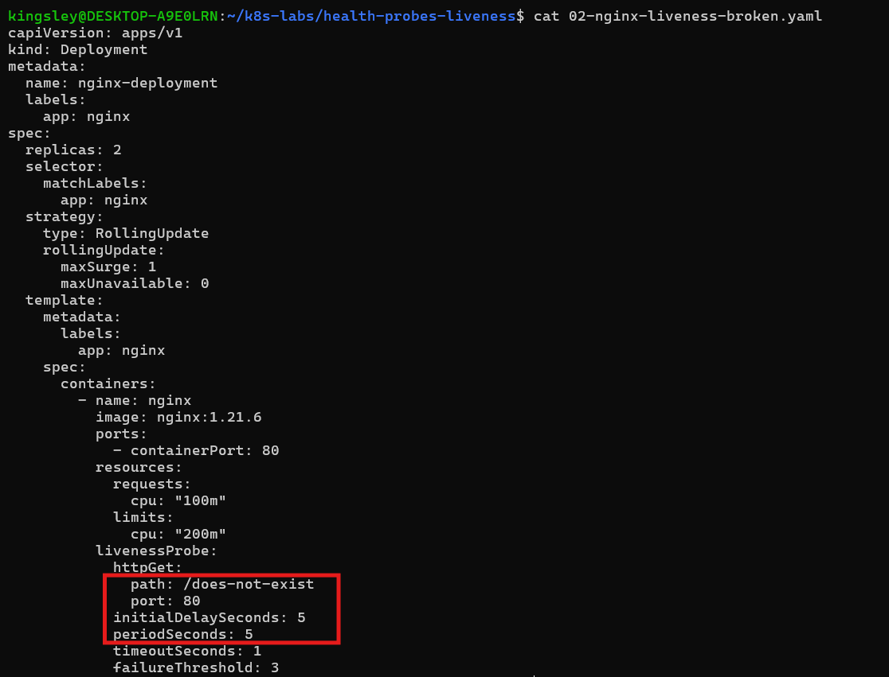

---

#### Screenshot 9 — Pod output showing an increased RESTARTS count

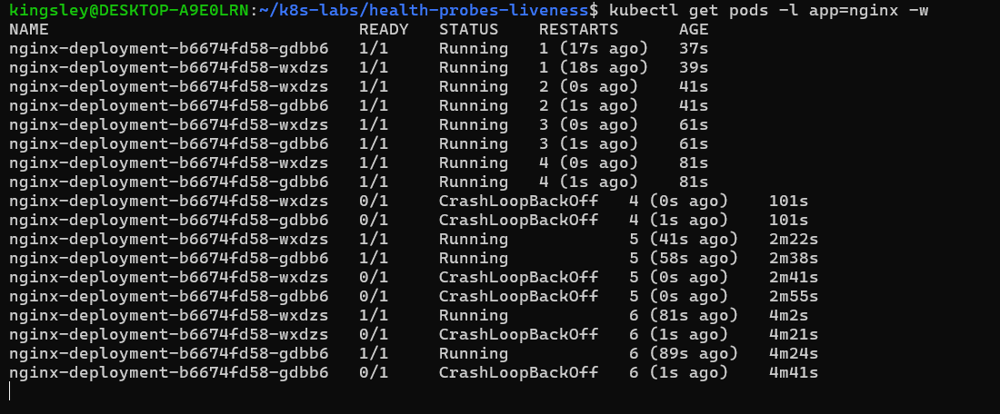

---

#### Screenshot 10 — Pod description showing liveness-probe failure events or restart details

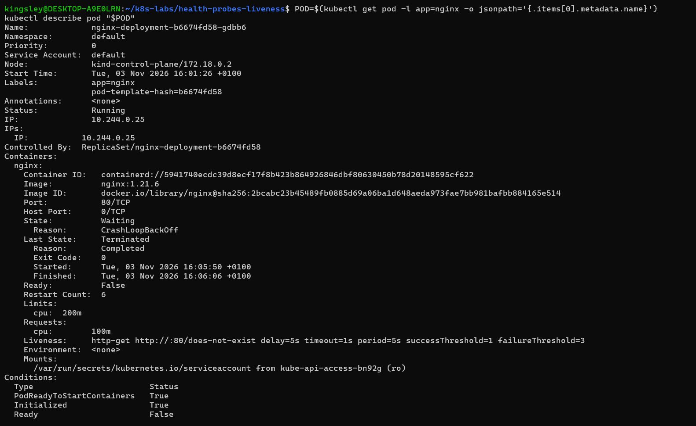

---

#### Screenshot 11 — Output showing stable running Pods after applying the fixed configuration

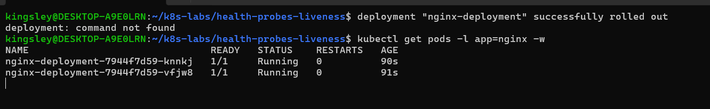

---

### Notes

**1. Why did the liveness probe fail?**

The liveness probe failed because its HTTP GET request targeted /does-not-exist, a path that NGINX does not serve. The server returned HTTP 404 (Not Found), causing the health checks to fail repeatedly.

**2. What happened after Kubernetes detected repeated liveness-probe failures?**

After three consecutive failures, Kubernetes automatically restarted the affected NGINX containers. Repeated failures caused both Pods to experience multiple restarts and eventually enter CrashLoopBackOff.

**3. What does the RESTARTS column prove?**

The RESTARTS column shows how many times a container has been restarted within a particular Pod. The increase from 0 to 6 demonstrated that Kubernetes was automatically restarting the containers after liveness probe failures.

**4. How did you restore the Deployment to a stable state?**

I restored the original working liveness probe configuration by changing the health-check path back to /, saved it as 03-nginx-liveness-fixed.yaml, and reapplied it. Kubernetes successfully rolled out the updated Deployment, replacing the unhealthy Pods with two healthy Pods showing 1/1 Running and 0 restarts.

---

# Task 5 — Optional: Observe a Restart Loop

## Goal

Observe why overly aggressive or incorrectly configured liveness probes can create restart loops.

Complete this section only if you attempt Task 5. Otherwise, mark it as “Not attempted.”

**Task status:** Completed / Not attempted

### Evidence

#### Optional Screenshot — Pod output showing the RESTARTS count increasing during the restart-loop observation

Not attempted

No specific restart count or CrashLoopBackOff status is required.

---

### Notes — Answer Only If Attempted

**1. What is a restart loop?**

Not attempted

**2. Why can an aggressive liveness probe be harmful?**

Not attempted

**3. Why should liveness checks be lightweight and carefully tuned?**

Not attempted

---

# Task 6 — Share Your Liveness-Probe Learning on LinkedIn

## Goal

Share what you learned about Kubernetes liveness probes, container restarts, and the difference between readiness and liveness.

### Evidence

#### Screenshot 12 — Published LinkedIn post

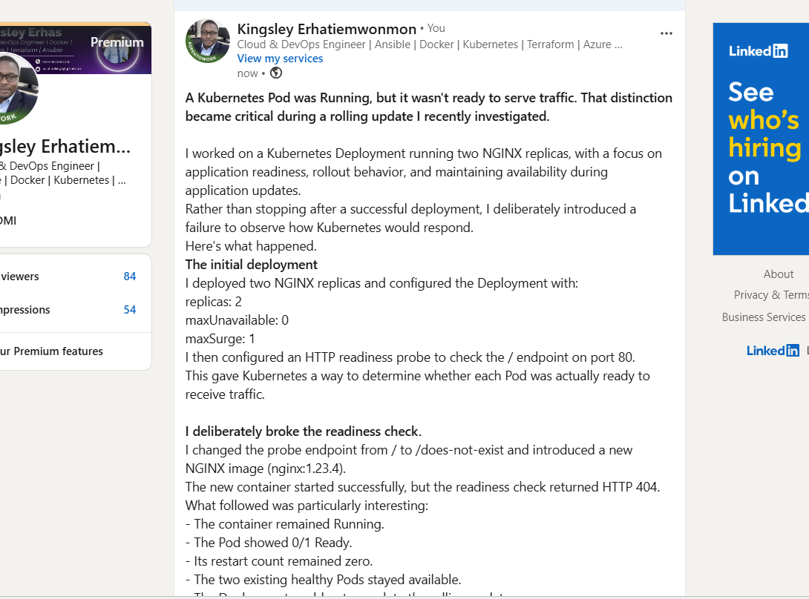

#### Linkedin post URL

https://www.linkedin.com/posts/kingsley-erhatiemwonmon_kubernetes-devops-cloudengineering-ugcPost-7523376666904109057-9iC-/?utm_source=share&utm_medium=member_desktop&rcm=ACoAAClDkSEBa4Zo6dTWVIEEl8FJLczvH_zPHtY

---

# Submission Instructions

- Add all required screenshots numbered 1–12.
- Include the optional Task 5 screenshot only if you attempt that task.
- Ensure your full name is visible in required screenshots.
- Use clear, readable screenshots showing the relevant manifest or output.
- Include the completed baseline and liveness-probe manifests in your repository.
- Answer all Notes questions for Tasks 1–4 in your own words.
- If you attempt Task 5, complete its Notes and restore the working configuration afterward.
- Do not expose tokens, passwords, kubeconfig files, account IDs, or other sensitive information.

---

# Completion Checklist

- [ ] Learning cluster confirmed and previous assignment resources removed where applicable
- [ ] Liveness-probe lab directory created (Screenshot 1)
- [ ] Baseline Deployment manifest completed (Screenshot 2)
- [ ] Successful rollout and two baseline Pods verified (Screenshot 3)
- [ ] Baseline Deployment details reviewed (Screenshot 4)
- [ ] Liveness probe added successfully (Screenshot 5)
- [ ] Successful liveness-probe rollout verified (Screenshot 6)
- [ ] Liveness-probe details inspected (Screenshot 7)
- [ ] Broken liveness configuration created (Screenshot 8)
- [ ] Increased container restart count observed (Screenshot 9)
- [ ] Liveness-probe failure events or restart details captured (Screenshot 10)
- [ ] Working liveness configuration restored and stable Pods verified (Screenshot 11)
- [ ] Optional Task 5 evidence and Notes completed, if attempted
- [ ] Working configuration restored after Task 5, if attempted
- [ ] LinkedIn post published (Screenshot 12)
- [ ] Notes for Tasks 1–4 completed
- [ ] Required manifests included
- [ ] All required screenshots are clear and readable
- [ ] No sensitive data exposed

---

## 📌 About DMI & CloudAdvisory

DevOps Micro Internship (DMI) is a project-based DevOps program run by Pravin Mishra (The CloudAdvisory) focused on real-world execution, systems thinking, and career readiness.

It helps learners build strong DevOps foundations with hands-on experience.

---

## 📌 Resources

- 🌐 DMI Official Website: https://dmi.pravinmishra.com?utm_source=github&utm_medium=readme  
- 🎓 University: https://university.pravinmishra.com?utm_source=github&utm_medium=readme  
- 💬 Discord Community: https://discord.pravinmishra.com?utm_source=github&utm_medium=readme  
- 📝 Blog: https://dmi.pravinmishra.com/blog?utm_source=github&utm_medium=readme  
- ▶️ YouTube Playlist: https://www.youtube.com/playlist?list=PLFeSNDtI4Cho  
- 🔗 Pravin Mishra (LinkedIn): https://www.linkedin.com/in/pravin-mishra-aws-trainer/  
- 🏢 CloudAdvisory (LinkedIn): https://www.linkedin.com/company/thecloudadvisory/

---

*This submission is part of DevOps Micro Internship (DMI) — Agentic AI Track.*
