# Assignment 8 — Kubernetes Services (NodePort)

Part of the DevOps Micro Internship (DMI) with Agentic AI

---

## Purpose

Create a healthy NGINX Deployment, expose it through a NodePort Service, test access using a node IP and NodePort, and observe how the Service behaves when a backend Pod is replaced.

---

# Task 1 — Set Up Your Lab Directory

## Goal

Create and enter a dedicated directory for the NodePort Service lab.

### Evidence

#### Screenshot 1 — Terminal showing that you are working inside `~/k8s-labs/services/nodeport`

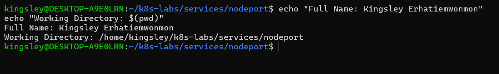

### Notes

**1. What is the difference between ClusterIP and NodePort?**

ClusterIP exposes a Service internally within the Kubernetes cluster, while NodePort exposes it through a port on each cluster node.

**2. What does a NodePort Service allow users to do?**

It allows users to access an application from outside the cluster using a node IP address and an assigned port.

---

# Task 2 — Create a Healthy NGINX Deployment

## Goal

Create a healthy NGINX Deployment that can act as the backend for the NodePort Service.

### Evidence

#### Screenshot 2 — Completed `00-nginx-deploy.yaml` manifest

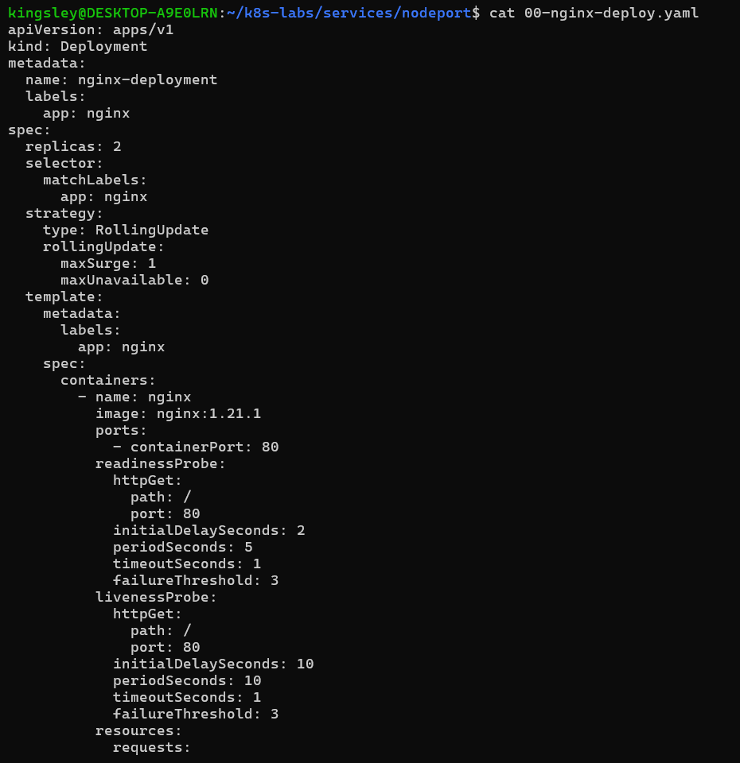

---

#### Screenshot 3 — Output showing successful rollout and two ready NGINX Pods

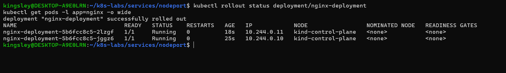

### Notes

**1. Which label will the NodePort Service use to find the NGINX Pods?**

The Service uses the label app: nginx to identify and select the NGINX Pods.

**2. Why must the Pods be ready before they can receive Service traffic?**

Pods must be ready to ensure their containers are healthy and able to handle incoming requests. Kubernetes adds ready Pods to the Service endpoints so that traffic is routed to available application instances.

**3. What port does the NGINX container listen on?**

The NGINX container listens on port 80 (TCP).

---

# Task 3 — Create the NodePort Service

## Goal

Create a NodePort Service that exposes the NGINX application through a port on every cluster node.

### Evidence

#### Screenshot 4 — Completed `01-nginx-svc-nodeport.yaml` manifest

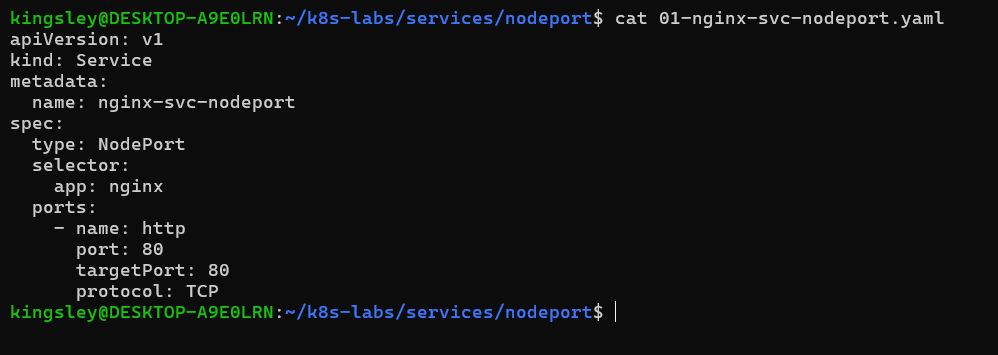

---

#### Screenshot 5 — Output showing the NodePort Service and its endpoints or EndpointSlices

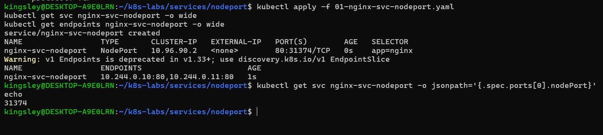

### Notes

**1. What is the purpose of `type: NodePort`?**

It exposes a Kubernetes Service through a port on each cluster node, allowing access using a node IP and the assigned NodePort.

**2. What is the difference between `port`, `targetPort`, and `nodePort`?**

- port: Port exposed by the Service.
- targetPort: Port on the backend container.
- nodePort: Port exposed on the Kubernetes nodes.

**3. What NodePort was assigned or selected in your environment?**

31374

**4. Why do Service endpoints need ready Pods?**

Ready Pods are healthy and available to receive traffic. Kubernetes uses their IP addresses as Service endpoints.

---

# Task 4 — Find a Node IP and Test the NodePort

## Goal

Find a reachable node IP and access the NodePort Service.

### Evidence

#### Screenshot 6 — Output of `kubectl get nodes -o wide`

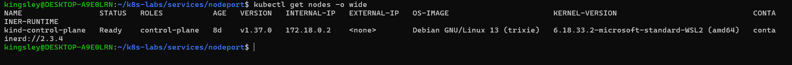

---

#### Screenshot 7 — Output showing the `tester` Pod running

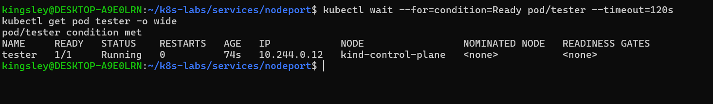

---

#### Screenshot 8 — Successful NodePort response from the laptop or the `tester` Pod

If neither route is supported by your environment, include the failed request output and ready endpoint evidence, and explain the limitation in your Notes.

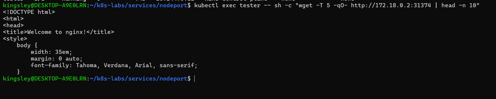

### Notes

**1. Which node IP and NodePort did you test?**

Node IP: 172.18.0.2; NodePort: 31374.

**2. Was your laptop able to reach the NodePort directly? Explain your result.**

No. The request timed out because the kind cluster's internal Docker network was not directly reachable from the laptop. However, access from the tester Pod inside the cluster was successful.

**3. Why can external NodePort access behave differently in Minikube, kind, Docker Desktop, and cloud clusters?**

Because networking configurations differ. Minikube, kind, Docker Desktop and cloud clusters use different networking, routing, NAT and firewall configurations.

---

# Task 5 — Optional: Test the Label-Selector Contract

## Goal

Break the Service selector, observe that usable endpoints disappear, and restore the correct selector.

Complete the Evidence and Notes below only if you attempted this optional task.

### Evidence

#### Screenshot 9 — `02-nginx-svc-selector-broken.yaml` showing the incorrect selector

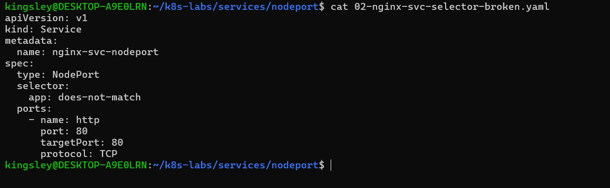

---

#### Screenshot 10 — Empty endpoints or EndpointSlice output after applying the broken selector

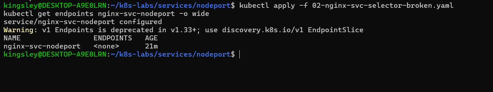

---

#### Screenshot 11 — Restored endpoints or EndpointSlices after applying the original Service manifest

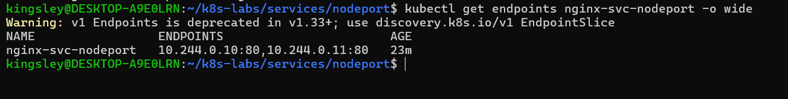

### Notes

**1. Why did the Service endpoints become empty?**

The Service selector was changed to app: does-not-match, which did not match the NGINX Pods labelled app: nginx.

**2. Why is NodePort only useful when matching ready Pods exist?**

Because the Service needs healthy matching backend Pods to forward incoming traffic to. Without ready endpoints, there is no available backend to serve requests.

**3. How did you restore the backend connectivity?**

I reapplied the original Service manifest, restoring the selector to app: nginx. Kubernetes then rediscovered the matching ready NGINX Pods and repopulated the Service endpoints.

---

# Task 6 — Observe Resilience During Pod Churn

## Goal

Delete one NGINX Pod and observe its replacement while the Service continues routing traffic to available Pods.

### Evidence

#### Screenshot 12 — Output of the Pod deletion command

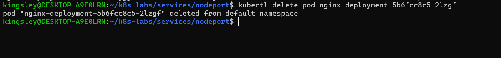

---

#### Screenshot 13 — Output showing the replacement Pod and two running, ready Pods

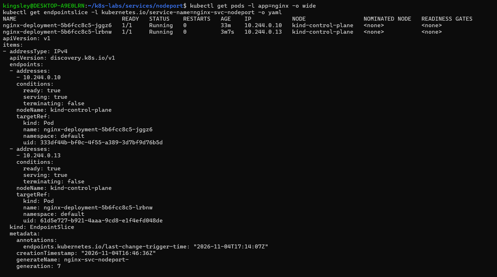

### Notes

**1. What happened after you deleted one Pod?**

Kubernetes automatically created a replacement Pod to maintain the Deployment's desired replica count of two. The remaining Pod continued running while the replacement was created.

**2. Which Kubernetes resource created the replacement Pod?**

The ReplicaSet controller, managed by the Deployment, created the replacement Pod to maintain the desired replica count.

**3. Why can the NodePort Service continue working during Pod churn?**

The Service continued using its available ready endpoint while Kubernetes replaced the deleted Pod. Once the replacement became ready, its IP address was added to the EndpointSlice, restoring two healthy endpoints.

---

# Task 7 — Share Your NodePort Learning on LinkedIn

## Goal

Share what you learned about NodePort Services, backend Pods, and network access in your Kubernetes environment.

### Evidence

#### Screenshot 14 — Published LinkedIn post about your NodePort Service lab

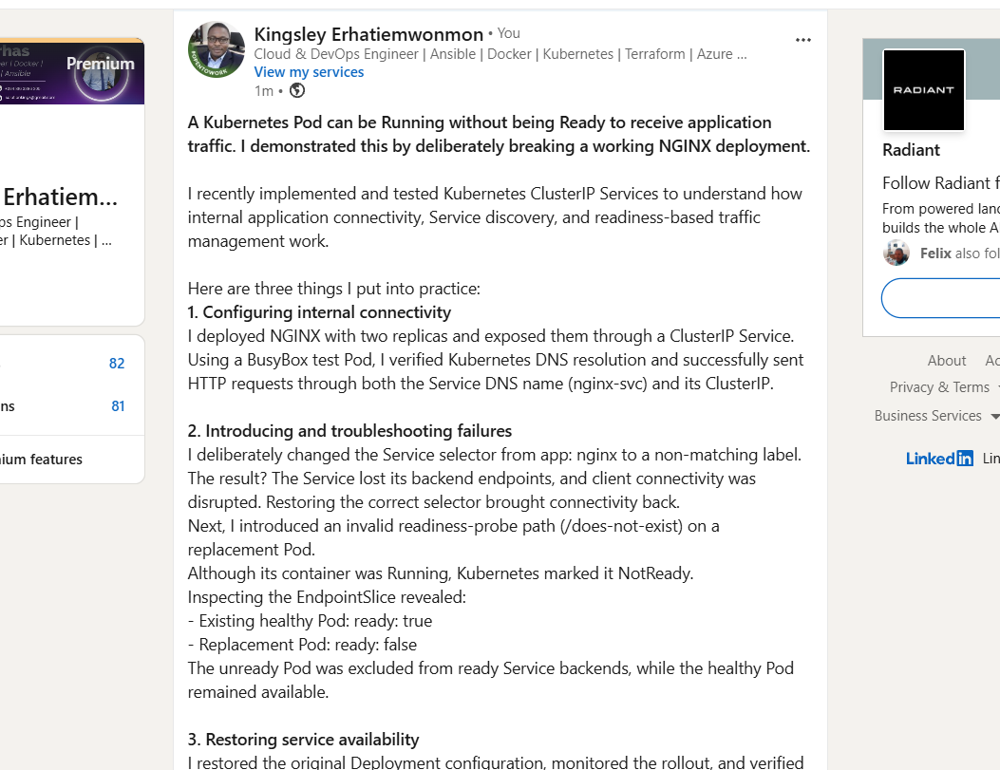

#### Linkedin post link

https://www.linkedin.com/posts/kingsley-erhatiemwonmon_kubernetes-devops-cloudengineering-ugcPost-7523776950209974272-FE3C/?utm_source=share&utm_medium=member_desktop&rcm=ACoAAClDkSEBa4Zo6dTWVIEEl8FJLczvH_zPHtY

---

# Submission Instructions

- Include the completed YAML manifests created during the lab.
- Add all required screenshots: Screenshots 1–8 and 12–14.
- Include Screenshots 9–11 only if you attempted optional Task 5.
- Complete the Notes for Tasks 1–4 and Task 6.
- Complete Task 5 Notes only if you attempted that task.
- Use clear, readable screenshots showing the relevant commands and outputs.
- Ensure your full name is visible in the required screenshots.
- If NodePort access is restricted by your environment, include the failed request output, ready endpoint evidence, and an explanation.
- Do not expose passwords, access tokens, private keys, kubeconfig contents, or account IDs.

---

# Completion Checklist

- [ ] Created and entered `~/k8s-labs/services/nodeport` (Screenshot 1)
- [ ] Created and applied the NGINX Deployment manifest (Screenshot 2)
- [ ] Confirmed successful rollout and two ready NGINX Pods (Screenshot 3)
- [ ] Created the NodePort Service manifest (Screenshot 4)
- [ ] Verified the Service and its endpoints or EndpointSlices (Screenshot 5)
- [ ] Recorded the assigned or selected NodePort
- [ ] Identified a node IP (Screenshot 6)
- [ ] Confirmed that the `tester` Pod is running (Screenshot 7)
- [ ] Tested NodePort access, or documented the environment limitation with evidence (Screenshot 8)
- [ ] Optional: Tested and restored the Service selector (Screenshots 9–11)
- [ ] Deleted one NGINX Pod (Screenshot 12)
- [ ] Confirmed the replacement Pod and two running, ready Pods (Screenshot 13)
- [ ] Completed all required Notes
- [ ] Published the LinkedIn post (Screenshot 14)
- [ ] No sensitive data exposed

---

## 📌 About DMI & CloudAdvisory

DevOps Micro Internship (DMI) is a project-based DevOps program run by Pravin Mishra (The CloudAdvisory) focused on real-world execution, systems thinking, and career readiness.

It helps learners build strong DevOps foundations with hands-on experience.

---

## 📌 Resources

- 🌐 DMI Official Website: https://dmi.pravinmishra.com?utm_source=github&utm_medium=readme  
- 🎓 University: https://university.pravinmishra.com?utm_source=github&utm_medium=readme  
- 💬 Discord Community: https://discord.pravinmishra.com?utm_source=github&utm_medium=readme  
- 📝 Blog: https://dmi.pravinmishra.com/blog?utm_source=github&utm_medium=readme  
- ▶️ YouTube Playlist: https://www.youtube.com/playlist?list=PLFeSNDtI4Cho  
- 🔗 Pravin Mishra (LinkedIn): https://www.linkedin.com/in/pravin-mishra-aws-trainer/  
- 🏢 CloudAdvisory (LinkedIn): https://www.linkedin.com/company/thecloudadvisory/

---

*This submission is part of DevOps Micro Internship (DMI) — Agentic AI Track.*
