# Assignment 09 — Kubernetes Services: LoadBalancer on AKS

Part of the DevOps Micro Internship (DMI) with Agentic AI

---

## Purpose

Deploy a healthy NGINX application to Azure Kubernetes Service (AKS), expose it publicly using a LoadBalancer Service, observe readiness behavior, and scale the application behind the same public endpoint.

---

# Task 1 — Create or Connect to an AKS Cluster

## Goal

Create a small AKS cluster for this lab, or connect to an existing approved AKS lab cluster.

### Evidence

#### Screenshot 1 — Output of `kubectl get nodes` showing ready AKS node(s)

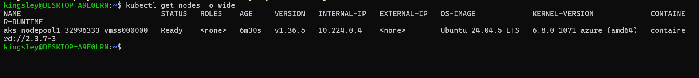

### Notes

**1. Why does this lab use a cloud-capable Kubernetes environment such as AKS for the LoadBalancer Service?**

This lab uses AKS because a LoadBalancer Service requires cloud infrastructure to provision an external load balancer and assign a public IP address. Unlike a local Kubernetes cluster, AKS integrates with Azure to provide external access to applications running inside the cluster.

**2. What Azure resources can Kubernetes provision when a LoadBalancer Service is created?**

Kubernetes can provision an Azure Load Balancer and a public IP address. Azure may also create or configure associated networking resources, such as load-balancing rules, health probes, and backend pool configurations, to route external traffic to the application Pods.

**3. Why is it important to delete unused AKS resources after the lab?**

It is important to delete unused AKS resources to avoid unnecessary Azure charges, prevent resource waste, reduce security exposure, and keep the Azure environment clean. Resources such as AKS clusters, load balancers, and public IP addresses may continue to incur costs even after the lab is completed.

---

# Task 2 — Set Up Your Lab Directory

## Goal

Create and enter a dedicated directory for the LoadBalancer Service manifests.

### Evidence

#### Screenshot 2 — Terminal showing the output of `pwd` confirming that you are working inside `~/k8s-labs/services/loadbalancer`

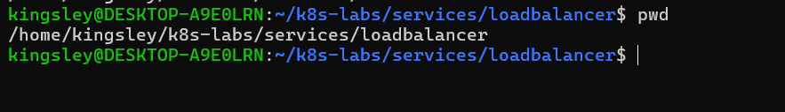

### Notes

**1. Why is it useful to keep Kubernetes manifests organized in dedicated directories?**

It helps keep Kubernetes configuration files structured, easy to locate, maintain, and reuse. It also makes it easier to manage different Kubernetes resources, troubleshoot issues, and avoid mixing files from different projects or assignments.

**2. What are the names of the main Deployment and LoadBalancer Service YAML files you will create in this assignment?**

- Deployment manifest: deployment.yaml
- LoadBalancer Service manifest: service.yaml

---

# Task 3 — Deploy a Healthy NGINX Application

## Goal

Create a healthy NGINX Deployment with readiness and liveness probes.

### Evidence

#### Screenshot 3 — Completed `00-nginx-deploy.yaml` manifest

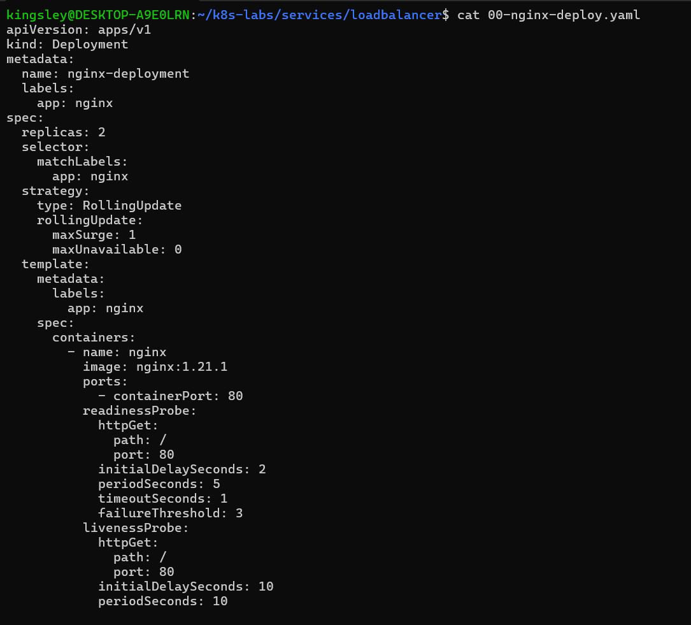

---

#### Screenshot 4 — Output showing successful rollout and two ready NGINX Pods

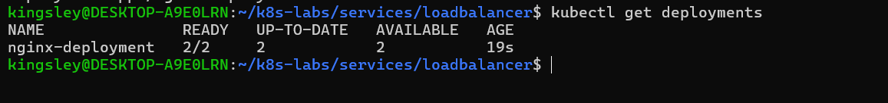

### Notes

**1. Why must Pods be ready before they should receive public traffic?**

Pods must be ready before receiving public traffic to ensure the application is running properly and can handle incoming requests. Sending traffic to unready Pods can result in failed requests, connection errors, and poor user experience.

**2. What is the role of the readiness probe in this Deployment?**

The readiness probe checks whether a Pod is ready to accept traffic. If the check fails, Kubernetes temporarily removes the Pod from the Service's available endpoints until it becomes ready again.

**3. What is the role of the liveness probe in this Deployment?**

The liveness probe checks whether the application inside a container is still functioning. If repeated checks fail, Kubernetes restarts the container to recover it from an unhealthy state.

---

# Task 4 — Create and Test the LoadBalancer Service

## Goal

Create a public LoadBalancer Service and verify that the NGINX application is reachable from the internet.

### Evidence

#### Screenshot 5 — Completed `01-nginx-svc-loadbalancer.yaml` manifest

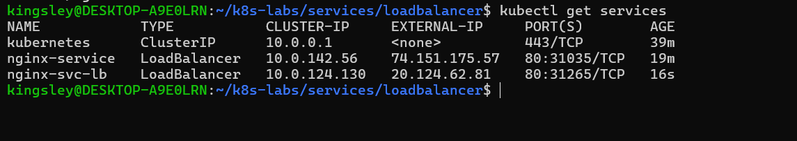

---

#### Screenshot 6 — Output showing the Service with an assigned EXTERNAL-IP

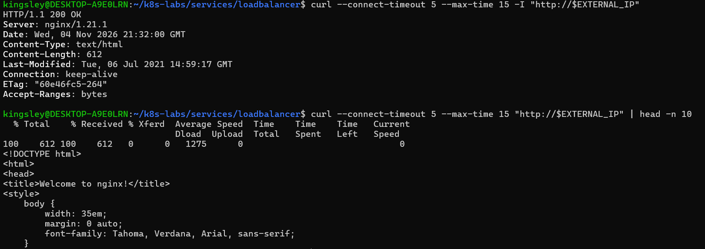

---

#### Screenshot 7 — Successful curl output from the public IP

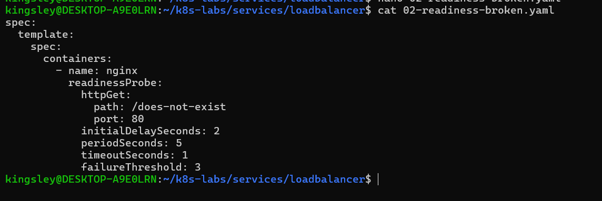

### Notes

**1. What does `type: LoadBalancer` instruct AKS to do?**

It instructs AKS to provision an Azure Load Balancer and assign a public IP address to the Kubernetes Service, allowing users outside the cluster to access the application.

**2. What public IP was assigned to your Service?**

The public IP assigned to my nginx-svc-lb Service was 20.124.62.81.

**3. How does the public request eventually reach the NGINX Pods?**

An external request reaches the Azure Load Balancer through its public IP address. The load balancer forwards the traffic to the Kubernetes Service, which uses its selectors and endpoints to route requests to healthy, ready NGINX Pods.

**4. Why should you wait for EXTERNAL-IP before testing the Service?**

The EXTERNAL-IP confirms that Azure has provisioned and assigned a public IP address to the LoadBalancer Service. Testing before this happens may fail because the external load-balancing infrastructure is not yet ready.

---

# Task 5 — Observe How Readiness Protects Public Traffic

## Goal

Intentionally break readiness and observe how Kubernetes excludes unready Pods from ready Service backends while existing healthy Pods continue serving public traffic.

### Evidence

#### Screenshot 8 — Completed `02-readiness-broken.yaml` patch file

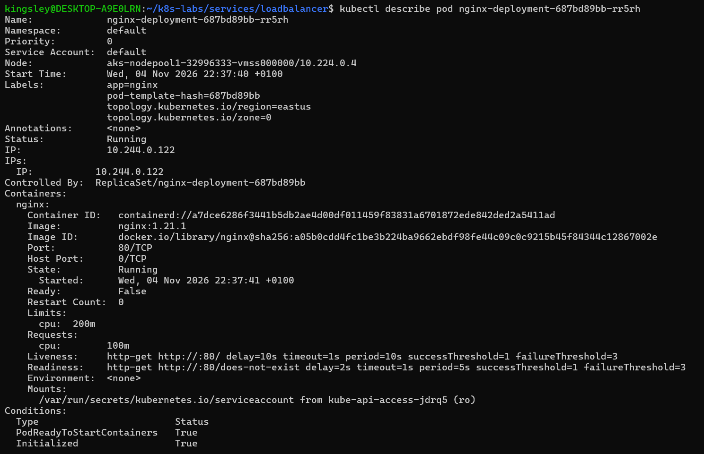

---

#### Screenshot 9 — Output showing the expected incomplete rollout or readiness failure

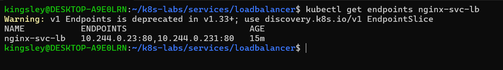

---

#### Screenshot 10 — EndpointSlice output showing ready healthy backends and the effect of the readiness failure

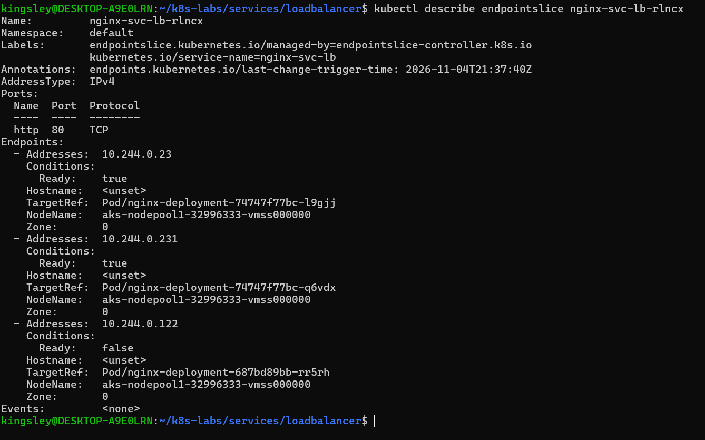

---

#### Screenshot 11 — Successful public curl response after recovery

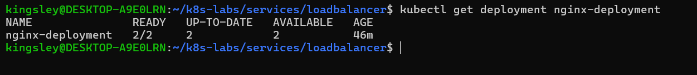

### Notes

**1. Why did the rollout not complete?**

The rollout did not complete because the newly created Pods failed their readiness probe. Kubernetes could not mark them as ready, so the Deployment could not reach the required number of available replicas.

**2. Why can the public endpoint still work while new Pods fail readiness?**

The public endpoint can still work because the existing healthy Pods remain available behind the LoadBalancer Service and continue handling incoming requests while the new Pods are failing readiness checks.

**3. What would happen if Kubernetes routed traffic to Pods before they were ready?**

Users could experience failed requests, connection errors, slow responses, or application downtime because the Pods might not be ready to handle incoming traffic.

**4. How did you restore the Deployment successfully?**

I restored the Deployment by correcting the readiness probe configuration and applying the updated manifest. Kubernetes then successfully marked the new Pods as ready, allowing the rollout to complete successfully.

---

# Task 6 — Scale the Deployment Behind the Load Balancer

## Goal

Scale the NGINX Deployment and confirm that more ready Pods become available behind the same public endpoint.

### Evidence

#### Screenshot 12 — Two ready NGINX Pods verified initially; four ready Pods verified after scaling

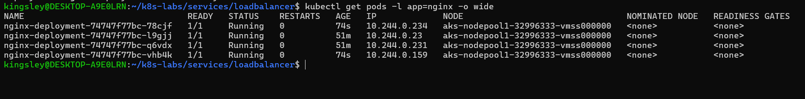

---

#### Screenshot 13 — Successful public curl response after scaling

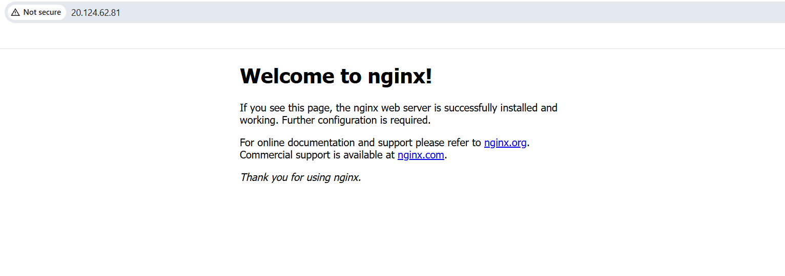

### Notes

**1. What changed after scaling the Deployment from two to four replicas?**

The number of NGINX Pods increased from two to four. This increased the application's capacity to handle incoming requests and provided more Pods for the Kubernetes Service to distribute traffic across.

**2. Did the public IP change after scaling? Explain why or why not.**

No, the public IP remained the same because the LoadBalancer Service is independent of the Deployment's replica count. Scaling the Deployment changes the number of backend Pods, not the Service's public IP address.             

**3. Why does scaling behind a LoadBalancer Service not require users to change the URL or IP they use?**

The LoadBalancer Service provides a stable external IP address that remains the same when the Deployment is scaled. Kubernetes automatically updates the Service's endpoints to include the new ready Pods, so users continue accessing the application through the same URL or IP address.

---

# Task 7 — Share Your LoadBalancer Lab on LinkedIn

## Goal

Share what you learned about exposing an NGINX application publicly through a LoadBalancer Service on AKS.

### Evidence

#### Screenshot 14 — Published LinkedIn post about your LoadBalancer lab on AKS

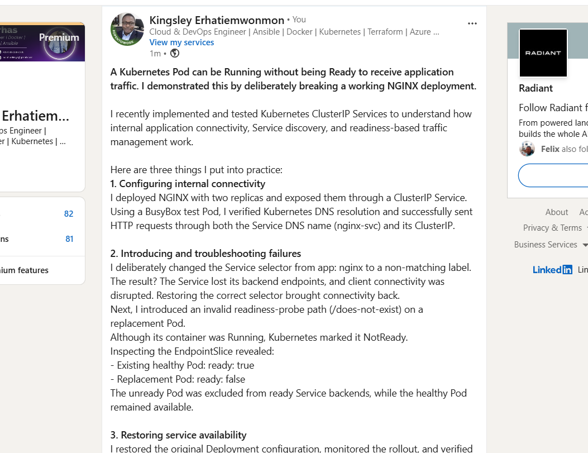

#### LinkedIn post link

https://www.linkedin.com/posts/kingsley-erhatiemwonmon_kubernetes-devops-cloudengineering-ugcPost-7523776950209974272-FE3C/?utm_source=share&utm_medium=member_desktop&rcm=ACoAAClDkSEBa4Zo6dTWVIEEl8FJLczvH_zPHtY

---

# Submission Instructions

- Include the completed YAML files:
  - `00-nginx-deploy.yaml`
  - `01-nginx-svc-loadbalancer.yaml`
  - `02-readiness-broken.yaml`
- Add all required screenshots, numbered 1–14, under their corresponding Evidence sections.
- Use clear, readable screenshots showing the relevant commands, configuration, and outputs.
- Ensure your full name is visible in the required screenshots.
- Complete the Notes for Tasks 1–6 in your own words.
- Capture all required evidence before cleaning up Azure resources.
- Plan or complete Azure cleanup according to your lab ownership and reuse arrangements.
- Do not expose passwords, tokens, private keys, cluster credentials, kubeconfig contents, subscription IDs, account IDs, or infrastructure details you are not permitted to share.

---

# Completion Checklist

- [ ] Created or connected to an approved AKS lab cluster
- [ ] Confirmed ready AKS node(s) (Screenshot 1)
- [ ] Created and entered the LoadBalancer lab directory (Screenshot 2)
- [ ] Created the NGINX Deployment manifest (Screenshot 3)
- [ ] Verified successful rollout and two ready NGINX Pods initially (Screenshot 4)
- [ ] Created the LoadBalancer Service manifest (Screenshot 5)
- [ ] Verified the assigned external IP (Screenshot 6)
- [ ] Verified successful public access using curl (Screenshot 7)
- [ ] Created the broken readiness patch (Screenshot 8)
- [ ] Observed the expected incomplete rollout or readiness failure (Screenshot 9)
- [ ] Inspected EndpointSlices during the readiness failure (Screenshot 10)
- [ ] Restored the healthy Deployment and verified public access (Screenshot 11)
- [ ] Scaled the Deployment to four ready Pods and verified updated Service backends (Screenshot 12)
- [ ] Verified public access after scaling (Screenshot 13)
- [ ] Completed the Notes for Tasks 1–6
- [ ] Published the LinkedIn post (Screenshot 14)
- [ ] Included all required YAML files and screenshots
- [ ] Planned or completed Azure cleanup
- [ ] No sensitive data exposed

---

## 📌 About DMI & CloudAdvisory

DevOps Micro Internship (DMI) is a project-based DevOps program run by Pravin Mishra (The CloudAdvisory) focused on real-world execution, systems thinking, and career readiness.

It helps learners build strong DevOps foundations with hands-on experience.

---

## 📌 Resources

- 🌐 DMI Official Website: https://dmi.pravinmishra.com?utm_source=github&utm_medium=readme  
- 🎓 University: https://university.pravinmishra.com?utm_source=github&utm_medium=readme  
- 💬 Discord Community: https://discord.pravinmishra.com?utm_source=github&utm_medium=readme  
- 📝 Blog: https://dmi.pravinmishra.com/blog?utm_source=github&utm_medium=readme  
- ▶️ YouTube Playlist: https://www.youtube.com/playlist?list=PLFeSNDtI4Cho  
- 🔗 Pravin Mishra (LinkedIn): https://www.linkedin.com/in/pravin-mishra-aws-trainer/  
- 🏢 CloudAdvisory (LinkedIn): https://www.linkedin.com/company/thecloudadvisory/

---

*This submission is part of DevOps Micro Internship (DMI) — Agentic AI Track.*
