# Assignment 10 — Capstone: Deploy the Book Review App to Kubernetes

Part of the DevOps Micro Internship (DMI) with Agentic AI

---

## Purpose

Deploy the Book Review App as a production-style three-tier application using Kubernetes manifests or Helm charts, with an accessible frontend, an internal backend, and a managed or persistent MySQL database.

---

## Submission Details

**Full Name:** Kingsley Erhatiemwonmon

**Kubernetes Platform:** Minikube v1.39.0 (Kubernetes v1.37.0, Calico CNI, containerd runtime, Docker driver) on WSL2 Ubuntu

**Namespace:** book-review

**Frontend URL or IP:** http://localhost:8080 (local access via `kubectl port-forward svc/frontend 8080:80`, since Minikube has no public LoadBalancer IP)

**Access Method:** Documented local access (kubectl port-forward svc/frontend 8080:80, opened at http://localhost:8080)

**GitHub Manifests or Helm Chart URL:** https://github.com/solutionkingz-glitch/book-review-k8s

**Architecture Diagram:** https://drive.google.com/file/d/1dz-LraryX41ziHvqxCrBfYgdgVpnSsHf/view?usp=drive_link

---

# Task 1 — Prepare the Kubernetes Cluster and Project

## Goal

Prepare the cluster, application source, container images, and tooling needed for the deployment.

### Evidence

#### Screenshot 1 — Active Kubernetes context and Ready nodes

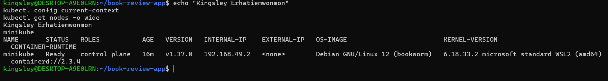

---

#### Screenshot 2 — If using Helm: Output of `helm version`

Required only if you choose Helm. Skip this screenshot if using YAML manifests.

Not applicable — using YAML manifests.

---

# Task 2 — Design the Three-Tier Kubernetes Architecture

## Goal

Document the workloads, networking, configuration, storage, and permitted communication paths before deployment.

### Evidence

#### Screenshot 3 — Completed Kubernetes architecture diagram

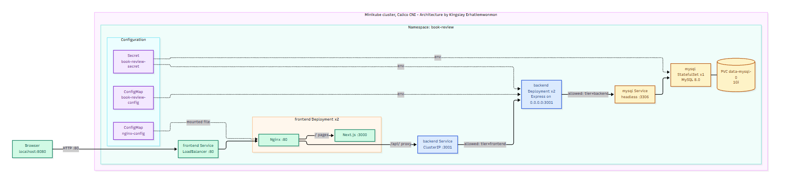

---

# Task 3 — Create ConfigMaps and Secrets

## Goal

Provide application configuration and credentials without embedding sensitive values in images or committing them to Git.

### Evidence

#### Screenshot 4 — ConfigMap configuration or describe output showing non-sensitive values

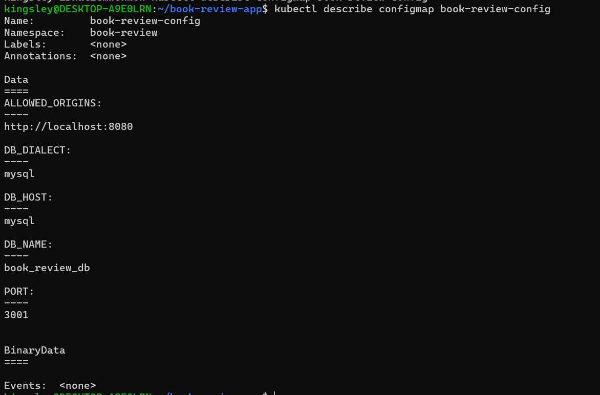

---

#### Screenshot 5 — Secret references or describe output showing names and keys without sensitive values

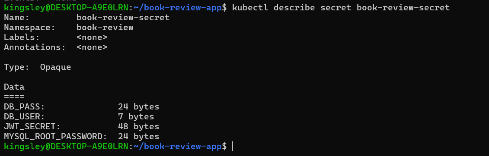

---

# Task 4 — Deploy and Configure the MySQL Data Tier

## Goal

Provide persistent MySQL storage and allow the backend to connect without exposing the database publicly.

### Evidence

#### Screenshot 6 — Managed MySQL status or MySQL StatefulSet and PVC status

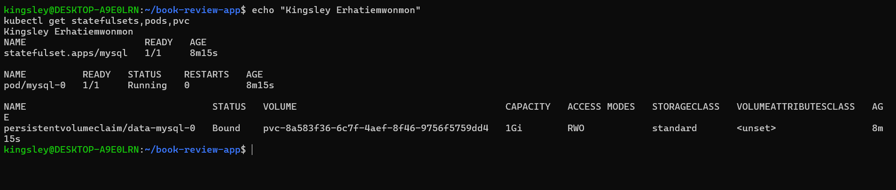

---

#### Screenshot 7 — Successful database connectivity or schema verification with credentials hidden

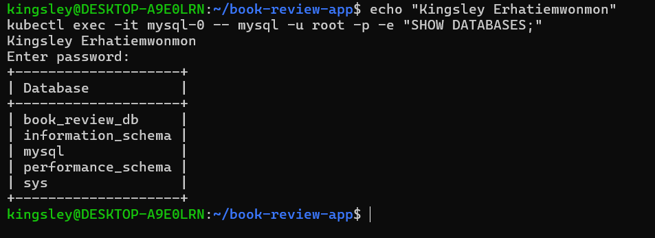

---

# Task 5 — Deploy the Backend Application Tier

## Goal

Run one or two Node.js/Express backend replicas on port 3001 and expose them through an internal ClusterIP Service.

### Evidence

#### Screenshot 8 — Backend Deployment, ready Pods, and internal Service

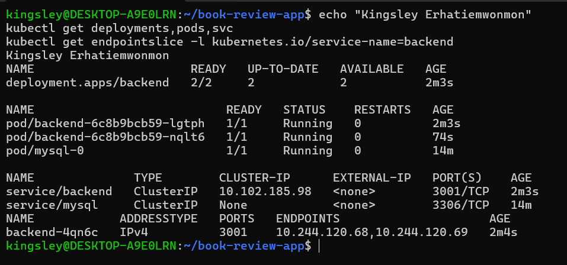

---

#### Screenshot 9 — Backend startup logs and database connectivity evidence

If the application does not log successful database connections, provide a successful database-backed request alongside the startup logs.

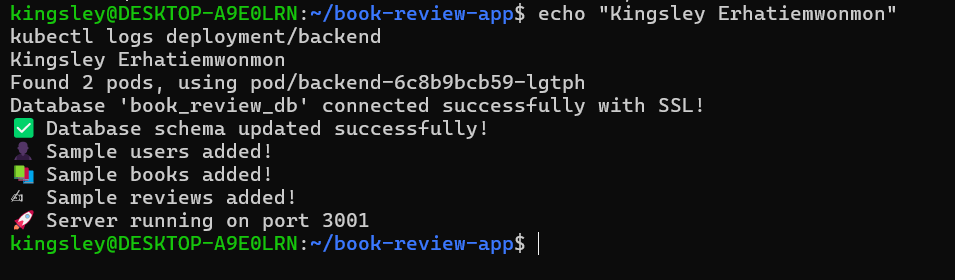

---

# Task 6 — Deploy the Frontend and Configure Nginx

## Goal

Run the Next.js frontend behind Nginx on port 80 and proxy API requests to the internal backend Service.

### Evidence

#### Screenshot 10 — Frontend Deployment and Ready Pods

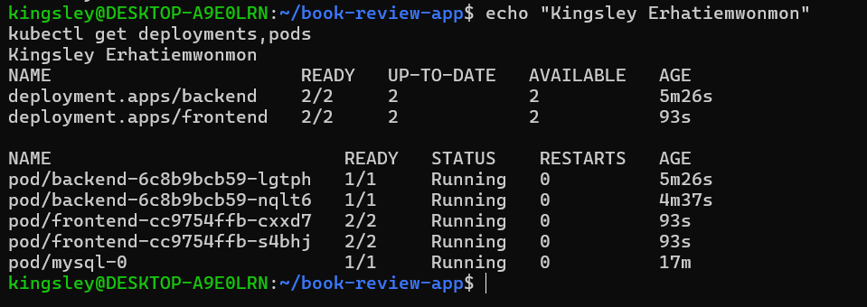

---

#### Screenshot 11 — Nginx reverse-proxy configuration showing the internal backend Service name and port 3001

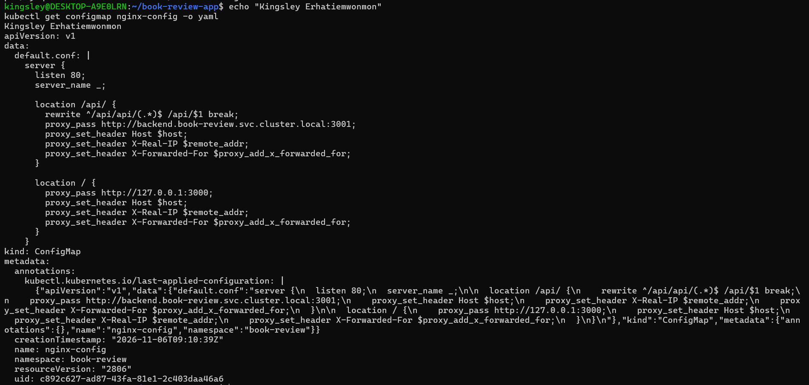

---

# Task 7 — Configure External and Internal Networking

## Goal

Expose the frontend and enforce the intended communication path between application tiers.

### Evidence

#### Screenshot 12 — Frontend LoadBalancer or Ingress configuration and assigned endpoint, or documented local access method

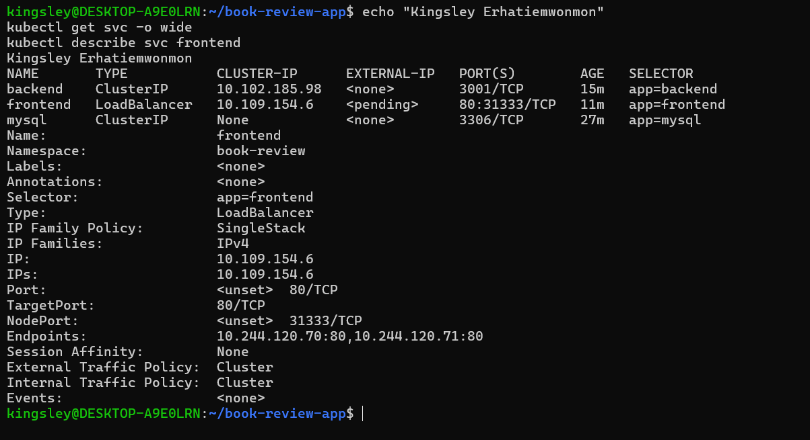

---

#### Screenshot 13 — Internal backend Service and NetworkPolicy or equivalent restriction, with access-test evidence

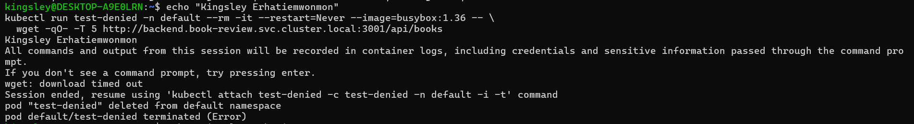

---

# Task 8 — Validate the Application End to End

## Goal

Prove that the frontend, backend, and MySQL database work together and collect operational evidence.

### Evidence

#### Screenshot 14 — `kubectl get all` output for the book-review namespace

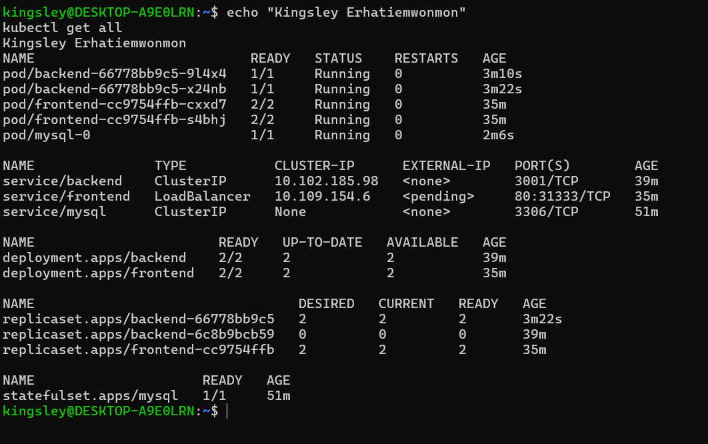

---

#### Screenshot 15 — Functional Book Review App in the browser with the URL visible, including evidence of a successful user flow

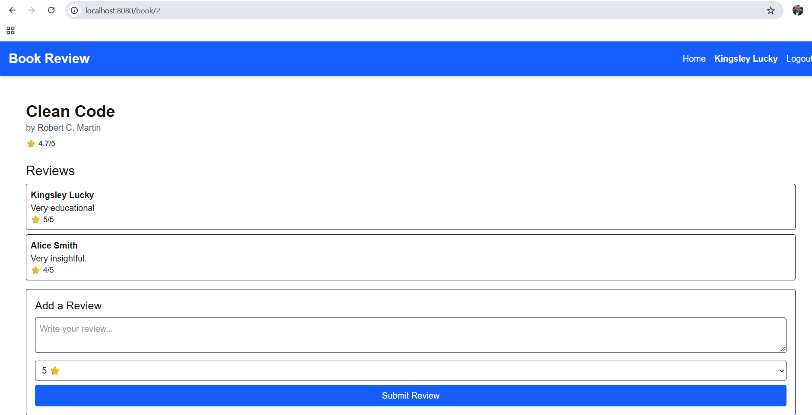

---

#### Screenshot 16 — Frontend or Nginx container logs

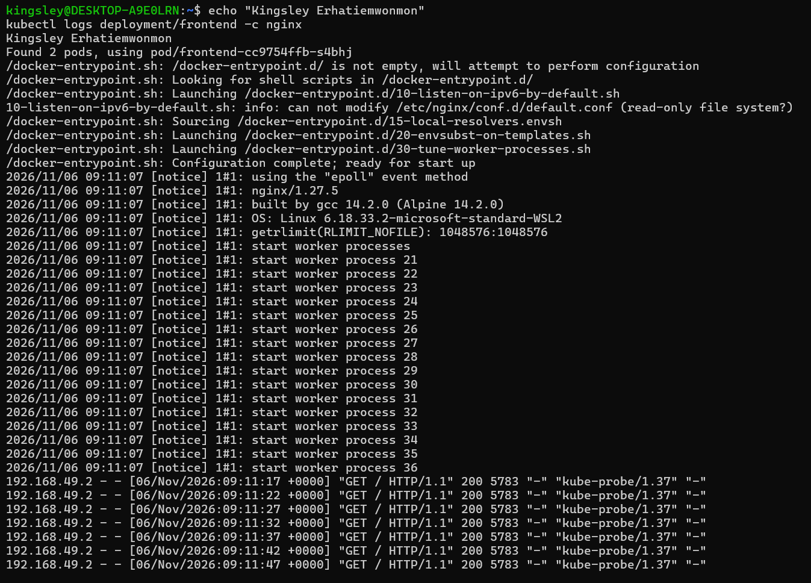

---

#### Screenshot 17 — Backend logs and evidence of a successful database-backed operation

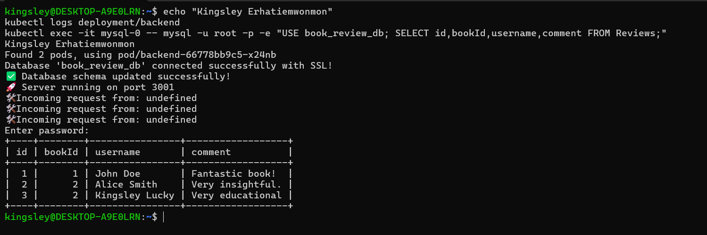

---

#### Screenshot 18 — Optional: Kubernetes dashboard

Add your screenshot here, or write “Not attempted.”

Multiple images may be included under a screenshot number when needed to demonstrate the complete user flow.

Not attempted

---

# Task 9 — Optional: Implement Production Improvements

## Goal

Add selected improvements without breaking the required three-tier architecture.

### Evidence

#### Screenshot 19 — Optional: Evidence of selected Helm, HPA, probe, or TLS improvements

Not attempted.

---

# Task 10 — Publish Your Book Review App Deployment on LinkedIn

## Goal

Explain your three-tier architecture, demonstrate the working application, and share what you learned.

### Evidence

#### Screenshot 20 — Published LinkedIn post about your Book Review App deployment on Kubernetes

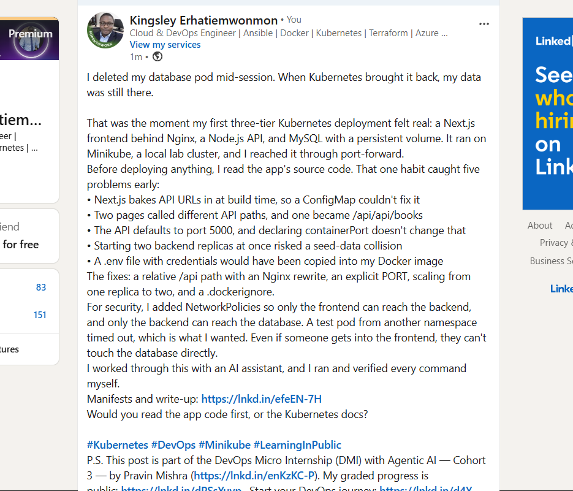

### LinkedIn Post URL

https://www.linkedin.com/posts/kingsley-erhatiemwonmon_kubernetes-devops-minikube-ugcPost-7524564084986531840-W5CG/?utm_source=share&utm_medium=member_desktop&rcm=ACoAAClDkSEBa4Zo6dTWVIEEl8FJLczvH_zPHtY

---

# Final Summary

## What Worked

Describe the application components and user flows you successfully deployed and tested.

**Components deployed**
- **Frontend:** 2 replicas, each Pod running Next.js (port 3000) and Nginx (port 80), exposed through a LoadBalancer Service. Nginx serves the app and proxies `/api/` requests to the internal backend Service.
- **Backend:** 2 Node.js/Express replicas listening on `0.0.0.0:3001`, exposed only through a ClusterIP Service. Both connected to MySQL and the startup logs showed schema sync and seed data.
- **Database:** a MySQL 8.0 StatefulSet with a 1Gi PersistentVolumeClaim (`data-mysql-0`, Bound) and a headless internal Service.
- **Configuration:** non-sensitive values in ConfigMaps (`book-review-config`, `nginx-config`) and credentials in a Secret (`book-review-secret`). The real Secret is not in Git, only a placeholder example.
- **Network restrictions:** default-deny NetworkPolicies, with frontend to backend on 3001, backend to MySQL on 3306, and DNS allowed.

**User flows and tests that passed**
- The homepage loaded at `http://localhost:8080` and listed the seeded books.
- `curl http://localhost:8080/api/books` returned JSON through Nginx, the backend Service, the backend Pods and MySQL.
- I registered a new user, logged in, opened a book and submitted a review. The review appeared in the `Reviews` table in MySQL.
- After `kubectl rollout restart deployment/backend`, the backend Pods recovered and the saved review was still there.
- After deleting the `mysql-0` Pod, the StatefulSet recreated it, the PVC stayed Bound and the data survived.
- NetworkPolicy tests: a Pod in the `default` namespace was denied access to the backend (request timed out), while a Pod labeled `tier=frontend` received the books JSON. The app kept working through the frontend after the policies were applied.
- The backend and MySQL Services have no external IP, so they are not publicly exposed.

## Issues and Fixes

Describe the main issues encountered, their causes, and how you resolved them.

**1. Frontend API URL is fixed at build time**
- **Cause:** Next.js inlines `NEXT_PUBLIC_API_URL` during `npm run build`, so a ConfigMap cannot change it at runtime. The code also falls back to `http://localhost:3001` when the value is empty, which would break in a browser.
- **Fix:** Built the image with `NEXT_PUBLIC_API_URL=/api`, so the browser calls the frontend endpoint and Nginx forwards requests to the internal backend Service.

**2. Frontend and backend route paths did not match**
- **Cause:** The backend serves routes under `/api/...`. `api.js` calls `${API_URL}/books`, but `page.js` calls `${API_URL}/api/books`, which became `/api/api/books`.
- **Fix:** Added an Nginx rewrite (`^/api/api/(.*)$` to `/api/$1`) in the `/api/` location, so no application code had to change.

**3. Backend would have listened on the wrong port and interface**
- **Cause:** `server.js` defaults to port 5000, and `containerPort: 3001` alone does not change the listening port. `app.listen` also had no explicit host.
- **Fix:** Set `PORT: "3001"` in the ConfigMap and changed the code to `app.listen(PORT, "0.0.0.0", ...)`.

**4. Secrets could have been baked into the images**
- **Cause:** The backend folder contained a `.env` file and there was no `.dockerignore`, so `COPY . .` would have copied it into the image. The upstream repo also tracks `.env` and `node_modules`.
- **Fix:** Added `.dockerignore` files to the backend and frontend. The submission repo contains only manifests and my app changes, and the real Secret is excluded by `.gitignore`.

**5. The frontend Dockerfile was not production-ready**
- **Cause:** It ran `npm run dev` and had no way to pass the API URL at build time.
- **Fix:** Wrote a multi-stage Dockerfile with `ARG NEXT_PUBLIC_API_URL` that builds the app and runs `npm start`.

**6. Image build failed with a buildkit 404 error**
- **Cause:** `eval $(minikube docker-env)` pointed Docker at a containerd-based Minikube node, which is not a real Docker daemon.
- **Fix:** Ran `minikube docker-env -u`, built the images with normal Docker, then used `minikube image load` to copy them into the cluster.

**7. Seed-data race between backend replicas**
- **Cause:** Each backend replica runs `sync({alter: true})` and inserts seed data on startup, so two replicas starting together can collide on the unique user email.
- **Fix:** Deployed the backend with 1 replica first, waited for the seed log lines, then scaled to 2.

**8. CORS would reject login and review requests**
- **Cause:** The backend only accepts origins listed in `ALLOWED_ORIGINS`, and browsers send an `Origin` header on POST requests.
- **Fix:** Set `ALLOWED_ORIGINS` to the exact browser URL, `http://localhost:8080`.

**9. LoadBalancer EXTERNAL-IP stays pending on Minikube**
- **Cause:** Minikube has no cloud load balancer.
- **Fix:** Documented the local access method and used `kubectl port-forward svc/frontend 8080:80`.

**10. Seeded users cannot log in**
- **Cause:** The sample users have fake plaintext passwords rather than hashed ones.
- **Fix:** Registered a new user to test login and reviews.

**Note:** Issues 2, 3, 7 and 8 were identified by reading the code before deployment, so I handled them in the design rather than debugging them after failures.

## Tools and Sources Used

List the documentation and tools that helped you complete the assignment.

**Tools used**
- **Minikube v1.39.0** with the Calico CNI: local Kubernetes cluster that enforces NetworkPolicy
- **kubectl**: deploying and inspecting resources, logs, events and port-forwarding
- **Docker** (on WSL2 Ubuntu): building the backend and frontend images
- **`minikube image load`**: loading the local images into the cluster
- **Nginx 1.27 (alpine)**: reverse proxy for the frontend and API
- **MySQL 8.0**: database tier, run as a StatefulSet with a PersistentVolumeClaim
- **busybox**: temporary Pods for the NetworkPolicy allow and deny tests
- **openssl**: generating random database and JWT credentials
- **Git and GitHub**: version control and the submission repo
- **Mermaid Live Editor (mermaid.live)**: drawing the architecture diagram
- **Claude (Anthropic AI assistant)**: guidance on the deployment design, manifests, troubleshooting and documentation. I ran every command myself on my own cluster and verified the results.

**Sources**
- **Book Review App repository** (https://github.com/pravinmishraaws/book-review-app): the application source, `Dockerfile`s, `docker-compose.yml`, `mysql_docker.md` and `docker_frontend-README.md`, which I read to find the real environment variable names, ports, routes and database setup
- **Assignment 10 instructions**: architecture rules, task steps and the required evidence
- **Kubernetes documentation** (https://kubernetes.io/docs): Deployments, StatefulSets, Services, ConfigMaps, Secrets and NetworkPolicy
- **Minikube documentation** (https://minikube.sigs.k8s.io/docs): CNI options, loading images and LoadBalancer behavior
- **Next.js documentation** (https://nextjs.org/docs): how `NEXT_PUBLIC_*` variables are inlined at build time
- **Nginx documentation** (https://nginx.org/en/docs): `proxy_pass` and `rewrite` directives

## Optional Improvements

Describe any optional improvements implemented, or write “Not attempted.”

**Partially implemented:** readiness probes were included in the base manifests.
- **Backend:** TCP readiness probe on port 3001
- **Nginx (frontend):** HTTP readiness probe on `/` at port 80
- **MySQL:** exec readiness probe using `mysqladmin ping`

These keep traffic away from Pods that are not ready yet, such as a backend still starting up or MySQL still initializing.

**Not attempted:** Helm chart, Horizontal Pod Autoscaling, liveness probes, and TLS with Ingress and cert-manager. The deployment uses plain Kubernetes manifests.

## Cleanup or Reuse Plan

State which resources were removed or why the environment is being retained.

The environment is being retained temporarily so the deployment can be re-checked or re-demonstrated if more evidence is needed. It runs on a local Minikube cluster in the `book-review` namespace, so there are no cloud resources or ongoing charges. When no longer needed, I will remove it with `kubectl delete namespace book-review` followed by `minikube stop`, and I will not touch the unrelated `kind` cluster on my machine. The manifests are in the GitHub repo, so the deployment can be recreated.

---

# Submission Instructions

- Include your Kubernetes manifests or Helm chart in the linked repository.
- Submit Secret examples containing placeholders only.
- Include Screenshot 1, Screenshots 3–17, and Screenshot 20.
- Include Screenshot 2 only if using Helm.
- Screenshots 18–19 are optional.
- Keep screenshot numbering consistent with the guidelines.
- Use clear, readable screenshots showing relevant configuration, commands, and outputs.
- Make your full name visible in required screenshots.
- Complete the submission details and Final Summary.
- Include your published LinkedIn post URL.
- Capture required evidence before cleanup.
- Do not expose passwords, tokens, JWT secrets, actual Secret values, kubeconfig contents, cloud credentials, or confidential account information.

---

# Completion Checklist

- [ ] Selected and configured a supported Kubernetes platform
- [ ] Confirmed the context and Ready nodes (Screenshot 1)
- [ ] Created and selected the book-review namespace
- [ ] Inspected the application repository
- [ ] Prepared images accessible to the cluster
- [ ] Confirmed Helm if using charts (Screenshot 2, conditional)
- [ ] Created the architecture diagram (Screenshot 3)
- [ ] Created ConfigMaps and Secrets (Screenshots 4–5)
- [ ] Excluded actual Secret values from Git and screenshots
- [ ] Provisioned private managed MySQL or persistent Kubernetes MySQL (Screenshot 6)
- [ ] Initialized the required database and schema
- [ ] Verified database connectivity or schema (Screenshot 7)
- [ ] Deployed one or two backend replicas listening on port 3001
- [ ] Created the backend ClusterIP Service (Screenshot 8)
- [ ] Verified backend-to-database connectivity (Screenshot 9)
- [ ] Deployed one or two frontend replicas behind Nginx (Screenshot 10)
- [ ] Configured API proxying through the internal backend Service (Screenshot 11)
- [ ] Configured and documented frontend access (Screenshot 12)
- [ ] Enforced backend access restrictions (Screenshot 13)
- [ ] Confirmed that the backend and database are not publicly exposed
- [ ] Captured resource status for book-review (Screenshot 14)
- [ ] Tested application functionality and database writes (Screenshots 15 and 17)
- [ ] Verified saved data after application restart
- [ ] Captured frontend and backend logs (Screenshots 16–17)
- [ ] Included optional dashboard or improvement evidence if attempted (Screenshots 18–19)
- [ ] Published the LinkedIn post (Screenshot 20)
- [ ] Included the LinkedIn post URL
- [ ] Documented issues, fixes, and useful sources
- [ ] Recorded cleanup status or reuse plans
- [ ] No sensitive data exposed

---

## 📌 About DMI & CloudAdvisory

DevOps Micro Internship (DMI) is a project-based DevOps program run by Pravin Mishra (The CloudAdvisory) focused on real-world execution, systems thinking, and career readiness.

It helps learners build strong DevOps foundations with hands-on experience.

---

## 📌 Resources

- 🌐 DMI Official Website: https://dmi.pravinmishra.com?utm_source=github&utm_medium=readme  
- 🎓 University: https://university.pravinmishra.com?utm_source=github&utm_medium=readme  
- 💬 Discord Community: https://discord.pravinmishra.com?utm_source=github&utm_medium=readme  
- 📝 Blog: https://dmi.pravinmishra.com/blog?utm_source=github&utm_medium=readme  
- ▶️ YouTube Playlist: https://www.youtube.com/playlist?list=PLFeSNDtI4Cho  
- 🔗 Pravin Mishra (LinkedIn): https://www.linkedin.com/in/pravin-mishra-aws-trainer/  
- 🏢 CloudAdvisory (LinkedIn): https://www.linkedin.com/company/thecloudadvisory/

---

*This submission is part of DevOps Micro Internship (DMI) — Agentic AI Track.*
