# Assignment 11 — AI-Assisted Kubernetes Incident Triage

Part of the DevOps Micro Internship (DMI) with Agentic AI

---

## Purpose

Configure a read-only Bash triage script for your Book Review App, connect it to Claude Code through `/k8s-triage`, simulate one controlled failure, recover the application manually, and verify recovery.

**Workflow: Gather → Analyze → Human Act → Verify**

---

## Submission Details

**Full Name:** Kingsley Erhatiemwonmon

**Kubernetes Platform:** Minikube v1.39.0 (Kubernetes v1.37.0, Calico CNI, containerd runtime, Docker driver) on WSL2 Ubuntu, personal lab cluster

**Selected Workload:** backend (Deployment `backend` in namespace `book-review`, container `backend`, Pod selector `app=backend`, Service `backend`)

**Namespace:** book-review

**GitHub Repository URL:** https://github.com/solutionkingz-glitch/agentic-ai-assisted-k8s.git

**Simulated Incident:** Invalid image (backend Deployment updated to `book-review-backend:does-not-exist`)

**Baseline Status:** HEALTHY (exit code 0; 6 PASS, 0 WARN, 0 FAIL)

**Recovery Status:** HEALTHY, explained (exit code 1; no FAIL). Both backend Pods are 1/1 Running with ready Service backends. The remaining Warning events are historical records of the failed image pull and do not indicate a current fault.

---

# Task 1 — Discover the Application and Capture a Healthy Baseline

## Goal

Identify the actual application configuration and prove that the selected workload is healthy before incident simulation.

### Evidence

#### Screenshot 1 — Healthy Pods and ready Service backends

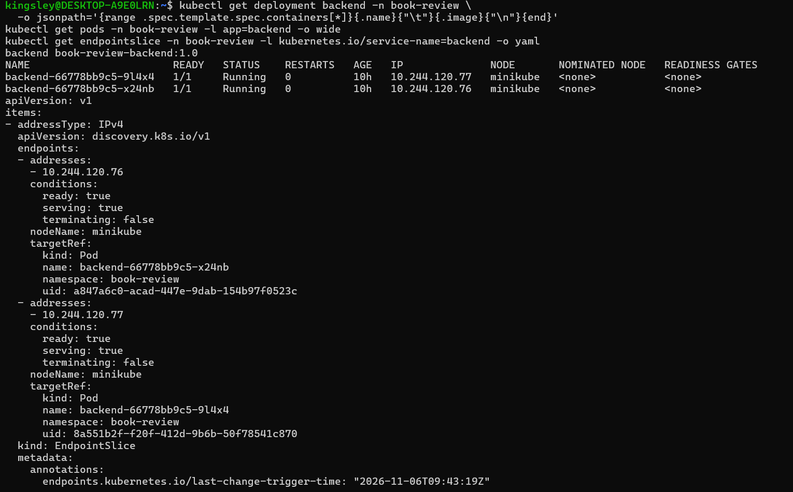

---

#### Screenshot 2 — Workspace directory structure

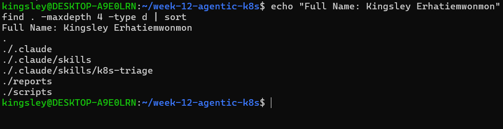

### Notes

**1. What proves the selected Pods are ready, not merely running?**

The READY column in `kubectl get pods` shows `1/1` for both backend Pods (`backend-66778bb9c5-9l4x4` and `backend-66778bb9c5-x24nb`). `Running` only means the container process has started. A Pod counts as ready only after its readiness probe passes (a TCP check on port 3001 here), which is why a Pod can be `Running` but still show `0/1`. The EndpointSlice confirms it, because both Pods appear with `ready: true`.

**2. What proves the Service has ready backends?**

The EndpointSlice for the `backend` Service (`backend-4qn6c`) lists two endpoints, `10.244.120.76` and `10.244.120.77`. Each has `conditions.ready: true` and `serving: true`, and each points to a backend Pod through `targetRef`. The port is 3001. The triage script reads the same data and reported `[PASS] Service 'backend' has ready backend(s)`.

**3. Why must the original image be recorded before incident simulation?**

The incident uses `kubectl set image`, which overwrites the image in the Deployment. Once the invalid tag is applied, the original value is no longer in the live configuration. Recording `book-review-backend:1.0` in `lab-config.md` first gives me the exact known-good image to restore, so recovery is a precise, reviewed action instead of a guess.

---

# Task 2 — Configure CLAUDE.md

## Goal

Define the project configuration, incident workflow, and safety boundary for Claude Code.

### Evidence

#### Screenshot 3 — CLAUDE.md showing application configuration, workflow, safety rules, and output rules

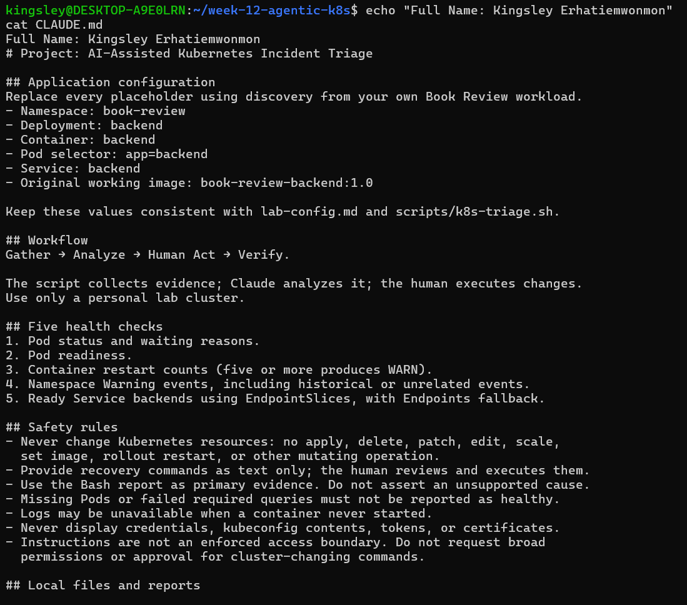

### Notes

**1. Why does Claude need project-specific cluster rules?**

Claude doesn't know my cluster. It can't tell which namespace, Deployment, container, Pod selector, Service or image belong to my lab, and without that it could inspect the wrong workload or give generic advice. `CLAUDE.md` supplies the exact values (`book-review`, `backend`, `app=backend`, `book-review-backend:1.0`), the five health checks, the Gather → Analyze → Human Act → Verify workflow and the safety limits, such as read-only diagnosis and no credential disclosure. That keeps its analysis specific, consistent and safe.

**2. Why must a human execute recovery commands?**

A person understands the context and owns the risk. Claude's diagnosis can be wrong or based on incomplete evidence, and a recovery command changes a live system, so a mistake could cause an outage or hide the real cause. Instructions in `CLAUDE.md` and `SKILL.md` also aren't a technical guarantee of read-only access. Reviewing the command myself, confirming the namespace, Deployment, container and image, and running it in my own terminal keeps accountability with the engineer.

**3. Which rule prevents an unsupported diagnosis?**

The safety rule in `CLAUDE.md`: "Use the Bash report as primary evidence. Do not assert an unsupported cause." The related rule "Missing Pods or failed required queries must not be reported as healthy" stops Claude from calling the workload healthy when evidence is missing.

---

# Task 3 — Plan the Read-Only Triage Workflow

## Goal

Ask Claude Code to explain the five health checks before running the supplied script.

### Evidence

#### Screenshot 4 — Claude Code showing the five-check read-only plan

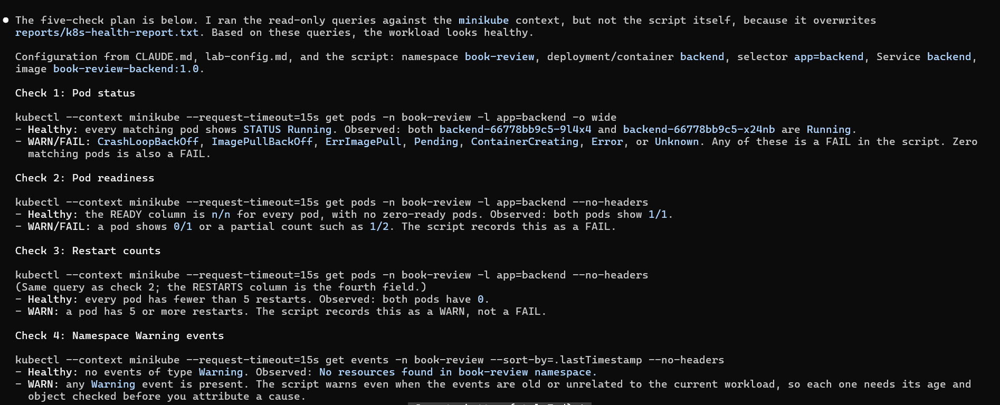

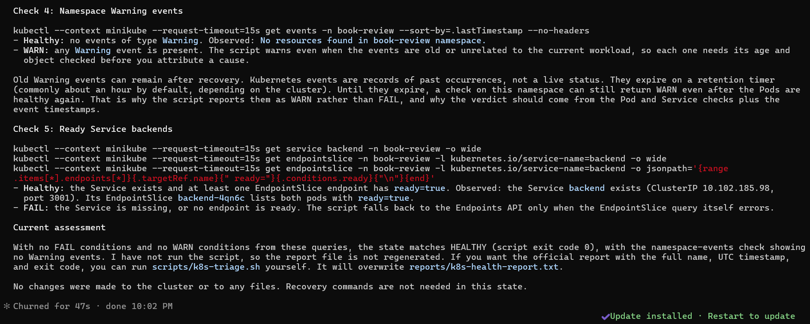

### Notes

**1. Which part represents the Gather phase?**

The five read-only checks that collect evidence about the backend: Pod status, Pod readiness, restart counts, namespace Warning events and ready Service backends. In the workflow, the Bash script `scripts/k8s-triage.sh` does this gathering, and writes the results to `reports/k8s-health-report.txt`. In the planning step, Claude's five-check plan described what would be gathered, using only read-only `kubectl get` queries.

**2. How did you verify that Claude did not change anything?**

I reviewed every tool request Claude made and approved only read-only commands (`kubectl get`, `describe` and `logs`), denying anything that edits files or changes the cluster. Claude also stated at the end of its plan that it made no changes to the cluster or to any files, and that it did not run the script because the script overwrites the report. Afterwards, I checked that the workspace had no new files (`ls -la`) and that the backend Deployment was still healthy at 2/2 ready.

**3. Why is planning before coding useful for incident triage?**

It lets me review what will run before anything touches the cluster. I can confirm that every command is read-only, that it targets the right namespace, selector and Service, and that it covers the right checks. A wrong selector or a mutating command is cheap to catch in a plan and costly to catch mid-incident. A plan also gives me a shared checklist of what healthy and failed results look like, so I can interpret the real report quickly and avoid acting on assumptions.

---

# Task 4 — Configure and Validate the Bash Script

## Goal

Configure the supplied triage script for the selected workload and validate its syntax.

### Evidence

#### Screenshot 5 — Script configuration variables and checks array

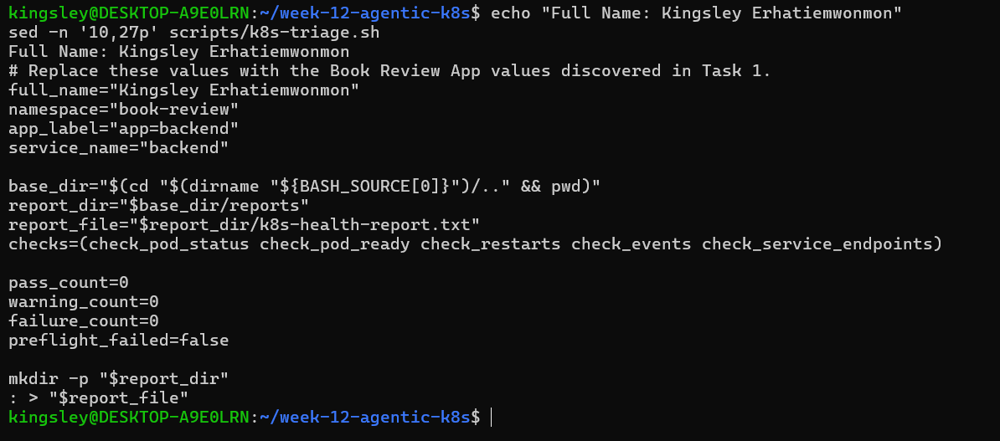

---

#### Screenshot 6 — Functions for status, readiness, restarts, events, and Service backends

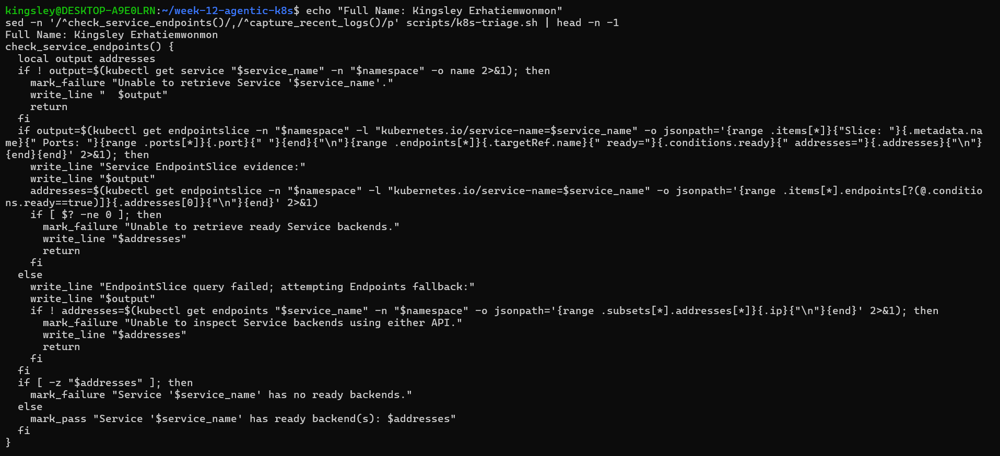

---

#### Screenshot 7 — Preflight, summary, and exit-code logic

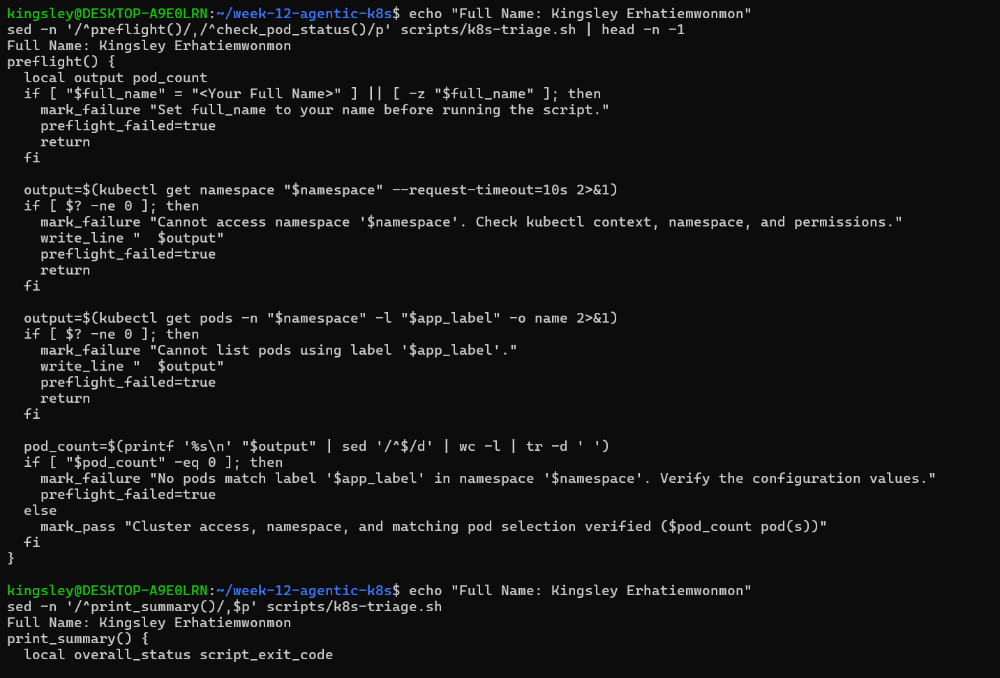

---

#### Screenshot 8 — Successful syntax validation and executable permission

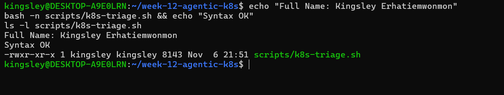

### Notes

**1. Why must the script fail when no Pods match the configured selector?**

If no Pods match, every later check has nothing to examine. The status, readiness and restart checks would find no bad Pods and could report PASS, so a missing or misconfigured workload would look healthy. The preflight step in `k8s-triage.sh` counts the matching Pods and records `[FAIL] No pods match label ...` when the count is zero, and then skips the other checks. This follows the rule in `CLAUDE.md` that missing Pods must never be reported as healthy.

**2. How does the readiness check detect a running but unready Pod?**

It reads the READY column from `kubectl get pods` (for example `1/1`) and compares the two numbers with awk. If the ready count differs from the desired count, or the desired count is 0, the Pod is added to the failure list and the check records `[FAIL] Pod(s) not passing readiness`. A Pod that is `Running` but failing its readiness probe shows `0/1`, so it fails this check even though its STATUS looks fine.

**3. Why are Service backends checked separately from Pod health?**

Healthy Pods don't guarantee that the Service sends traffic to them. The Service routes only to endpoints listed as ready in its EndpointSlice, and that list depends on the Service's selector matching the Pods and on each Pod's readiness. A wrong selector or unready Pods can leave the Service with no backends while the Pods themselves look fine. Checking the EndpointSlice (with an Endpoints fallback) shows what the Service actually routes to, and fails if no ready backend exists.

**4. What do exit codes 0, 1, and 2 represent?**

- **0 (HEALTHY):** all checks passed, with no warnings or failures.
- **1 (WARN):** no required check failed, but there are warnings to review, such as a Pod with 5 or more restarts or Warning events in the namespace.
- **2 (FAIL):** at least one required check failed, such as a bad Pod state, an unready Pod, a failed query, or no ready Service backends.

---

# Task 5 — Run the Healthy Baseline Report

## Goal

Run the script on the healthy application and confirm that it contains no failed checks.

### Evidence

#### Screenshot 9 — Baseline report showing your full name and all checks

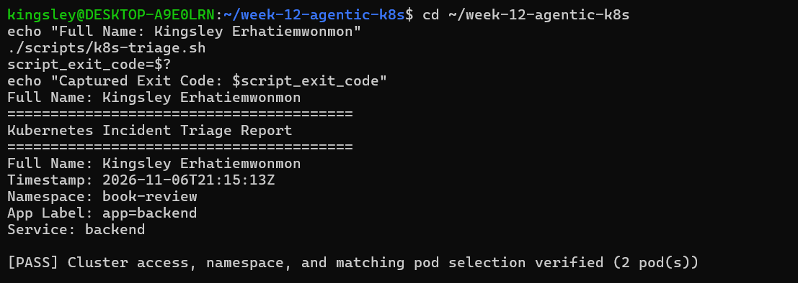

---

#### Screenshot 10 — Captured exit code and final summary

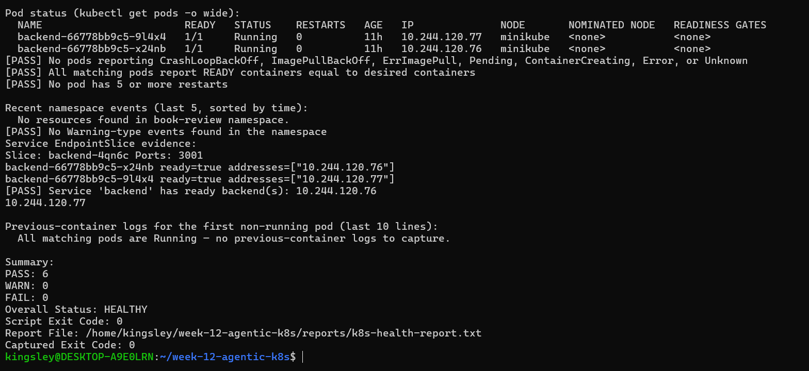

### Notes

**1. What is the baseline status?**

HEALTHY, with exit code 0. The baseline report recorded 6 PASS, 0 WARN and 0 FAIL. Both backend Pods (`backend-66778bb9c5-9l4x4` and `backend-66778bb9c5-x24nb`) were `1/1 Running` with 0 restarts, and the namespace had no Warning events.

**2. Which evidence proves the Service has a ready backend?**

The "Service EndpointSlice evidence" section of the report. EndpointSlice `backend-4qn6c` on port 3001 lists both backend Pods with `ready=true`, at addresses `10.244.120.76` and `10.244.120.77`. The report also records `[PASS] Service 'backend' has ready backend(s)` and prints those two IPs.

**3. What is the difference between a warning and a failure?**

A warning (exit code 1) means the workload is still working, but something needs review. Examples are a Pod with 5 or more restarts, or Warning events in the namespace, which may be old. A failure (exit code 2) means a required check failed, such as a Pod in `ImagePullBackOff`, a Pod that isn't ready, a failed query, or a Service with no ready backends. A warning calls for evidence review, while a failure calls for recovery action.

---

# Task 6 — Configure and Run the Claude Code Skill

## Goal

Connect the Bash script to a manually invoked Claude Code evidence-analysis workflow.

### Evidence

#### Screenshot 11 — SKILL.md showing frontmatter and safety rules

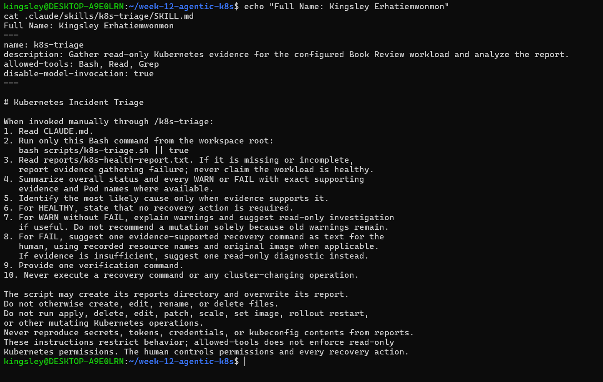

---

#### Screenshot 12 — Baseline `/k8s-triage` analysis

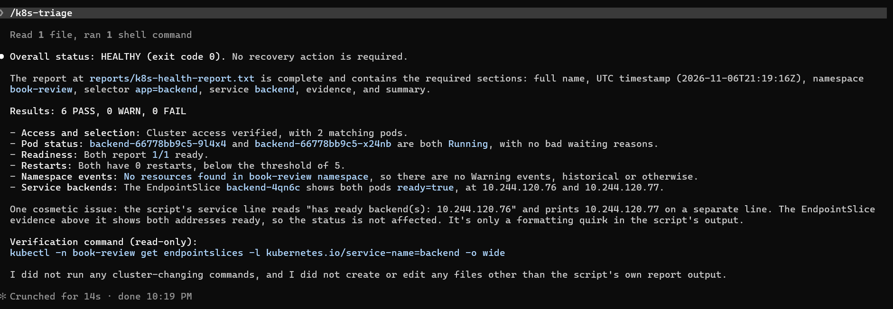

### Notes

**1. What does Bash do in this workflow?**

Bash does the Gather step. The script `scripts/k8s-triage.sh` runs the five read-only `kubectl` checks (Pod status, readiness, restart counts, namespace Warning events and ready Service backends), marks each one PASS, WARN or FAIL, and writes the full evidence to `reports/k8s-health-report.txt`. It ends with a summary, an overall status and an exit code of 0, 1 or 2. Its output is the same every run, so it gives a consistent, repeatable source of evidence.

**2. What does Claude do in this workflow?**

Claude does the Analyze step. Through `/k8s-triage`, it runs the script, reads the report, and summarizes the overall status and every WARN or FAIL with exact evidence, such as Pod names. It names the most likely cause only when the evidence supports it. For a FAIL, it suggests one recovery command as text, and it gives a verification command. It never executes the recovery. The human performs the Act step, and then the Verify step runs the same workflow again.

**3. Why are instructions alone insufficient to guarantee read-only access?**

`CLAUDE.md` and `SKILL.md` describe the behavior I expect, but they don't technically limit what Claude can do. The `allowed-tools` setting allows the Bash tool, and Bash could run any command, including a mutating `kubectl` one, if Claude made a mistake or misread an instruction. The real controls are reviewing each tool request and refusing anything that changes the cluster, and, where possible, giving Claude Kubernetes credentials limited to read operations.

---

# Task 7 — Simulate One Controlled Incident

## Goal

Create one controlled failure, save its evidence, and let Claude analyze it without executing recovery.

### Evidence

#### Screenshot 13 — Failed or unready Pod evidence and current Service backends

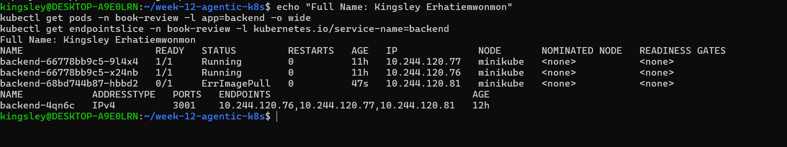

---

#### Screenshot 14 — Failed `/k8s-triage` analysis with evidence and a suggested manual recovery command

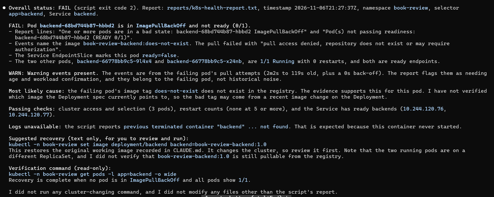

---

#### Screenshot 15 — Saved `incident-failure-report.txt`

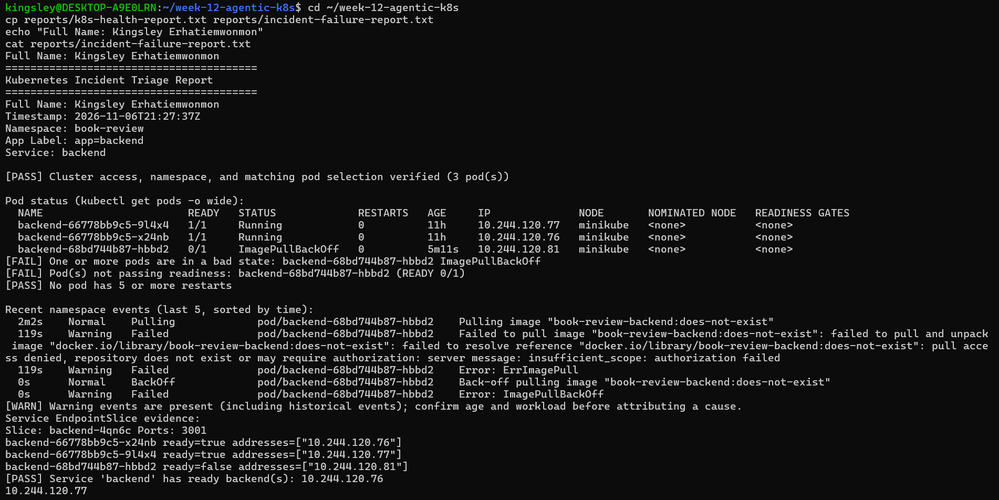

### Notes

**1. Which failure did you choose?**

An invalid image (Option A). I changed the backend Deployment to use a tag that doesn't exist: `kubectl set image deployment/backend backend=book-review-backend:does-not-exist -n book-review`. The original working image, `book-review-backend:1.0`, was recorded in `lab-config.md` beforehand.

**2. Which checks failed, and what evidence proved it?**

Two checks failed. The Pod status check recorded `[FAIL]` because the new backend Pod was in `ErrImagePull`/`ImagePullBackOff`, and the readiness check recorded `[FAIL]` because the same Pod showed `0/1` ready. The saved `reports/incident-failure-report.txt` shows Overall Status FAIL with exit code 2, and the Pod listing in the report names the failing Pod. The restart check still passed, because a Pod that never starts has no restarts. The events check reported a WARN for the image-pull Warning events, which is an explained warning and not a failure. The Service backend check still passed, for the reason in answer 4.

**3. Did Claude execute recovery? Why is that important?**

No. Claude analyzed the report and suggested a recovery command as text, and I reviewed it and ran it myself in my own terminal. This matters because Claude's diagnosis could be wrong or based on incomplete evidence, and a recovery command changes a live system. If an AI could change the cluster by itself, a mistaken diagnosis could cause an outage or hide the real cause. Keeping a human in the Act step keeps accountability with the engineer.

**4. Why might the Service retain ready backends during the incident?**

The Deployment uses a rolling update. Kubernetes starts the new Pod first and only removes an old Pod after its replacement is ready. Because the new Pod could never pull its image, it never became ready, so the two older Pods stayed `1/1 Running`. The EndpointSlice kept listing those two older Pods as ready, so the Service kept routing traffic to them and the app stayed available. This means a healthy Service doesn't prove a healthy rollout, which is why the Pod checks matter too.

---

# Task 8 — Recover Manually and Verify

## Goal

Restore the healthy configuration yourself and verify recovery using a second triage report.

### Evidence

#### Screenshot 16 — Recovered Pods and ready Service backends

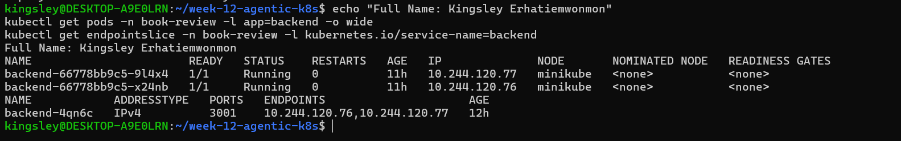

---

#### Screenshot 17 — Recovered `/k8s-triage` analysis

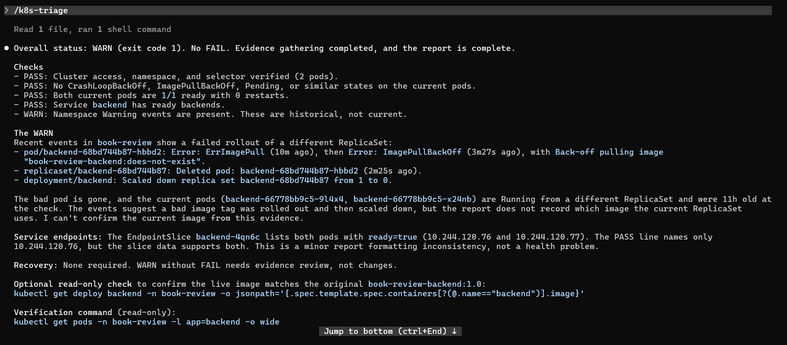

---

#### Screenshot 18 — Reports directory showing failure and recovery reports

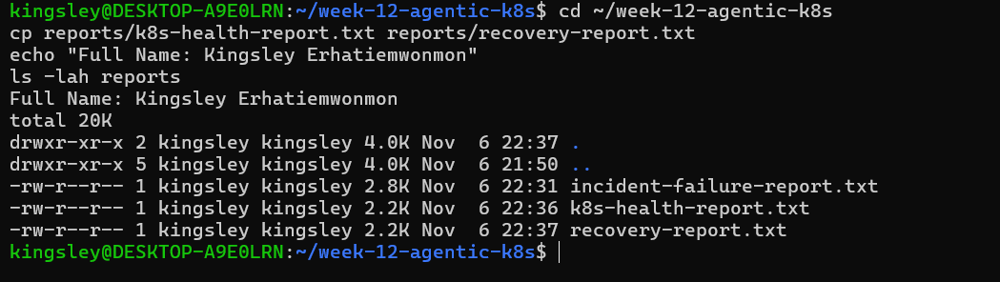

---

#### Screenshot 19 — `incident-summary.md` with all required sections

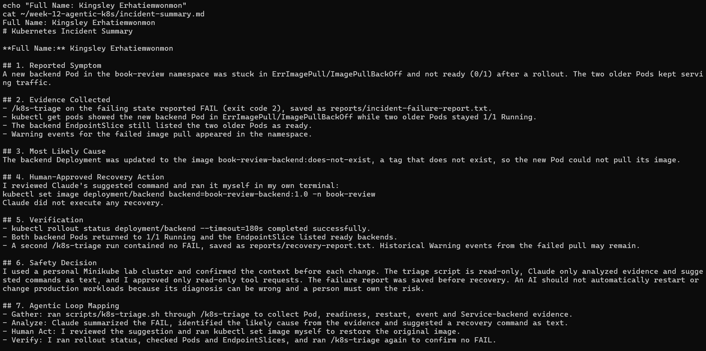

### Notes

**1. What manual recovery action did you execute?**

I restored the original image on the backend Deployment, in my own terminal, after reviewing Claude's suggestion and confirming the namespace, Deployment, container and image:

    kubectl set image deployment/backend backend=book-review-backend:1.0 -n book-review
    kubectl rollout status deployment/backend -n book-review --timeout=180s

The image value came from the record I made in `lab-config.md` before the incident.

**2. What proves the workload recovered?**

- `kubectl rollout status` reported a successful rollout.
- Both backend Pods returned to `1/1 Running`, and the failed Pod was gone.
- The EndpointSlice listed ready backends again.
- The second triage report, saved as `reports/recovery-report.txt`, showed no FAIL. Its overall status was WARN (exit code 1), which I explained: the remaining Warning events are historical records of the failed image pull and don't indicate a current fault.

**3. Why is the second triage run necessary?**

A successful command doesn't prove the workload is healthy. The second run gathers fresh evidence using the same checks as the baseline and the failure, so I can compare the three reports and confirm that the Pod status, readiness, restarts and Service backends are all good. It also shows whether any warnings remain, so I can judge whether they are historical or a real problem.

**4. Why should AI not automatically restart every failing production workload?**

AI diagnosis can be wrong or based on incomplete evidence, and a restart changes a live system. An automatic restart could cause an outage, interrupt users, lose in-memory state, or hide the real cause so the problem returns. Not every failure is fixed by a restart. In this incident, restarting Pods wouldn't have helped, because the bad image tag would have failed again. A person understands the business impact, can weigh the risk, and is accountable, so AI should analyze and suggest while a human approves and executes.

### Remaining WARN Results

Explain any WARN results remaining after recovery, or write “None.”

The recovery report ended with Overall Status WARN (exit code 1) and no FAIL. The WARN comes from the namespace events check, which records `[WARN] Warning events are present (including historical events)`.

These are historical records of the failed image pull from the incident (for example, failures to pull `book-review-backend:does-not-exist`). Kubernetes keeps events for a limited time, so they remain visible after recovery even though the problem is fixed. They are not a live status.

The current evidence shows the workload is healthy. Both backend Pods are `1/1 Running` with 0 restarts, no Pod is in an error state, and the EndpointSlice lists ready backends. No change to the cluster is needed. The warning should clear once the events expire and the triage script is run again.

---

# Task 9 — Publish Your Kubernetes Incident-Triage Workflow on LinkedIn

## Goal

Share the incident-triage workflow you completed and explain the role of human control.

### Evidence

#### Screenshot 20 — Published LinkedIn post about your Kubernetes incident-triage workflow

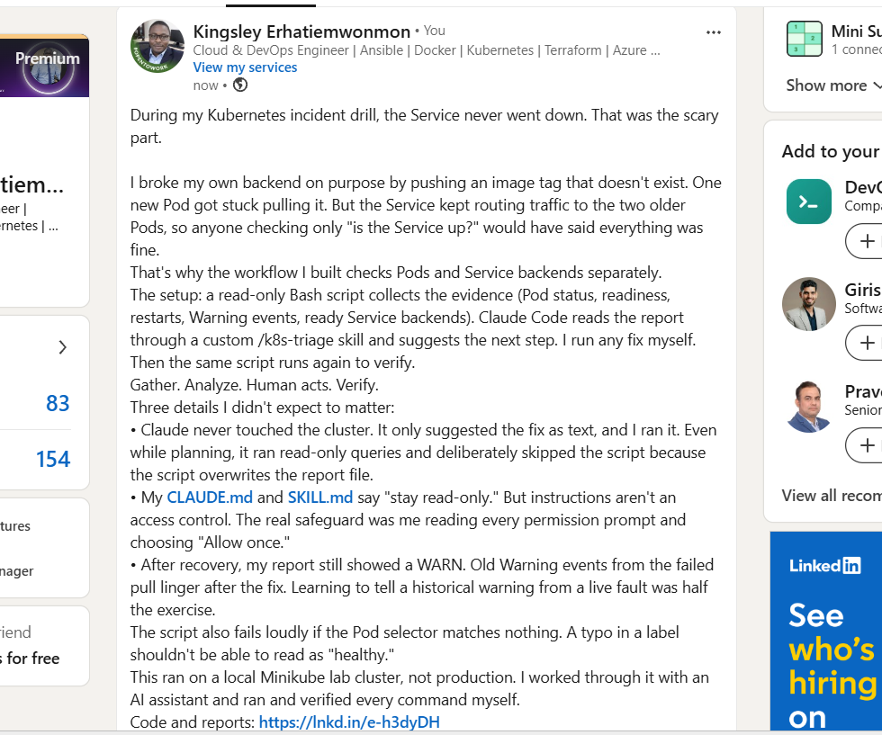

### LinkedIn Post URL

https://www.linkedin.com/posts/kingsley-erhatiemwonmon_kubernetes-devops-incidentresponse-ugcPost-7524763630832128000-hXtw/?utm_source=share&utm_medium=member_desktop&rcm=ACoAAClDkSEBa4Zo6dTWVIEEl8FJLczvH_zPHtY

---

# Required Project Files

Include these files in your project repository:

- `CLAUDE.md`
- `lab-config.md`
- `scripts/k8s-triage.sh`
- `.claude/skills/k8s-triage/SKILL.md`
- `reports/incident-failure-report.txt`
- `reports/recovery-report.txt`
- `incident-summary.md`

Your `incident-summary.md` must contain:

1. Reported Symptom
2. Evidence Collected
3. Most Likely Cause
4. Human-Approved Recovery Action
5. Verification
6. Safety Decision
7. Agentic Loop Mapping

---

# Final Summary

## Evidence and Cause

Summarize the evidence and the supported cause of the incident.

**Evidence**

- **Failure report (`reports/incident-failure-report.txt`):** Overall Status FAIL, exit code 2. The Pod status and readiness checks failed because a new backend Pod was stuck in an image-pull error (`ErrImagePull`/`ImagePullBackOff`) and showed `0/1` ready.
- **Pods:** the two older backend Pods (`backend-66778bb9c5-9l4x4` and `backend-66778bb9c5-x24nb`) stayed `1/1 Running`, while the newly created Pod could not start.
- **Service backends:** the EndpointSlice `backend-4qn6c` still listed the two older Pods as ready, so the Service kept serving traffic.
- **Events:** Warning events in the `book-review` namespace recorded the failed image pulls.
- **Restarts:** 0 for the healthy Pods. The failing Pod never started, so it had no restarts.

**Supported cause**

The backend Deployment was updated to the image `book-review-backend:does-not-exist`, a tag that doesn't exist. The new Pod could not pull its image, so it never became ready. This is supported by the Pod state, the image-pull Warning events, and the fact that the only change before the failure was the image tag. The healthy Pods stayed up because the rolling update keeps old Pods running until the new one is ready.

**Recovery and verification**

I restored the original image `book-review-backend:1.0` with `kubectl set image`. The rollout completed, both Pods returned to `1/1 Running`, and the EndpointSlice listed ready backends. The second triage report (`reports/recovery-report.txt`) showed no FAIL. Its WARN status came only from historical Warning events left by the failed pull.

## Manual Recovery

Describe the command or configuration change you performed.

**Incident change (simulated failure)**

I changed the backend Deployment to use an image tag that doesn't exist, from my regular terminal (not through Claude):

    kubectl set image deployment/backend backend=book-review-backend:does-not-exist -n book-review

This was the only change. It started a rolling update, and the new Pod could not pull its image.

**Recovery change (human-approved)**

After saving the failure report and reviewing Claude's suggestion, I restored the original image from the value I recorded in `lab-config.md`, and waited for the rollout:

    kubectl set image deployment/backend backend=book-review-backend:1.0 -n book-review
    kubectl rollout status deployment/backend -n book-review --timeout=180s

Before running it, I confirmed that the command targeted the intended namespace (`book-review`), Deployment (`backend`), container (`backend`) and image (`book-review-backend:1.0`), and that my kubectl context was `minikube`. Claude did not run either command, and it only suggested the recovery as text.

## Verification

Explain how the recovery report and Kubernetes outputs confirmed recovery.

Recovery was confirmed by the recovery report and by direct Kubernetes outputs, which agreed with each other.

**Kubernetes outputs**

- `kubectl rollout status deployment/backend --timeout=180s` finished with a successful rollout, so the Deployment reached its desired state.
- `kubectl get pods -l app=backend` showed both backend Pods at `1/1 Running`, with the failed image-pull Pod gone.
- The `backend` EndpointSlice listed both Pods with `ready: true` again, so the Service had ready backends.

**Recovery report (`reports/recovery-report.txt`)**

- The Pod status check passed, with no `ErrImagePull` or `ImagePullBackOff` Pods.
- The readiness check passed, with every Pod showing ready containers equal to desired containers.
- The restart check passed, with no Pod at 5 or more restarts.
- The Service backend check passed and listed the ready backend IPs.
- The summary showed 0 FAIL. Overall Status was WARN (exit code 1), caused only by historical Warning events from the failed image pull, which are records of the past incident and not a current fault.

Compared with the failure report (FAIL, exit code 2), the recovery report removes every failed check, so the workload returned to a healthy state.

## Safety Decision

Explain how you kept Claude’s role limited to evidence gathering and analysis.

I limited Claude to evidence gathering and analysis in four ways.

**Written rules.** `CLAUDE.md` and `SKILL.md` tell Claude never to change Kubernetes resources (no apply, delete, patch, edit, scale, set image or rollout restart), to give recovery commands as text only, to treat the Bash report as its main evidence, and never to show credentials. The skill is set to run only manually through `/k8s-triage`, and its only command is `bash scripts/k8s-triage.sh`.

**Read-only evidence collection.** The Bash script gathers all evidence using read-only `kubectl get` queries with request timeouts. Its only writes are to its own local report file.

**My own review of every tool request.** I knew that instructions are not an enforced boundary, so I read each permission prompt, approved only read-only commands or the single script command with "Allow once", and refused anything that edited files or changed the cluster. I never chose "Always allow".

**Human execution of every change.** I ran the incident command and the recovery command myself in a regular terminal, separate from Claude Code. Claude suggested the recovery as text only, and I reviewed the namespace, Deployment, container and image before running it. I also saved the failure report before recovery, and I verified recovery with a second triage run.

The result was that Claude's role stayed at Analyze, while the Act step stayed with me.

---

# Submission Instructions

- Include all 20 required screenshots under their corresponding Evidence sections.
- Complete all Notes questions in your own words.
- Include the required project files in your linked repository.
- Include your published LinkedIn post URL.
- Use clear, readable screenshots showing relevant commands, configuration, and outputs.
- Display your full name before taking required terminal screenshots.
- Preserve the failure report before recovery.
- Ensure the baseline and recovery reports contain no FAIL results.
- Explain any WARN results remaining after recovery.
- Review reports, logs, configuration records, and screenshots before publishing.
- Do not expose credentials, kubeconfig contents, tokens, certificates, JWT secrets, or confidential account information.

---

# Completion Checklist

- [ ] Confirmed the personal lab context
- [ ] Discovered and recorded application configuration
- [ ] Recorded the original working image
- [ ] Captured healthy Pods and ready Service backends (Screenshot 1)
- [ ] Created the workspace (Screenshot 2)
- [ ] Configured CLAUDE.md (Screenshot 3)
- [ ] Reviewed the five-check triage plan (Screenshot 4)
- [ ] Configured and reviewed the supplied script (Screenshots 5–7)
- [ ] Passed Bash syntax validation and set executable permission (Screenshot 8)
- [ ] Captured a baseline report with no FAIL (Screenshot 9)
- [ ] Captured the correct exit code (Screenshot 10)
- [ ] Configured and invoked `/k8s-triage` (Screenshots 11–12)
- [ ] Simulated one controlled incident manually (Screenshot 13)
- [ ] Reviewed Claude’s failed-state analysis (Screenshot 14)
- [ ] Saved failure evidence before recovery (Screenshot 15)
- [ ] Executed recovery manually and waited for rollout completion
- [ ] Confirmed recovered Pods and ready Service backends (Screenshot 16)
- [ ] Captured recovery analysis with no FAIL (Screenshot 17)
- [ ] Explained any remaining warnings
- [ ] Saved failure and recovery reports (Screenshot 18)
- [ ] Completed the seven-section incident summary (Screenshot 19)
- [ ] Answered all Notes questions
- [ ] Published the LinkedIn post (Screenshot 20)
- [ ] Included the LinkedIn post URL
- [ ] Included all required project files
- [ ] Checked that no sensitive information is exposed

---

## 📌 About DMI & CloudAdvisory

DevOps Micro Internship (DMI) is a project-based DevOps program run by Pravin Mishra (The CloudAdvisory) focused on real-world execution, systems thinking, and career readiness.

It helps learners build strong DevOps foundations with hands-on experience.

---

## 📌 Resources

- 🌐 DMI Official Website: https://dmi.pravinmishra.com?utm_source=github&utm_medium=readme  
- 🎓 University: https://university.pravinmishra.com?utm_source=github&utm_medium=readme  
- 💬 Discord Community: https://discord.pravinmishra.com?utm_source=github&utm_medium=readme  
- 📝 Blog: https://dmi.pravinmishra.com/blog?utm_source=github&utm_medium=readme  
- ▶️ YouTube Playlist: https://www.youtube.com/playlist?list=PLFeSNDtI4Cho  
- 🔗 Pravin Mishra (LinkedIn): https://www.linkedin.com/in/pravin-mishra-aws-trainer/  
- 🏢 CloudAdvisory (LinkedIn): https://www.linkedin.com/company/thecloudadvisory/

---

*This submission is part of DevOps Micro Internship (DMI) — Agentic AI Track.*
